.. index:: ! Colocalisation Plugins

Colocalisation Plugins
======================

Digital images can be recorded using different light filters. Each filter records an image containing only the information from the wavelengths of light that pass through the filter. This produces an image with multiple channels each representing different light. Colocalisation analysis is used to determine the amount of an image channel's signal that occurs in the same location as another channel. If the channels represent specific objects such as fluorescence tagged proteins, colocalisation analysis will quantify whether the different objects are found in the same location.

The GDSC Colocalisation plugins provide various tools to perform colocalisation
analysis. The tools include:

- Thresholding for N-dimensional images for signal identification
- Correlation and overlap coefficient analysis
- Colocalisation significance testing

The stack analyser plugins can be incorporated into ``ImageJ`` macros to allow rapid analysis of hundreds of images for correlations (see :numref:`{number}: {name} <colocalisation_batch_processing>`).

The plugins are described in the following sections using the order presented on the
``Plugins > GDSC > Colocalisation`` menu.

.. index:: ! Stack Threshold

Stack Threshold
---------------

Processes an image stack and applies thresholding to create a mask for each channel+frame combination. This allows thresholding to be applied to a 5D image on a per frame basis and can be used to define the signal region of each channel.

.. index:: Stack Threshold Image Thresholding

Image Thresholding
~~~~~~~~~~~~~~~~~~

An initial stage of image analysis is to determine which pixels contain the important image data. All the other pixels can then be ignored resulting in faster processing of the image. A simple way to separate the important pixels is to assign a threshold level to the image. Pixels below the threshold are the background; pixels above the threshold are the foreground.

It is possible to automatically set a threshold level. This is done by analysing the distribution of image pixel intensities (image histogram) and setting a threshold value that separates a background cluster from the foreground pixels. :numref:`Figure %s <fig_stack_threshold_histogram>` outlines the two peaks that are characteristic of a well defined background and foreground.

.. _fig_stack_threshold_histogram:
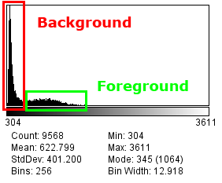

    Image histogram showing the background and foreground pixels

There are many different thresholding methods. ``ImageJ`` has a built-in threshold method available using the command ``Image > Adjust > Threshold...``. The `Auto Threshold <https://imagej.net/plugins/auto-threshold>`_ plugin of Gabriel Landini contains several different methods.

The threshold methods analyse the image histogram of the channel that is thresholded. ``ImageJ`` can perform thresholding on a single image or a 3D image stack but has no method to threshold each channel of a multi-channel image.

The ``Stack Threshold`` plugin can analyse a multi-dimensional image and apply thresholding to each channel and time frame in the image. The histogram is computed using all the z slices for the channel and frame. Pixels above the threshold are foreground (white, 255); all other pixels are background (black, 0). An example of an input and output image is shown in :numref:`Figure %s <fig_stack_threshold_input>` and :numref:`Figure %s <fig_stack_threshold_output>`.

.. _fig_stack_threshold_input:
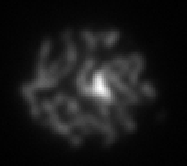

    Stack Threshold input image

.. _fig_stack_threshold_output:
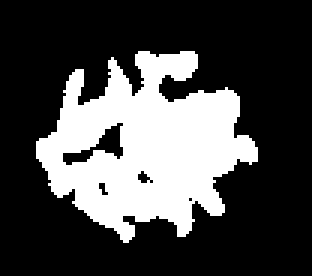

    Stack Threshold output mask using the ``Otsu`` method

.. index:: Stack Threshold Plugin Interface

Plugin Interface
~~~~~~~~~~~~~~~~

The ``Stack Threshold`` plugin uses a standard ``ImageJ`` dialog. The plugin processes the current image which must be an 8-bit or 16-bit greyscale image.

The following parameters can be configured:

.. list-table::
   :widths: 20 80
   :header-rows: 1

   * - Parameter
     - Description

   * - Method
     - Specify the thresholding method. The methods are those of the ``Auto Threshold`` plugin that run quickly on 16-bit images: ``Default``; ``Li``; ``MaxEntropy``; ``Mean``; ``MinError(I)``; ``Moments``; ``Otsu``; ``Percentile``; ``RenyiEntropy``; ``Triangle``; and ``Yen``.

       The ``Try all`` option will create a mask using each method. In a macro multiple methods can be specified using a space-separated list.

   * - Log thresholds
     - Record the thresholds to the ``ImageJ`` log window. A threshold will be calculated for each combination of time frame and channel, e.g.

       .. code-block:: text

           t1c1 threshold = 778
           t1c2 threshold = 617
           t1c3 threshold = 2441

   * - Composite colour
     - Display the mask as a composite colour image. This option is only available if the image has multiple channels.

   * - New image
     - Create a new image for the mask. The image is named using the input image title and the method, e.g. ``Image.tif:Otsu``.

       If not selected then the mask replaces the pixels of the input image. A new image is always created if multiple methods are used.

.. index:: ! Colocalisation Threshold

Colocalisation Threshold
------------------------

Compares two images for correlated pixel intensities. If the two images are correlated a search is performed to identify the threshold below which the two images are not correlated.

A positive correlation between two images indicates that the signal in one channel is observed at the same location as the signal in the other channel. This may have biological significance.

The correlation is expected to be high when the signal in both channels is strong. As the signal reduces towards the background noise the correlation is expected to also reduce. Under this assumption it is possible to measure the amount of signal that is correlated.

A method for determining the threshold level for each channel was proposed by Costes *et al* (2004) (see :ref:`references:References`). Each image is thresholded at its maximum intensity and the correlation below this threshold is measured (i.e. the correlation for the entire signal). This will be positive if the two channels are colocalised. The threshold is then reduced and the correlation remeasured. By iterating this process a search is performed for the intensity threshold below which there is no correlation. The fraction of signal above this threshold is a measure of the colocalisation of the signal in the two image channels.

An exhaustive search for the thresholds is computationally expensive due to the large number of combinations. The ``Colocalisation Threshold`` plugin computes a regression between the two channels. This regression is used to approximate the threshold level required in the second image for a set threshold in the first image. The plugin performs a converging search for the image thresholds and reports various metrics on the resulting thresholded images.

:numref:`Figure %s <fig_colocalisation_threshold_input1>` and :numref:`Figure %s <fig_colocalisation_threshold_input2>` show an example input of two channels of a microscopy image where the channels are stained for different proteins.

.. _fig_colocalisation_threshold_input1:

    Colocalisation Threshold input channel 1

.. _fig_colocalisation_threshold_input2:
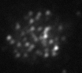

    Colocalisation Threshold input channel 2

The results of the analysis are shown in :numref:`Figure %s <fig_colocalisation_threshold_coloc>`, :numref:`Figure %s <fig_colocalisation_threshold_scatter>` and :numref:`Figure %s <fig_colocalisation_threshold_r_plot>`.

.. _fig_colocalisation_threshold_coloc:
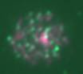

    Colocalised pixels image. The original channels are shown in red and green; the blue channel shows the colocalised pixels above both thresholds.

.. _fig_colocalisation_threshold_scatter:
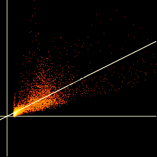

    Scatter plot of channel 1 (x-axis) versus channel 2 (y-axis). The regression line is plotted along with the threshold level for channel 1 (vertical line) and channel 2 (horizontal line).

.. _fig_colocalisation_threshold_r_plot:
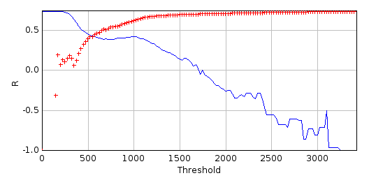

    Plot of the correlation above (blue line) and below (red crosses) the thresholds versus the channel 1 threshold

.. index:: Colocalisation Threshold Features

Features
~~~~~~~~

* Processes 8-bit and 16-bit greyscale images
* Processes 2D and 3D images (i.e. image stacks)
* Selection of a channel and frame from multi-dimensional images
* Selection of the analysis region using an ``ImageJ`` ROI
* Calculates the threshold value for each image below which there is no correlation
* Outputs threshold mask images
* Generates a full results table
* Efficient convergence algorithm is fast

The plugin is a modification of the ``Colocalisation Threshold`` plugin from the Wright Cell Imaging Facility (WCIF) ``ImageJ`` collection. The plugin has been altered to add support for 16-bit and 3D images, region selection options, more results output and a new implementation of the threshold search.

.. index:: Colocalisation Threshold Method

Method
~~~~~~

The plugin uses a heuristic search for the threshold of each channel below which there is no correlation. The search is only performed if there is a positive correlation between all the pixels in both channels. The correlation must be at least the larger of the ``Minimum total correlation`` and the ``Correlation limit``; otherwise the plugin reports that no correlation was found. Details of the analysis are recorded in the ``ImageJ`` log window.

Step 1: Regression Analysis
^^^^^^^^^^^^^^^^^^^^^^^^^^^

A regression is computed between the two channels. This assumes a linear relationship between the two channels. The regression is an orthogonal regression that minimises the perpendicular distance to the line, i.e. noise in both channels is allowed. The value of channel 2 can then be expressed as:

.. math::

    \mathit{ch2} = \mathit{ch1} \times m + b

The search is not performed if the gradient :math:`m` is not positive.

Step 2: Define Limits
^^^^^^^^^^^^^^^^^^^^^

The limits for the threshold search of channel 1 are set by mapping the minimum and maximum value of channel 2 to channel 1 using the regression:

.. math::

    T_{\mathit{min}} &= \left\lceil \frac{\mathit{ch2}_{\mathit{min}} - b}{m} \right\rceil \\
    T_{\mathit{max}} &= \left\lfloor \frac{\mathit{ch2}_{\mathit{max}} - b}{m} \right\rfloor

If :math:`T_{\mathit{min}}` is below the minimum of channel 1 it is set to zero; if :math:`T_{\mathit{max}}` is above the maximum of channel 1 it is set to the maximum.

Step 3: Iterative Search
^^^^^^^^^^^^^^^^^^^^^^^^

For a threshold :math:`T` for channel 1 the threshold for channel 2 is computed using the regression (rounded to the nearest integer). Pixels are classified as above the thresholds if both channels are at or above their threshold; all other pixels are below the thresholds. The correlation is computed for the pixels above and below the thresholds.

The search is performed by updating the current threshold for channel 1 and measuring the correlation below the thresholds. The search is convergent in that it only operates between the current lower and upper limit for channel 1. The limits are adjusted based on the result of each iteration and the threshold is updated to halfway between the current threshold and the appropriate limit:

* The search starts at :math:`T = T_{\mathit{max}}` where the correlation is known to be positive. The threshold is then reduced
* Calculate the correlation for the pixels below the thresholds
* If the correlation is at or above the ``Correlation limit`` then the threshold must be lowered. :math:`T_{\mathit{max}}` is updated to :math:`T` and :math:`T` is reduced
* If the correlation is below the ``Correlation limit`` (or cannot be computed, e.g. no pixels are below the thresholds) then the threshold must be raised. :math:`T_{\mathit{min}}` is updated to :math:`T` and :math:`T` is increased
* Repeat

The iteration stops when either:

* The correlation below the thresholds is within 0.001 of the ``Correlation limit`` and the correlation above the thresholds is positive
* The threshold is not changed or has already been evaluated, i.e. convergence
* The ``Max. iterations`` value is reached

In certain cases the final threshold may not have the desired correlation. This is because convergence or ``Max. iterations`` occurs during a search where the ``Correlation limit`` is not reached. The final threshold is chosen from all the evaluated thresholds. The results are sorted in descending order by the threshold and the final threshold is set as the threshold which resulted in:

* The correlation above the thresholds being more than the ``Correlation limit``
* The correlation below the thresholds being the closest to the target ``Correlation limit``

In the event that no results satisfy the criteria then the threshold is set to zero.

:numref:`Figure %s <fig_colocalisation_threshold_search>` shows how the threshold is updated during a typical search. Initially the threshold is reduced until the correlation goes below the ``Correlation limit``. The threshold is then raised and subsequently raised or lowered as the correlation alternates around the ``Correlation limit``. In this instance the ``Correlation limit`` was not obtained and the threshold converged at 166.

.. _fig_colocalisation_threshold_search:
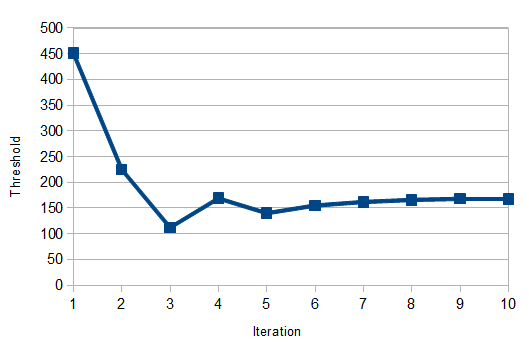

    Channel 1 threshold during the iterative search

.. index:: Colocalisation Threshold Plugin Interface

Plugin Interface
~~~~~~~~~~~~~~~~

The ``Colocalisation Threshold`` plugin uses a window frame within the ``ImageJ`` application. The plugin can be left open and the analysis repeated by clicking the ``Apply`` button. The plugin has many options but these can be divided into sections controlling parts of the algorithm. The different sections are described below.

Input Parameters
^^^^^^^^^^^^^^^^

The input parameters specify the images to use for the analysis. The user can select the two input channels and specify the region to use for the analysis. Only 8-bit and 16-bit greyscale images are available; any previous results from the plugin are excluded. The two images must have the same width, height and number of z slices.

.. list-table::
   :widths: 20 80
   :header-rows: 1

   * - Parameter
     - Description

   * - Channel 1/2
     - Specify the channel 1 or 2 image.

       If the image has multiple channels or frames then the channel and frame are requested when the analysis is run. This eliminates optional fields from the main window. All the z slices for the channel and frame are analysed.

   * - Use ROI
     - Specify the region to use for analysis. This uses a Region-of-Interest (ROI) that has been drawn on the input image using the ``ImageJ`` ROI tools. The options are:

       * ``[None]``: Use all the pixels.
       * ``Channel 1``: Use the ROI from the channel 1 image.
       * ``Channel 2``: Use the ROI from the channel 2 image.

       If the selected image has no ROI then all the pixels are used.

Search Parameters
^^^^^^^^^^^^^^^^^

The search parameters control the algorithm used to find the colocalisation thresholds.

.. list-table::
   :widths: 20 80
   :header-rows: 1

   * - Parameter
     - Description

   * - Minimum total correlation
     - The minimum correlation for all the pixels required to perform the threshold search. The search requires a correlation of at least the ``Minimum total correlation`` and the ``Correlation limit``.

   * - Correlation limit
     - Define the desired correlation for the pixels below the image thresholds. This can be increased from the default of 0 in an attempt to obtain thresholds that specify more strongly correlated channel pixels.

Results Parameters
^^^^^^^^^^^^^^^^^^

The other parameters control the results of the plugin.

.. list-table::
   :widths: 20 80
   :header-rows: 1

   * - Parameter
     - Description

   * - Show colocalised pixels
     - Show an RGB image (``CT Colocalised Pixels``) of the analysis region. Channel 1 is shown in red and channel 2 in green. Channels with a maximum above 255 are scaled to the range 0-255. The blue channel shows the colocalised pixels that are above both thresholds using the geometric mean of the scaled channel values.

   * - Use constant intensity for colocalised pixels
     - Show the blue channel (colocalised pixels) of the output RGB image using a constant intensity (255).

   * - Show Scatter plot
     - Show a scatter plot of the channel 1 intensity versus the channel 2 intensity. The plot is a 256x256 image of the pixel counts using the scaled channel values. The regression line and the channel thresholds are drawn on the plot.

   * - Include zero-zero pixels in threshold calculation
     - Include pixels with zero value in both channels in the correlation calculations. Ignoring these pixels is useful for images that have been masked so that certain regions have no value.

   * - Close windows on exit
     - If selected then the windows that have been opened by the plugin are closed when the plugin window is closed. This includes the results table and the output images and plots.

   * - Set results options
     - Shows a dialog with additional options (see :numref:`{number}: {name} <colocalisation_threshold_results_options>`).

.. _colocalisation_threshold_results_options:

Results Options
^^^^^^^^^^^^^^^

Clicking the ``Set results options`` checkbox shows a dialog containing settings for configuring the columns included in the results table. Further details can be found in the :numref:`{number}: {name} <colocalisation_threshold_results_table>` section. This can be useful to remove unwanted columns from the table.

The dialog also contains the following options:

.. list-table::
   :widths: 20 80
   :header-rows: 1

   * - Parameter
     - Description

   * - Output ROIs/Masks
     - If an ROI was selected from an input image then this option will output a cropped duplicate of the input images (``CT Channel 1/2``) with all the pixels outside the ROI (if non-rectangular) set to zero (:numref:`Figure %s <fig_colocalisation_threshold_roi>`).

       In all cases this option will also show a mask image for each channel (``CT Pixels 1/2``) where all the pixels at or above the colocalisation threshold are white and other pixels are black (:numref:`Figure %s <fig_colocalisation_threshold_mask>`).

   * - Exhaustive search
     - If selected the convergence algorithm is not used. Instead the thresholds between the lower and upper limit for channel 1 are analysed using ``Max. iterations`` to define the step increment. The final threshold is chosen using the same criteria as the convergence algorithm.

   * - Plot R values
     - Produce a plot of the correlation (R) values above (blue line) and below (red crosses) the thresholds versus the channel 1 threshold (:numref:`Figure %s <fig_colocalisation_threshold_r_plot>`).

   * - Max. iterations
     - Specify the maximum iterations to use within the algorithm.

.. _fig_colocalisation_threshold_roi:
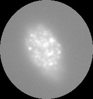

    Channel 1 image cropped to an oval ROI

.. _fig_colocalisation_threshold_mask:
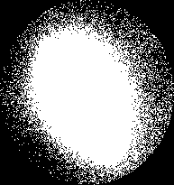

    Channel 1 mask of the pixels above the threshold

.. _colocalisation_threshold_results_table:

Results Table
~~~~~~~~~~~~~

The results table contains details about the threshold analysis. The analysis is performed on pixels that have been classified using different criteria:

* The pixel is above a set level for one channel
* The pixel is above the set levels for both channels

In each case the level can be zero (i.e. count any pixel), above zero (i.e. the pixel has a value) or at or above the threshold set during the analysis phase.

This allows the following values to be computed:

.. list-table::
   :widths: 20 80
   :header-rows: 1

   * - Value
     - Description

   * - nCh1
     - The number of pixels in channel 1.

   * - nCh1gtT
     - The number of pixels in channel 1 at or above the channel 1 threshold.

   * - nColoc
     - The number of pixels where both channels are at or above the threshold.

   * - sumCh1
     - The sum of pixel values in channel 1.

   * - sumCh1gtT
     - The sum of pixel values in channel 1 at or above the channel 1 threshold.

   * - sumCh1_Ch2gt0
     - The sum of pixel values in channel 1 where channel 2 is greater than zero.

   * - sumCh1_Ch2gtT
     - The sum of pixel values in channel 1 where channel 2 is at or above the channel 2 threshold.

   * - sumCh1_Coloc
     - The sum of pixel values in channel 1 where both channels are at or above the threshold.

With the exception of nColoc all of these values have corresponding equivalents for channel 2.

The values are used to compute result metrics that are displayed in the results table. The following table describes the results and the option used to enable or disable the result column(s):

.. list-table::
   :widths: 20 20 60
   :header-rows: 1

   * - Result
     - Option
     - Description

   * - Images
     - \-
     - The titles of the input images used for the analysis.

   * - ROI
     - \-
     - The ROI that was used to select the region for the analysis.

   * - ZeroZero
     - \-
     - Shows whether zero-zero pixels were included (``incl.``) or excluded (``excl.``) in the threshold calculation.

   * - Rtotal
     - Pearson's for whole image
     - The Pearson correlation for the entire image.

   * - m, b
     - Show linear regression solution
     - The linear regression coefficients: :math:`\mathit{ch2} = \mathit{ch1} \times m + b`.

   * - Ch1 thresh, Ch2 thresh
     - Show thresholds
     - The channel thresholds.

   * - Rcoloc
     - Pearson's for image above thresholds
     - The Pearson correlation coefficient for the pixels above both the channel thresholds.

   * - R<threshold
     - Pearson's for image below thresholds (should be ~0)
     - The Pearson correlation coefficient for the pixels below the channel thresholds. This should be close to the ``Correlation limit``.

   * - M1, M2
     - Mander's original coefficients (threshold = 0)
     - The Manders coefficient for the image (Manders *et al* (1993)). How much of the channel 1 intensity occurs where channel 2 has signal:

       .. math::

           M1 = \frac{\mathit{sumCh1\_Ch2gt0}}{\mathit{sumCh1}}

   * - tM1, tM2
     - Mander's using thresholds
     - The Manders coefficient for the pixels above the channel thresholds. How much of the channel 1 intensity occurs where channel 2 is correlated:

       .. math::

           tM1 = \frac{\mathit{sumCh1\_Ch2gtT}}{\mathit{sumCh1}}

   * - N
     - Number of colocalised voxels
     - The number of pixels in the analysis region (optionally excludes the zero-zero pixels).

   * - nZero
     - Number of colocalised voxels
     - The number of pixels that are zero for both channel 1 and 2.

   * - nCh1gtT, nCh2gtT
     - Number of colocalised voxels
     - The number of pixels that are at or above the threshold for channel 1/2.

   * - nColoc
     - Number of colocalised voxels
     - The number of pixels that are at or above the threshold for both channel 1 and channel 2.

   * - %Vol Coloc
     - % Volume colocalised
     - The percentage of pixels that are above the thresholds for both channels:

       .. math::

           \mathit{\%Vol\ Coloc} = \frac{\mathit{nColoc}}{\mathit{TotalPixels}}

       Note that :math:`\mathit{TotalPixels}` is the total number of pixels in the analysis region including zero-zero pixels.

   * - %Ch1gtT Vol Coloc, %Ch2gtT Vol Coloc
     - % Volume above threshold colocalised
     - The percentage of pixels above the channel threshold that are also above the threshold for the other channel:

       .. math::

           \mathit{\%Ch1gtT\ Vol\ Coloc} = \frac{\mathit{nColoc}}{\mathit{nCh1gtT}}

   * - %Ch1 Int Coloc, %Ch2 Int Coloc
     - % Intensity colocalised
     - The percentage of channel intensity that is colocalised:

       .. math::

           \mathit{\%Ch1\ Int\ Coloc} = \frac{\mathit{sumCh1\_Coloc}}{\mathit{sumCh1}}

   * - %Ch1gtT Int Coloc, %Ch2gtT Int Coloc
     - % Intensity above threshold colocalised
     - The percentage of channel intensity that is above the channel threshold that is colocalised:

       .. math::

           \mathit{\%Ch1gtT\ Int\ Coloc} = \frac{\mathit{sumCh1\_Coloc}}{\mathit{sumCh1gtT}}

.. index:: ! CDA

CDA
---

Uses the Confined Displacement Algorithm (CDA) to compute the significance of colocalisation metrics (Manders coefficients M1 and M2, and Pearson's correlation coefficient R).

This is a modified version of the original ``ImageJ`` CDA plugin by Maria Osorio-Reich (see :ref:`references:References`). The code to translate images was reimplemented to allow efficient parallel execution. A fixed number of shifts (``Permutations``) is randomly sampled from all the shifts within the maximum radius, allowing larger maximum shifts with the same run time.

The quantification of colocalisation is performed in two stages. Stage 1 identifies locations where the two channels both occur. Stage 2 calculates a measure to quantify the co-occurrence of the two channels, for example using the percentage of colocalised signal or the correlation between the colocalised channels.

However the quantification of colocalisation has no context. This results in subjective interpretation as to the significance of the value. For example a given colocalisation result may be very good or very bad depending on the underlying distribution of signal intensity within the image. The results of many different images can be compared to provide a context for the result under investigation. However this analysis is also subjective and it is possible that alternative images are either not available or not representative.

To solve this issue representative images for comparison can be produced from the original image. This ensures the total channel intensity is the same. Randomly shuffling the pixels provides new images but does not maintain a realistic grouping of pixel intensities characteristic of structural content. Rotating the image in 90 degree intervals or translating the image with wrapping does maintain the structural content but introduces bias depending on the nature of the transform, e.g. the centre of the rotation or the angle of the translation.

A solution is to perform translations in all directions and at all possible distances. If the colocalisation measure is calculated for each translation then a probability density function can be computed that shows how the measure varies with distance. If the two channels are significantly colocalised it would be expected that the original colocalisation measure would be very different from the colocalisation measure of a highly shifted image. If there is no true colocalisation then shifting the image will produce colocalisation scores higher (and lower) than the actual measure.

An additional factor to consider is that the information in the two channels may be located in only parts of the overall image, for example the nucleus of a cell. Consequently the translation shifts may move the signal of the channel into an area of the image where it would never naturally occur. This could result in a false conclusion that the two channels are colocalised in the original image. The solution is to define an area within which the pixels can be translated. Pixels moving beyond the region are wrapped to re-enter from the other side. This method thus maintains the underlying image structure. This method is the principle behind the Confined Displacement Algorithm (CDA) (Ramírez *et al* (2010)).

:numref:`Figure %s <fig_cda_input>` shows an example input of 3 channels of a microscopy image where the red and green channels are stained for different proteins and the blue is stained for DNA. The mask images have been produced by thresholding using the ``ImageJ`` default threshold method. Colocalisation analysis can be performed between any of the channels.

.. _fig_cda_input:
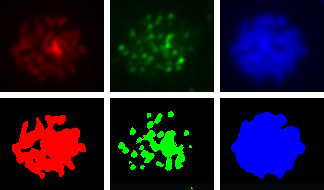

    CDA input channels (top) and channel masks (bottom)

The results of colocalisation analysis between the red and green channels are shown in :numref:`Figure %s <fig_cda_output_merged>`, :numref:`Figure %s <fig_cda_r_samples>` and :numref:`Figure %s <fig_cda_r_pdf>`. The CDA algorithm was run using all displacements up to 25 pixels. The scores from displacements above 15 pixels were used as the random background; significance was assessed using a p-value of 0.01. The mask regions of the red and green channel were used to define the presence of each channel. The mask region of the blue channel was used to confine the analysis region.

.. _fig_cda_output_merged:
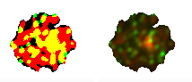

    CDA merged ROI (left) and merged channel (right) images. The pixels of channel 1 are red and channel 2 are green; any overlap is visible as yellow.

.. _fig_cda_r_samples:
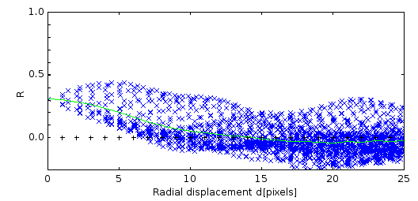

    CDA correlation coefficient (R) samples versus displacement. The line shows the sample average using a bin width of 1.

.. _fig_cda_r_pdf:
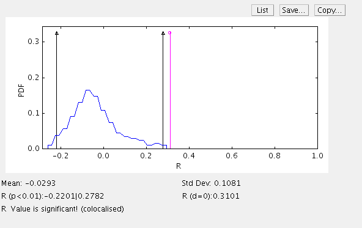

    CDA probability density of the correlation coefficient scores. The measured correlation (R=0.31) is significant given the estimated probability density function.

.. index:: CDA Features

Features
~~~~~~~~

* Processes 8-bit and 16-bit greyscale images
* Processes 2D and 3D images (i.e. image stacks)
* Selection of a channel and frame from multi-dimensional images
* Selection of channel regions and confined region using: a mask image; an image minimum display value; or the ``ImageJ`` ROI
* Optional expansion of the confined region to include the channel regions
* Performs CDA shifts within a configurable radius
* Calculates Manders coefficients and the correlation coefficient
* Outputs the analysed regions as new images
* Generates a full results table
* Saves the results table and images to a directory
* Efficient combined-image displacement algorithm is fast
* Multi-threading support for extra speed

.. index:: CDA Method

Method
~~~~~~

The ``CDA`` plugin provides colocalisation analysis for 2D and 3D images. The process for using the plugin has two stages: identification of the regions containing the signal in each channel; and running the CDA analysis.

Stage 1: Identify Channel Signal
^^^^^^^^^^^^^^^^^^^^^^^^^^^^^^^^

To determine if the signal in two channels is colocalised the first step is to assign the region that contains the signal in each channel. Additionally it is possible to define a region of the image where the signal is expected to occur. This is the confined compartment which will be used within the Confined Displacement Algorithm.

This region assignment process is not performed by the ``CDA`` plugin. However the plugin recognises different methods for defining the signal regions:

* Using the ``ImageJ`` minimum display value
* Using an ``ImageJ`` ROI
* Using an image mask

Each of these options is described in further detail below.

**Using the ImageJ minimum display value**

``ImageJ`` provides the ability to change the range of pixel values that are displayed on screen. Any pixel above the maximum display value will be fully saturated, pixels below the minimum display value will be black.

To change the display range use ``Image > Adjust > Brightness/Contrast``. This will display a small dialog that has sliders to control the display range. Use the ``Minimum`` slider to set a different minimum display value. This should be adjusted so that any areas that do not contain a strong signal (i.e. background pixels) are black. To assist in viewing the channel signal you can adjust the ``Maximum`` slider to set the major signal regions to fully saturated.

This process is outlined using an example. :numref:`Figure %s <fig_cda_display_default>` shows the default representation of an image using the full range of pixel intensity. The ``Maximum`` slider is adjusted to view the region of strong signal (:numref:`Figure %s <fig_cda_display_max>`). The ``Minimum`` slider is then adjusted to exclude the background leaving only the channel signal (:numref:`Figure %s <fig_cda_display_min>`).

.. _fig_cda_display_default:
.. figure:: images/cda_display_default.png
    :align: center

    Image displayed using the full range of pixel intensity

.. _fig_cda_display_max:
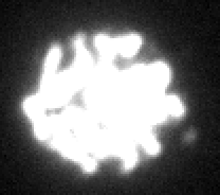

    Image with the maximum display value reduced to saturate the region of strong signal

.. _fig_cda_display_min:
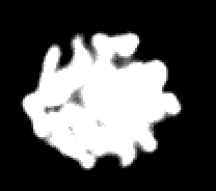

    Image with the minimum display value increased to exclude the background

All the pixels at or above the minimum display value define the pixels that will be included in the analysis. For a multi-channel composite image the display range of the selected channel is used.

Note: Adjusting the image display range will not alter the underlying channel intensity data that will be used to perform the analysis.

**Using the ImageJ ROI**

``ImageJ`` contains tools for drawing regions of interest (ROIs). These can be based on shapes (``Rectangle``, ``Oval`` or ``Polygon``) or ``Freehand``. Each tool can be selected from the ``ImageJ`` toolbar.

The ``Rectangle`` and ``Oval`` tools are used by dragging on the image to define the shape. This can be moved by dragging inside the shape and resized by dragging the small markers at the shape edge.

The ``Polygon`` tool is used by clicking on points in the image that you want to be a polygon apex. The polygon is completed by clicking in the small square that defined the start point. The polygon can be moved and resized as above.

The ``Freehand`` tool is used by clicking to define a start point and then dragging the mouse to trace a shape. Releasing the mouse results in ``ImageJ`` completing the shape.

:numref:`Figure %s <fig_cda_freehand_roi>` shows an image where the ``Freehand`` ROI tool has been used to define a region.

.. _fig_cda_freehand_roi:
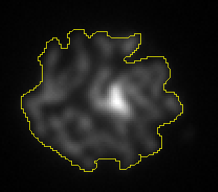

    Image with a freehand ROI

The ROI is applied to all the z slices of the image. Note that since the ROI must be contiguous this method is not recommended for defining regions with two or more distinct segments of channel intensity.

**Using an image mask**

A mask is an image of the same dimensions as the original image but with pixel values set as either foreground or background. This is usually done using a black and white image. Only the pixels that are not black will be used.

``ImageJ`` provides tools to produce a mask from your original image. This is done by analysing the image and setting a threshold value for pixels to be included in the foreground:

* ``Image > Duplicate...``
* ``Image > Adjust > Threshold...``

There are many different thresholding methods. The `Auto Threshold <https://imagej.net/plugins/auto-threshold>`_ plugin of Gabriel Landini contains several that you can try. You can apply all the methods to see which is best for your image. However in most cases the default ``ImageJ`` method or the ``Otsu`` method both provide robust and efficient partitioning of the data. An example of the ``Otsu`` method is shown in :numref:`Figure %s <fig_stack_threshold_output>`.

To assist in the thresholding of multi-dimensional images you can use the :ref:`colocalisation_plugins:Stack Threshold` plugin. This plugin can process a 5D hyperstack. Each combination of channel and frame is extracted for separate processing. The threshold method is then applied to the individual channel z-stack for each time frame in the sequence. The results are displayed as a new hyperstack.

Note: In practice it is possible to use any image as a mask. All non-zero pixels will define the region to include in the analysis.

Stage 2: Analysis
^^^^^^^^^^^^^^^^^

The Confined Displacement Algorithm (CDA) computes measures of colocalisation for the selected pixels in two channels (CH1 and CH2). The regions that define the channels are known as ROI1 and ROI2 respectively. This analysis is performed within a defined area (the confined compartment). The colocalisation measures are the Manders coefficients and the Pearson correlation coefficient.

The metrics are computed for all possible translations (displacements) of channel 1 within a set radius. The distribution of the scores can be used to determine if the score of the original image is significant.

**Manders Coefficient**

The Manders coefficient provides a measure of how much of the signal intensity of a channel occurs in the same location as the other channel. The overlap between ROI1 and ROI2 defines the region used to calculate the Manders coefficient (Manders *et al* (1993)). The coefficient is calculated for each channel as follows:

.. math::

    M1 &= \frac{\text{Sum of CH1 intensity in the overlap of ROI1 and ROI2}}{\text{Sum of CH1 intensity in ROI1}} \\
    M2 &= \frac{\text{Sum of CH2 intensity in the overlap of ROI1 and ROI2}}{\text{Sum of CH2 intensity in ROI2}}

The values range from 0 to 1. The Manders coefficient can be interpreted as the fraction of signal that is colocalised. It does not provide a measure of whether there is a dependency between the strength of the two channel signals.

**Pearson Correlation Coefficient**

The Pearson correlation coefficient (R) provides a measure of dependence between two quantities, in this case the two image channels. It is calculated as:

.. math::

    r_{xy} = \frac{n \sum x_i y_i - \sum x_i \sum y_i}
                  {\sqrt{n \sum x_i^2 - (\sum x_i)^2} \sqrt{n \sum y_i^2 - (\sum y_i)^2}}

The value ranges from +1 in the case of a perfect positive (increasing) linear relationship (correlation) to -1 in the case of a perfect decreasing (negative) linear relationship (anticorrelation). As it approaches zero there is less of a relationship (closer to uncorrelated). The closer the coefficient is to either -1 or 1, the stronger the correlation between the variables.

In the ``CDA`` plugin the Pearson correlation coefficient is calculated using the pixels within the overlap of ROI1 and ROI2. If no ROIs are defined then the overlap is the entire confined compartment.

**Displacements**

The CDA method involves shifting channel 1 (and ROI1) relative to channel 2 within the confined compartment and computing the colocalisation metrics. The shifts are applied in the XY dimensions; each z slice is shifted by the same amount. All possible integer displacements within a radius are computed. The user must select the maximum radius to use for the displacements. The plugin provides charts to help in this process.

Once all the displacements have been performed the resulting distribution of metrics can then be plotted versus the distance. In the case where the two channels contain colocalised signal the distribution will show a fall off with increasing distance as the metrics approach a random background. This can be seen in the chart of the R samples of a weakly correlated image (:numref:`Figure %s <fig_cda_r_samples>`).

The fall off will eventually plateau at a level that corresponds to random images with the same underlying structure. The plateau should be defined where the mean of the samples is approximately constant. To assist in setting this level the plot shows the mean of the samples as a continuous line. The mean is calculated by rounding the displacement distance to the nearest whole number and averaging all the samples for each distance.

The point at which the random plateau begins should be used to define the distribution for calculating the significance. This level will vary between images and so requires the user to configure the displacement radius. For example :numref:`Figure %s <fig_cda_r_samples_random>` shows the same image with the region from 15 to 25 pixels used to define the random (background) distribution.

.. _fig_cda_r_samples_random:
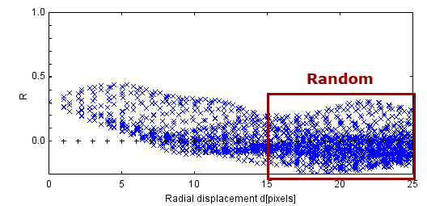

    CDA correlation coefficient (R) samples with the random distribution region

:numref:`Figure %s <fig_cda_r_pdf>` shows the probability distribution of the samples taken from the 15 to 25 pixel displacement distance. The limits for the significance test are shown as the black lines marked by triangles. The lower and upper limits are the values at the ``p-Value`` and ``1 - p-Value`` quantiles of the sorted random samples. It can be clearly seen that the original metric score (magenta line) lies outside the range expected for a random pair of images. In this case the correlation of 0.31 is significant.

**Speed Increases**

When using a large radius there may be many thousands of possible displacements. It is possible to compute a random subset of these displacements to increase speed. The number of samples can be configured in the plugin options (using the ``Permutations`` parameter). However enough samples must be computed to produce an estimate of the distribution.

The plugin uses multi-threaded code to compute the permutations. The number of threads can be configured using the ``ImageJ`` options (``Edit > Options > Memory & Threads``). By default this will be the number of processor cores available on your computer.

.. index:: CDA Plugin Interface

Plugin Interface
~~~~~~~~~~~~~~~~

The ``CDA`` interface uses a window frame within the ``ImageJ`` application. The plugin can be left open and the analysis repeated by clicking the ``Apply`` button. The plugin has many options but these can be divided into sections controlling parts of the algorithm. The different sections are described below.

Input Parameters
^^^^^^^^^^^^^^^^

The input parameters specify the images to use for the analysis. The user can select the two input channels and specify the regions to use for the analysis. Only 8-bit and 16-bit greyscale images are available. The analysis requires two images or a single image with multiple channels or frames. All the images must have the same width, height and number of z slices.

.. list-table::
   :widths: 20 80
   :header-rows: 1

   * - Parameter
     - Description

   * - Channel 1/2
     - Specify the channel 1 or 2 image.

       If an image has multiple channels or frames then the channel and frame are requested when the analysis is run. This eliminates optional fields from the main window. All the z slices for the channel and frame are analysed.

   * - ROI for channel 1/2
     - Specify the region that contains the image signal for channel 1 or 2. The region is defined using a method and an image. The methods are:

       * ``(None)``: Use all the pixels.
       * ``Min Display Value``: Use the pixels at or above the minimum display value of the image.
       * ``Use ROI``: Use the ROI of the image.
       * ``Use as mask``: Use the non-zero pixels of the image.

       The image can be ``(Channel image)`` to use the channel 1 or 2 image, or any other image. If the image has a different width or height from the channel image then all the pixels are used.

       The methods are described above in :numref:`{number}: {name} <colocalisation_plugins:Stage 1: Identify Channel Signal>`.

       If ``(None)`` is selected then only the correlation analysis will be relevant (since the Manders coefficient will always be 1).

   * - Confined compartment
     - Specify the region used to confine the displacements. Only pixels within this region will be analysed. The region is defined using the same methods as the ROI for the channels.

   * - Include ROIs
     - If this option is selected the confined compartment will be expanded to contain all the pixels in ROI1 and ROI2. Otherwise the two ROIs will be cropped to the confined compartment. This allows the user to separately define the confined region but ensure that all the channels' signal is included in the analysis.

Displacement Parameters
^^^^^^^^^^^^^^^^^^^^^^^

The displacement parameters control the maximum shift applied to channel 1 relative to channel 2. Increasing the maximum displacement will increase the number of calculations required.

.. list-table::
   :widths: 20 80
   :header-rows: 1

   * - Parameter
     - Description

   * - Maximum radial displacement
     - The maximum displacement distance (in pixels). The maximum is 256.

   * - Random radial displacement
     - The distance that defines the random sample distribution. The probability distribution will be calculated using all samples above this distance. This must be less than the ``Maximum radial displacement``; the field is highlighted if the value is invalid.

   * - Compute sub-random samples
     - All the samples below the ``Random radial displacement`` are not required for the analysis. However they are useful for determining the displacement radius since they are plotted in the samples window.

       Disable this option if you have configured the ``Random radial displacement`` and are re-running the analysis to produce different result outputs. This will decrease calculation time.

   * - Approx. number of samples
     - The label shows an estimate of the number of displacements that are required for the analysis. It is possible to reduce the number of samples by using the ``Permutations`` parameter in the results options dialog (see below).

   * - Bins for histogram
     - The probability distribution is calculated by binning data to produce a histogram. This parameter sets the number of bins to use to cover the range. If there are a large number of samples this value can be increased.

Options Parameters
^^^^^^^^^^^^^^^^^^

The other parameters provide options for the ``CDA`` plugin.

.. list-table::
   :widths: 20 80
   :header-rows: 1

   * - Parameter
     - Description

   * - Close windows on exit
     - If selected then the windows that have been opened by the plugin are closed when the plugin window is closed. This includes the results table and the output images and charts.

   * - Set results options
     - Shows a dialog with additional options (see :numref:`{number}: {name} <cda_results_options>`).

.. _cda_results_options:

Results Options
^^^^^^^^^^^^^^^

Clicking the ``Set results options`` checkbox shows a dialog containing the following settings:

.. list-table::
   :widths: 20 80
   :header-rows: 1

   * - Parameter
     - Description

   * - Show channel 1/2
     - Show an image of the signal of channel 1 or 2 within the confined compartment (``CDA Channel 1/2``). This represents the input data used in the analysis.

   * - Show ROI 1/2
     - Show an image of the signal region of channel 1 or 2 (``CDA ROI 1/2``). This represents the region used in the analysis.

   * - Show merged channel
     - Show a combined RGB image that contains both channels (``CDA Merged channel``). Channel 1 is red and channel 2 is green.

   * - Show merged ROI
     - Show a combined RGB image that contains both channel regions (``CDA Merged ROI``). ROI1 is red and ROI2 is green.

   * - Show merged channel max displacement
     - Show a combined RGB image that contains both channels but with channel 1 shifted by the maximum displacement in the X direction (i.e. representative of a random pair of channels).

   * - Show merged ROI max displacement
     - Show a combined RGB image that contains both channel regions but with ROI1 shifted by the maximum displacement in the X direction.

   * - Show M1/M2/R plot
     - Specify whether to show a plot of the samples for the M1/M2/R metrics versus the displacement distance.

   * - Show M1/M2/R statistics
     - Specify whether to show a probability distribution for the M1/M2/R metrics. The window shows the mean and standard deviation of the random samples, the limits for the significance test, the value of the metric for the unshifted image (d=0) and the result of the significance test.

   * - Save results
     - If selected this will cause the results to be saved to a folder in the ``Results directory``. The folder will be named ``cdaYYYYMMDD_HHmmss`` where the date section will be set using the current time.

       The plugin will save the ``Merged channel`` and ``Merged ROI`` images as ``ImageJ`` TIFF images (``MergedChannel.tif`` and ``MergedROI.tif``) and the results that are recorded in the results table in a text file called ``results.txt``. These items allow a user to quickly see the channel data used in the analysis and the results. This is useful for quickly scanning a history of CDA analysis. All the other results can be recomputed using the plugin if necessary.

   * - Results directory
     - Specify the root directory for the results. If it does not exist then the plugin will not save any results and the user is alerted with a warning.

   * - p-Value
     - Set the p-value used to define the limits for the assessment of significance. If the score from the unshifted image lies outside of the limits defined using this p-value then the result is labelled as significant.

   * - Permutations
     - The number of displacements to compute. If set lower than the total number possible then a subset will be randomly chosen. This applies separately to the displacements above and below the ``Random radial displacement``. Use this option to speed up the CDA algorithm.

       Setting this value to zero causes all permutations to be computed.

.. index:: CDA Results Table

Results Table
~~~~~~~~~~~~~

The results table contains details about the CDA analysis. The table contains the following information:

.. list-table::
   :widths: 20 80
   :header-rows: 1

   * - Result
     - Description

   * - Exp. ID
     - The experiment ID. It has the format ``cdaYYYYMMDD_HHmmss`` where the date section will be set using the current time.

       Note: This is used to name the folder within the ``Results directory`` if results are being saved.

   * - Channel 1/2
     - The name of the image used for channel 1 or 2. For a multi-channel or multi-frame stack the channel and frame are included.

   * - ROI 1/2
     - The method used to define ROI1 or ROI2. If an image is used then the image name will be included. The ``Min Display Value`` method includes the minimum value; the ``Use ROI`` method includes the ROI bounds.

   * - Confined
     - The method used to define the confined compartment. If an image is used then the image name will be included.

   * - Include ROIs
     - If true then the ROI regions were used to expand the confined compartment.

   * - D-max
     - The maximum displacement distance.

   * - D-random
     - The distance used to define the random background used to build the probability distribution.

   * - Samples
     - The number of displacement samples computed (including the unshifted image).

   * - Bins
     - The number of bins used to calculate the probability distribution.

   * - p-Value
     - The p-value used for the significance assessment.

   * - M1
     - The Manders coefficient for channel 1.

   * - M1 av
     - The random sample average for M1.

   * - M1 sd
     - The random sample standard deviation for M1.

   * - M1 limits
     - The lower and upper limits for the significance assessment.

   * - M1 result
     - Contains the significance result. Can be one of three values: ``Not significant``; ``Significant (colocated)``; and ``Significant (non-colocated)``.

The same results are shown for the Manders coefficient for channel 2 (M2) and for the Pearson correlation coefficient (R).

.. index:: ! CDA (Macro)

CDA (macro)
-----------

Provides support for the CDA plugin within ``ImageJ`` macros (i.e. macro recording and execution).

The ``CDA (macro)`` plugin performs the same analysis as the :ref:`colocalisation_plugins:CDA` plugin. However it uses a standard ``ImageJ`` dialog to get the parameters. This allows it to be recorded by the ``ImageJ`` Macro Recorder and used in ``ImageJ`` macros.

The options and results are identical to the ``CDA`` plugin. The ``ROI for channel 1/2`` and ``Confined compartment`` parameters are each specified using two fields: the method and the image. The ``Set results options`` checkbox will show the results options dialog. Note that the ``Approx. number of samples`` is not shown.

.. index:: ! Stack Correlation Analyser

Stack Correlation Analyser
--------------------------

Processes a stack image with multiple channels. Extracts all the channels and frames and performs:

- Thresholding to create a mask for each channel+frame (or for each z-slice if the ``Aggregate Z-stack`` option is disabled)
- All-vs-all channel correlation within the union/intersect of the channel masks. When using the intersect the Manders coefficients M1 and M2 are also reported

The analysis of a single image for correlated channels requires definition of the channel signal region, definition of the region overlap and then analysis of the signal intensity. This can be a labour intensive task if performed manually. However it is possible to perform all the steps automatically for a fast initial analysis of multiple channel images.

For example a 3 channel image will have a correlation analysis performed for 1-vs-2, 1-vs-3 and 2-vs-3 for each frame in the image sequence. For images with a z-stack this can be performed using the entire stack or for each z slice individually. The correlation is the Pearson correlation coefficient and the overlap is the Manders coefficient (see :numref:`{number}: {name} <colocalisation_plugins:Stage 2: Analysis>`).

The plugin can be used within ``ImageJ`` macros to rapidly test a large number of images for correlated channels (see :numref:`{number}: {name} <colocalisation_batch_processing>`). This allows the user to identify the best candidate images for further analysis.

.. index:: Stack Correlation Analyser Plugin Interface

Plugin Interface
~~~~~~~~~~~~~~~~

The ``Stack Correlation Analyser`` plugin uses a standard ``ImageJ`` dialog. The plugin processes the current image which must be an 8-bit or 16-bit image with multiple channels.

The following parameters can be configured:

.. list-table::
   :widths: 20 80
   :header-rows: 1

   * - Parameter
     - Description

   * - Method
     - Specify the thresholding method to use to identify the channel signal (foreground) from the background. Pixels above the threshold are foreground. Details of the thresholding methods can be found in :numref:`{number}: {name} <colocalisation_plugins:Image Thresholding>`.

       The ``Try all`` option will run the analysis using each method. The ``None`` method uses all the pixels. In a macro multiple methods can be specified using a space-separated list.

   * - Intersect
     - If selected then the intersect of the two channel masks will be used to define the pixels used in the analysis. Otherwise the union will be used.

       If the intersect is used then a Manders coefficient is calculated for each channel. The coefficient is the sum of the channel intensity in the intersect divided by the sum of the channel intensity in the channel mask.

   * - Aggregate Z-stack
     - Combine the z-stack of each channel and frame combination into a single stack for analysis, i.e. this will perform all-vs-all analysis between channels using the entire z-stack.

       If not selected then the threshold is computed for each z slice and all-vs-all analysis between channels is performed for each slice of the z-stack.

   * - Log thresholds
     - Record the thresholds to the ``ImageJ`` log window. A threshold will be calculated for each combination of time frame and channel (and optionally z slice), e.g.

       .. code-block:: text

           t1c1z1 threshold = 778
           t1c2z1 threshold = 617
           t1c3z1 threshold = 2441

   * - Show mask
     - If selected then the mask image calculated using the thresholds will be shown (:numref:`Figure %s <fig_stack_correlation_analyser_mask>`). The image is named using the input image title and the method, e.g. ``Image.tif:Otsu``. This allows the user to check that the mask is selecting the correct regions for analysis.

   * - Subtract threshold
     - Subtract the threshold value from each pixel before calculating the Manders coefficient. The coefficient then represents the fraction of intensity above the background that overlaps with the other region.

.. _fig_stack_correlation_analyser_mask:

    Stack Correlation Analyser mask for a channel

.. index:: Stack Correlation Analyser Results

Results
~~~~~~~

The ``Stack Correlation Analyser`` writes the results directly to the ``ImageJ`` log window.

**Header Record**

The first line records the threshold method used for the analysis and the name of the input image, e.g.

.. code-block:: text

    Stack correlation (Default) : Y3067s1_04_R3D.tif

**Threshold Record**

If ``Log thresholds`` is selected the plugin records the threshold for each extracted channel, e.g.

.. code-block:: text

    t1c1z1 threshold = 777
    t1c2z1 threshold = 616
    t1c3z1 threshold = 2441

The z slice is only included if ``Aggregate Z-stack`` is not selected.

**Correlation Record**

A single line is written for each channel correlation that is calculated. Each line uses a comma-separated format, e.g.

.. code-block:: text

    t1,c1z1,c2z1,1182,12.35%,0.3120,0.9190,0.7818
    t1,c1z1,c3z1,2692,28.14%,0.2281,0.9164,0.7854
    t1,c2z1,c3z1,1305,13.64%,-0.0233,0.1018,0.9006

The fields of the result entry are described in the following table:

.. list-table::
   :widths: 20 80
   :header-rows: 1

   * - Field
     - Description

   * - 1
     - The time frame of the image used for the analysis.

   * - 2
     - The first channel and z slice of the image used for the analysis.

       If ``Aggregate Z-stack`` was selected then this will contain only the channel.

   * - 3
     - The second channel and z slice of the image used for the analysis.

   * - 4
     - The number of pixels used for the analysis. This is either the union or intersect of the two channel masks depending on the ``Intersect`` parameter.

   * - 5
     - The percentage area used in the analysis, i.e. the number of pixels used in the analysis divided by the total number of pixels in the channel.

   * - 6
     - The Pearson correlation coefficient for the two channels.

   * - 7
     - The Manders coefficient for the first channel. This is only shown if the intersect of the masks is used.

   * - 8
     - The Manders coefficient for the second channel. This is only shown if the intersect of the masks is used.

.. index:: ! Stack Colocalisation Analyser

Stack Colocalisation Analyser
-----------------------------

Processes a stack image with multiple channels. Each frame is processed separately. Extracts all the channels (collating z-stacks) and performs:

- Thresholding to create a mask for each channel
- CDA analysis of the selected first and second channels, optionally within a region defined by a third channel or the union of the first two channel masks (``Combine 1+2``)

The Confined Displacement Algorithm (CDA) can be used to determine the significance of the colocalisation measures between two channels. The :ref:`colocalisation_plugins:CDA` plugin provides a feature rich interface for configurable analysis of images using the CDA algorithm. This can be a time consuming task when processing many images.

The ``Stack Colocalisation Analyser`` provides a simple implementation of the CDA algorithm for fast automated analysis of multi-channel images. The plugin requires an 8-bit or 16-bit image with at least 2 channels. The plugin performs the following steps:

* Selection of the 2 analysis channels
* Thresholding to create a mask region for each channel and frame (aggregating the z-stack)
* Optional thresholding of a third channel to define the analysis region
* CDA analysis of channel 1 versus channel 2 using the mask regions
* Analysis using different thresholding methods can be performed in a batch operation

During the CDA analysis channel 2 (and its mask) is shifted relative to channel 1 within the analysis region. The total number of displacements is limited to increase speed. This is performed by computing a random subset of all possible displacements. The subset size can be configured but should be large enough that the sample is representative of the entire set (e.g. 20%).

The plugin can be used within ``ImageJ`` macros to rapidly test a large number of images for colocalised channels (see :numref:`{number}: {name} <colocalisation_batch_processing>`). This allows the user to identify the best candidate images for further analysis.

.. index:: Stack Colocalisation Analyser Plugin Interface

Plugin Interface
~~~~~~~~~~~~~~~~

The ``Stack Colocalisation Analyser`` plugin uses a standard ``ImageJ`` dialog. The plugin processes the current image.

The following parameters can be configured:

.. list-table::
   :widths: 20 80
   :header-rows: 1

   * - Parameter
     - Description

   * - Channel 1/2
     - Select the two channels for CDA analysis.

   * - Channel 3
     - Optionally select the channel used to define the confined region for CDA analysis. The options are:

       * ``Combine 1+2``: Use the union of the channel 1 and 2 masks.
       * ``None``: Use the entire image.
       * A channel number: Use the mask of the channel.

   * - Method
     - Specify the thresholding method to use to identify the channel signal (foreground) from the background. Pixels above the threshold are foreground. Details of the thresholding methods can be found in :numref:`{number}: {name} <colocalisation_plugins:Image Thresholding>`.

       Thresholding can be disabled by selecting ``None``. The ``Try all`` option will run the analysis using each method. In a macro multiple methods can be specified using a space-separated list.

   * - Log thresholds
     - Record the thresholds to the ``ImageJ`` log window. A threshold will be calculated for each combination of time frame and analysed channel, e.g.

       .. code-block:: text

           t1c1 threshold = 778
           t1c2 threshold = 617
           t1c3 threshold = 2441

   * - Log results
     - Record the results to the ``ImageJ`` log window as comma-separated values. Otherwise the results are shown in a results table.

   * - Show mask
     - If selected then the mask image calculated using the thresholds will be shown. The image is named using the input image title and the method, e.g. ``Image.tif:Otsu``. The image has a channel for the channel 1 and 2 masks, and the confined region mask (unless ``Channel 3`` is ``None``). This allows the user to check that the mask is selecting the correct regions for analysis.

   * - Subtract threshold
     - Subtract the threshold value from each pixel before calculating the Manders coefficient. The coefficient then represents the fraction of intensity above the background that overlaps with the other region.

   * - Permutations
     - Specify the number of displacements to use for CDA analysis. This will be a random subset of the entire set of possible displacements (unless ``Permutations`` is greater than the entire set). Set to zero to disable the significance test.

   * - Minimum shift
     - Set the minimum displacement distance. Displacements must be above this distance. The minimum must be below the ``Maximum shift``.

   * - Maximum shift
     - Set the maximum displacement distance. The maximum is 255.

   * - Significance
     - Set the p-value used to calculate significance.

.. index:: Stack Colocalisation Analyser Results Table

Results Table
~~~~~~~~~~~~~

The results table contains details about the CDA analysis. The table contains the following information:

.. list-table::
   :widths: 20 80
   :header-rows: 1

   * - Result
     - Description

   * - Image
     - The title of the input image.

   * - p
     - The p-value used to assign significance.

   * - Method
     - The threshold method used to generate the mask image.

   * - Frame
     - The image frame used in the analysis.

   * - Ch1/2
     - The two channels used for CDA analysis.

   * - Ch3
     - The channel used to define the confined region. This is ``Combine 1+2`` if the union of the channel masks was used, or ``None`` if no region was selected.

   * - n
     - The number of pixels in the overlap between the channel 1 and 2 mask regions.

   * - Area
     - The percentage of pixels within the confined region used for analysis that are inside the overlap between the channel 1 and 2 mask regions.

   * - M1/2
     - The thresholded Manders coefficient for channel 1/2. The Manders coefficient is calculated as the fraction of the channel foreground intensity that occurs where the other channel is also foreground, e.g.

       .. math::

           M1 = \frac{\text{Sum of Ch1 intensity in the overlap of the masks}}{\text{Sum of Ch1 intensity in the Ch1 mask}}

       (How much of channel 1 foreground intensity occurs where channel 2 is foreground.)

   * - Sig
     - The significance of the Manders coefficient: ``Colocated`` if the value is above the upper limit of the shifted samples; ``Non-colocated`` if the value is below the lower limit of the shifted samples; otherwise ``-``.

   * - R
     - The Pearson correlation coefficient calculated using only the pixels from the overlap between the channel 1 and 2 mask regions.

   * - Sig
     - The significance of the Pearson correlation coefficient (as for the Manders coefficient).

.. index:: ! Particle Overlap

Particle Overlap
----------------

For all particles in a mask (defined by their unique pixel value), count the overlap with a second mask image (e.g. a second set of particles). An intensity image is used to calculate the Manders coefficient of each particle.

.. warning::

    The particle analysis performed by this plugin is very simple. All pixels with the same value are assumed to be the same particle, even if the pixels do not touch. Therefore the particle mask must be prepared using suitable software that can identify each particle. For example the :ref:`findfoci_plugins:FindFoci` plugin can produce suitable masks if the image has particles defined by peaks of intensity.

.. index:: Particle Overlap Plugin Interface

Plugin Interface
~~~~~~~~~~~~~~~~

The ``Particle Overlap`` plugin uses a standard ``ImageJ`` dialog. The following parameters can be configured:

.. list-table::
   :widths: 20 80
   :header-rows: 1

   * - Parameter
     - Description

   * - Particle mask
     - The image defining the particles. This must be an 8-bit or 16-bit image. Pixels with a value of zero are ignored.

   * - Particle image
     - The image defining the pixel intensity of the particles. This can be any greyscale image.

   * - Overlap mask
     - The image containing a second set of particles. This must be an 8-bit or 16-bit image. Any non-zero value will be counted as a particle.

   * - Show total
     - Show a row at the bottom of the results containing the totals. The row has an ``ID`` of zero.

   * - Show table
     - Show the table of results.

   * - File
     - Name of a file to save the results. The ``.xls`` extension is added if the filename has no extension.

       The file contains the same results as the table in a tab-delimited format.

       At least one of ``Show table`` or ``File`` must be specified.

**Input images**

The input images can be hyperstacks. Only the current channel and frame of each image are used for the analysis.

The input images must have the same width, height and z-depth dimensions.

.. index:: Particle Overlap Results Table

Results Table
~~~~~~~~~~~~~

The results table contains the following information:

.. list-table::
   :widths: 20 80
   :header-rows: 1

   * - Result
     - Description

   * - Mask1
     - The particle mask. For a hyperstack the channel and frame are included.

   * - Image1
     - The particle image.

   * - Mask2
     - The overlap mask.

   * - ID
     - The particle ID.

   * - N
     - The number of pixels in the particle.

   * - No
     - The number of pixels in the particle that overlap the second mask.

   * - %
     - The percentage of overlapping pixels.

   * - I
     - The sum of the intensity in the particle (using the particle image).

   * - Io
     - The sum of the intensity in the particle that overlaps the second mask.

   * - Manders
     - The Manders coefficient (the sum of the overlap intensity divided by the total intensity).

.. index:: ! Particle Correlation

Particle Correlation
--------------------

For all particles in a mask (defined by contiguous pixels with the same value), sum the pixel intensity in two different images and then perform a correlation analysis.

The ``Particle Correlation`` plugin can be used to assess if the signal in two channels is correlated. In contrast to the other correlation plugins it does not compute a correlation at the pixel level (i.e. comparing the individual pixels in two channels). Instead it computes the sum of the pixels within particles. The sums are then correlated.

The plugin performs the following steps:

* Identify all the particles in a mask image. A particle is defined by joining neighbour pixels with the same value.
* For each particle, sum the pixels in two input channel images
* Compute a correlation between the two sets of data and report the results

.. index:: Particle Correlation Plugin Interface

Plugin Interface
~~~~~~~~~~~~~~~~

The ``Particle Correlation`` plugin uses a standard ``ImageJ`` dialog. The following parameters can be configured:

.. list-table::
   :widths: 20 80
   :header-rows: 1

   * - Parameter
     - Description

   * - Particle mask
     - Select the mask image that contains the particles. This must be an 8-bit or 16-bit image. Pixels with a value of zero are ignored.

   * - Particle image1
     - Select the image for the first channel. This can be any greyscale image.

   * - Particle image2
     - Select the image for the second channel. This can be any greyscale image.

       This can be the same as image1 if you have a multiple channel image.

   * - Eight connected
     - Join pixels into particles using 8-connected neighbours. The default is 4-connected (see :ref:`Particle Assignment <particle_correlation_particle_assignment>`).

   * - Min object size
     - Specify the minimum number of pixels for a particle. Particles that are smaller are removed from the analysis.

   * - Show data table
     - Show a table of particle details, e.g. size, position and pixel intensities.

   * - Show plot
     - Show a scatter plot of the intensities in each channel.

   * - Show objects
     - Show a new mask image with each particle set to a unique pixel value.

**Input images**

The input images can be hyperstacks. Only the current channel and frame of each image are used for the analysis.

It is possible to quickly create a mask from a single channel of an input hyperstack image using the :ref:`thresholding_plugins:Mask Creator` plugin. This plugin allows auto-thresholding of a single channel and/or frame to create a new image.

The input images must match the width, height and z-depth dimensions of the mask image. By default the current channel of each image is used for the analysis. However if the same image is selected for image1 and image2, the plugin will prompt the user to select the channels to use for analysis. This allows analysis of a hyperstack with multiple channels.

Note that if you have images with multiple slices then the analysis will be done in 3D. To perform 2D analysis you will have to extract the slice of interest from the stack. You can do this using the ``Image > Duplicate...`` command.

.. _particle_correlation_particle_assignment:

**Particle Assignment**

The plugin must assign pixels to a particle. This is done by searching for pixels that touch and have the same value. Neighbour pixels can be defined using 4-connected or 8-connected. 4-connected pixels are neighbours to every pixel that touches one of their edges. These pixels are connected horizontally and vertically. 8-connected pixels are neighbours to every pixel that touches one of their edges or corners. These pixels are connected horizontally, vertically, and diagonally.

The advantage of 4-connected pixels is that it allows the user to draw black lines on a mask to cut large objects into small ones. This can be done using the ``ImageJ`` paintbrush tool. For example in :numref:`Figure %s <fig_particle_correlation_4_connected>` and :numref:`Figure %s <fig_particle_correlation_8_connected>` 4-connected processing assigns two particles and 8-connected processing assigns one particle.

.. _fig_particle_correlation_4_connected:
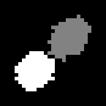

    Particles assigned using 4-connected processing

.. _fig_particle_correlation_8_connected:
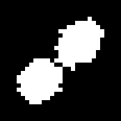

    Particles assigned using 8-connected processing

When performing 3D analysis there is an extra dimension and therefore 26 neighbours. The ``Eight connected`` option switches the search from 6-connected to 26-connected neighbours. When using a 6-connected search it is possible to separate objects with a line drawn through all the slices of the object.

To separate particles that touch on a pixel edge each particle must have a unique pixel value. For example the :ref:`findfoci_plugins:FindFoci` plugin can produce suitable masks if the image has particles defined by peaks of intensity.

.. index:: Particle Correlation Summary Table

Summary Table
~~~~~~~~~~~~~

The plugin will present a summary table with the following information:

.. list-table::
   :widths: 20 80
   :header-rows: 1

   * - Result
     - Description

   * - Mask
     - The name of the mask image.

   * - Image1
     - The name of the image for channel 1.

   * - Image2
     - The name of the image for channel 2.

   * - nParticles
     - The number of particles.

   * - Spearman
     - The Spearman rank correlation coefficient.

   * - pSpearman
     - The p-value of the Spearman rank correlation coefficient.

   * - R
     - The Pearson correlation coefficient.

   * - pR
     - The p-value of the Pearson correlation coefficient.

For a hyperstack the channel and frame are included in the image names.

The correlations require at least 3 particles; otherwise they are reported as ``NaN``.

.. index:: Particle Correlation Results Table

Results Table
~~~~~~~~~~~~~

If ``Show data table`` is selected the results table contains the following information:

.. list-table::
   :widths: 20 80
   :header-rows: 1

   * - Result
     - Description

   * - Mask
     - The name of the mask image.

   * - Image1
     - The name of the image for channel 1.

   * - Image2
     - The name of the image for channel 2.

   * - ID
     - The particle ID. This will match the pixel value in the output mask image (if the ``Show objects`` option is selected).

   * - Value
     - The pixel value of all the pixels in the particle (taken from the input mask image).

   * - x
     - The X centre of the particle pixels. This is a 0-based pixel coordinate.

   * - y
     - The Y centre of the particle pixels. This is a 0-based pixel coordinate.

   * - z
     - The Z centre of the particle pixels. This is a 1-based slice number.

   * - N
     - The number of pixels in the particle.

   * - Sum1
     - The sum of the pixels from channel 1.

   * - Sum2
     - The sum of the pixels from channel 2.

The coordinates use the same convention as ``ImageJ`` (and the :ref:`findfoci_plugins:FindFoci` results): pixel coordinates start from 0 and slice numbers start from 1.

.. index:: Particle Correlation Scatter Plot

Scatter Plot
~~~~~~~~~~~~

Optionally the plugin can show a plot of the two datasets as a scatter plot (:numref:`Figure %s <fig_particle_correlation_plot>`). The axes are labelled with the image names.

.. _fig_particle_correlation_plot:
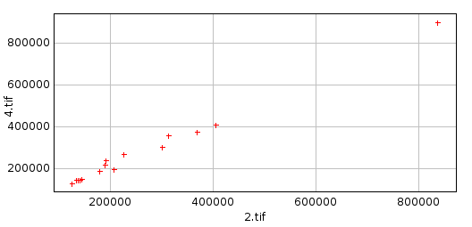

    Particle Correlation scatter plot of the particle sums for channel 1 (x-axis) and channel 2 (y-axis)

.. index:: Particle Correlation Object Mask

Object Mask
~~~~~~~~~~~

Optionally the plugin can show a mask image of the particles (``Particle Correlation Objects``). This can be used to check the particle identification has been performed correctly. The value of each particle will match the ``ID`` shown in the (optional) results table.

The assignment of particles can be adjusted using the ``Eight connected`` and ``Min object size`` parameters.

.. index:: ! Colocated Mask

Colocated Mask
--------------

Create a colocated mask from two source images using the threshold or minimum display value from each image to define their image mask. The two image masks are combined using an AND or OR operator.

Supports a live preview to allow interactively setting the threshold on the source images with live mask update.

.. _colocalisation_batch_processing:

.. index:: ! Batch Processing

Batch Processing
----------------

``ImageJ`` can automate processing large numbers of image files with a macro in a single batch process. This can be used to run a plugin on multiple input files, for example the :ref:`colocalisation_plugins:Stack Correlation Analyser` or :ref:`colocalisation_plugins:Stack Colocalisation Analyser`.

Step 1: Record the Macro
~~~~~~~~~~~~~~~~~~~~~~~~

Open a representative image to be used for the analysis. Test the plugin (or series of commands) using different parameters and ensure the result is as desired.

Open the ``ImageJ`` macro recorder: ``Plugins > Macros > Record...``

Run the chosen commands on the image configuring the parameters as required. ``ImageJ`` will record the commands to the ``Recorder`` window. For example running the ``Stack Correlation Analyser`` plugin on an image will produce the following macro command:

.. code::

    run("Stack Correlation Analyser", "method=Default intersect aggregate");

Press the ``Create`` button to generate a new macro and save it for use later. You can test the macro on a fresh image by using the ``Macros > Run Macro`` command from the macro editor window.

Step 2: Prepare Input Files
~~~~~~~~~~~~~~~~~~~~~~~~~~~

Place all the image files in a single directory. The directory should not contain images that you do not want to process.

If the macro command modifies the images then you can also create an output directory that will be used to store the modified images.

Step 3: Process Batch Command
~~~~~~~~~~~~~~~~~~~~~~~~~~~~~

Open the ``ImageJ`` batch processing window: ``Process > Batch > Macro...``

The ``Batch Process`` window allows you to select an input directory containing all your images. You can then specify an optional output directory and the format for the output images.

The window provides the ability to select from common commands which are then inserted into the text area. You can also open your own macros or paste the code from the ``ImageJ`` macro recorder. The ``Process`` button starts the batch processing.

For each image in the input folder ``ImageJ`` will open the image, apply the commands, save the image to the output folder (if present) and then close the image. Any results windows generated by the plugin commands will remain open.

Note that if you do not specify an output directory then the images will not be saved after running the command. This is useful if your macro command does not alter the input images.

Batch Macros
~~~~~~~~~~~~

The ``Batch Process`` command provides a powerful tool for processing many images. However it can be useful to perform more selective processing of images, for example to process only certain images in a directory or apply different parameters depending on the image name.

More control over the batch processing of images requires writing custom macros in the ``ImageJ`` macro language. The language has hundreds of built-in commands and custom commands can be defined. Full details of the `ImageJ Macro Language <https://imagej.net/ij/developer/macro/macros.html>`_ can be found on the ``ImageJ`` website.

The following sections contain examples of batch macros. In each case a place-holder indicates where to put your macro code:

.. code::

    // INSERT MACRO HERE

Insert your recorded macro commands into the place-holder and run the batch macro using ``Macros > Run Macro`` from the macro editor window.

**Process Files in a Directory**

The following macro code provides a macro version of the ``Batch Process`` command. It prompts for an input and output directory and the format for the output images:

.. code::

    dir1 = getDirectory("Choose Source Directory ");
    format = getFormat();
    dir2 = getDirectory("Choose Destination Directory ");
    list = getFileList(dir1);
    setBatchMode(true);
    for (i=0; i<list.length; i++) {
        showProgress(i+1, list.length);
        // Skip sub-directories
        if (!endsWith(list[i], "/")) {
            open(dir1+list[i]);

            // INSERT MACRO HERE

            if (format=="8-bit TIFF" || format=="GIF")
                convertTo8Bit();
            saveAs(format, dir2+list[i]);
            close();
        }
    }

    function getFormat() {
        formats = newArray("TIFF", "8-bit TIFF", "JPEG", "GIF", "PNG",
            "PGM", "BMP", "FITS", "Text Image", "ZIP", "Raw");
        Dialog.create("Batch Convert");
        Dialog.addChoice("Convert to: ", formats, "TIFF");
        Dialog.show();
        return Dialog.getChoice();
    }

    function convertTo8Bit() {
        if (bitDepth==24)
            run("8-bit Color", "number=256");
        else
            run("8-bit");
    }

If the output format is TIFF the code is much simpler:

.. code::

    dir1 = getDirectory("Choose Source Directory ");
    dir2 = getDirectory("Choose Destination Directory ");
    list = getFileList(dir1);
    setBatchMode(true);
    for (i=0; i<list.length; i++) {
        showProgress(i+1, list.length);
        // Skip sub-directories
        if (!endsWith(list[i], "/")) {
            open(dir1+list[i]);

            // INSERT MACRO HERE

            saveAs("TIFF", dir2+list[i]);
            close();
        }
    }

The code can be extended with specific functionality. For example to process only the TIFF files in the directory (this also skips sub-directories):

.. code::

    dir1 = getDirectory("Choose Source Directory ");
    dir2 = getDirectory("Choose Destination Directory ");
    list = getFileList(dir1);
    setBatchMode(true);
    for (i=0; i<list.length; i++) {
        showProgress(i+1, list.length);
        filename = dir1 + list[i];
        name = toLowerCase(list[i]);
        if (endsWith(name, ".tif") || endsWith(name, ".tiff")) {
            open(filename);

            // INSERT MACRO HERE

            saveAs("TIFF", dir2+list[i]);
            close();
        }
    }

Note that when an opening brace is used to define a block of code it must be closed with a matching closing brace.

If the macro does not modify the images, for example when running the :ref:`colocalisation_plugins:Stack Correlation Analyser`, the ``saveAs`` command can be removed and no output directory is required.

**Process Open Images**

It may be desired to run a command on all the currently open images. Since the command may open new result images this must be achieved by building a list of the images and then processing each one. The following code provides a stub for processing all the currently open images:

.. code::

    setBatchMode(true);
    imgArray = newArray(nImages);
    for (i=0; i<nImages; i++) {
        selectImage(i+1);
        imgArray[i] = getImageID();
    }

    // Now we have a list of all open images, we can work on it:
    for (i=0; i<imgArray.length; i++) {
        selectImage(imgArray[i]);

        // INSERT MACRO HERE

    }
