.. index:: ! Find Foci Plugins

Find Foci Plugins
=================

The ``FindFoci`` plugins allow the identification of peak intensity regions within 2D and 3D images. The algorithm is highly configurable and parameters can be optimised using reference images and then applied to multiple images using the batch mode.

Details of the benefits of training an algorithm on multiple images can be found in the ``FindFoci`` paper:

| **FindFoci: A Focus Detection Algorithm with Automated Parameter Training That Closely Matches Human Assignments, Reduces Human Inconsistencies and Increases Speed of Analysis**
| Herbert AD, Carr AM, Hoffmann E.
| *PLoS ONE* 9(12) 2014, **e114749**

.. image:: https://img.shields.io/badge/doi-10.1371%2Fjournal.pone.0114749-blue
    :target: https://doi.org/10.1371/journal.pone.0114749
    :alt: DOI 10.1371/journal.pone.0114749

The plugins are described in the following sections using the order presented on the
``Plugins > GDSC > FindFoci`` menu.

.. index:: ! FindFoci

FindFoci
--------

Finds areas of maximum intensity in 2D and 3D images. A standard ``ImageJ`` plugin that operates on the currently selected image. Results are presented as a mask image, shown in tabular format and/or saved to file.

An example input image is shown in :numref:`Figure %s <fig_findfoci_example_input>` and the identified peak regions in :numref:`Figure %s <fig_findfoci_example_output>`.

.. _fig_findfoci_example_input:
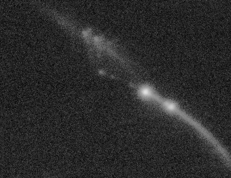

    Input image with regions of high intensity for peak analysis.

.. _fig_findfoci_example_output:
.. figure:: images/findfoci_example_output.png
    :align: center

    Output image showing the identified peak regions. Each peak centre is labelled with a point ROI marker.

.. index:: FindFoci Features

Features
~~~~~~~~

* Processes 8-bit, 16-bit and 32-bit greyscale images
* Processes 2D and 3D images (i.e. image stacks)
* Allows hyperstacks but only processes the current channel and time frame
* Finds peak regions above a configurable background
* Searches within the region of interest (ROI) if available
* Merges sub-peaks into their parent using merging criteria
* Ranks peaks using configurable criteria and outputs the top N
* Outputs the peak regions as a new image
* Generates a results table
* Marks peak centres using ``ImageJ`` point ROIs
* Overlays the peak regions on the original image in 2D/3D
* Allows processing within a mask, labelling maxima within each identified mask object
* Saves the results table and images to a directory
* All functionality is scriptable
* The algorithm is fast

.. index:: FindFoci Algorithm Overview

Overview
~~~~~~~~

The ``FindFoci`` plugin finds all the points of maximum intensity and expands them into regions. The initial regions are processed using merging criteria to produce a cleaner final result.

:numref:`Figure %s <fig_findfoci_overview_profile>` shows an intensity profile to which the peak finding algorithm will be applied.

.. _fig_findfoci_overview_profile:
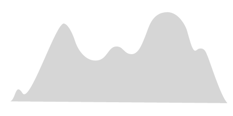

    An example intensity profile.

Stage 1: Assign Background
^^^^^^^^^^^^^^^^^^^^^^^^^^

Assign the background level. All pixels below this level are ignored (:numref:`Figure %s <fig_findfoci_stage1_background>`).

.. _fig_findfoci_stage1_background:
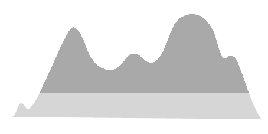

    Stage 1: The background level is assigned.

Stage 2: Assign Maxima
^^^^^^^^^^^^^^^^^^^^^^

Find the points with an intensity higher than all the surrounding points. These local maxima are potential peaks (:numref:`Figure %s <fig_findfoci_stage2_maxima>`).

.. _fig_findfoci_stage2_maxima:
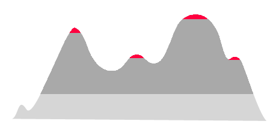

    Stage 2: Local maxima are identified as potential peaks.

Stage 3: Expand Peaks
^^^^^^^^^^^^^^^^^^^^^

Expansion is then performed by progressively assigning points of lower intensity to the peak area above it. This allows all points to be processed in a single pass from the highest to the lowest. The result is an initial assignment of all the points above the background to a peak (:numref:`Figure %s <fig_findfoci_stage3_expand>`).

.. _fig_findfoci_stage3_expand:
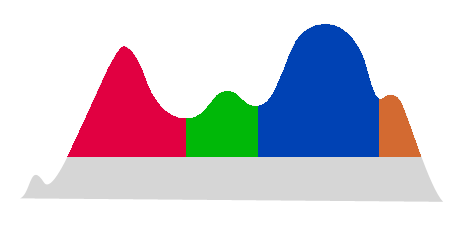

    Stage 3: All points above the background are assigned to a peak.

Stage 4: Merge Peaks
^^^^^^^^^^^^^^^^^^^^

The final stage is to merge insignificant peaks into their parent peak. This can be done if the sub-peak is not high enough or covers insufficient area. This stage is optional but can improve results on noisy images (:numref:`Figure %s <fig_findfoci_stage4_merge>`).

.. _fig_findfoci_stage4_merge:
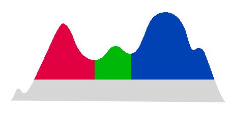

    Stage 4: Insignificant peaks are merged into their parent peak.

.. index:: FindFoci Image Input

Image Input
~~~~~~~~~~~

When the ``FindFoci`` plugin is run the target image is the currently active image window within ``ImageJ``. The image can be an 8-, 16- or 32-bit greyscale image. If the image has z-slices then the image is processed in 3D. If the image is a hyperstack the current time frame and channel are processed.

.. _findfoci_32bit_support:

32-bit Support
^^^^^^^^^^^^^^

``FindFoci`` supports integer (8- or 16-bit) images and true floating point 32-bit images. 32-bit processing was added in August 2016, 5 years after the original ``FindFoci`` plugin was created. Testing ensured that the same functionality and speed when using integer images was preserved. Float processing can handle negative values and floating-point images that are output from numerical analysis methods, e.g. deconvolution of microscope images.

Integer images are processed using integer arithmetic. Float images are processed using floating point arithmetic. A key part of the algorithm is the processing of image pixels in descending height order using the image histogram values. The process of creating and working with a histogram (for example in automated thresholding methods) and during pixel value comparisons is faster for integer images. So when an integer input image is converted to a float image before processing the speed will be slower. However the results will be the same under many conditions. The system recognises when a 32-bit image is an integer image and uses an integer histogram. True 32-bit images use an interpolated histogram for auto-thresholding methods and a full sorted histogram for height processing. Note that the threshold heights are computed in floating-point for 32-bit images (not rounded to the nearest integer) so results may differ when using a search method or peak height method that are fractions of the maximum value. If you use absolute values for peak heights the results will be identical.

When using a blur on an integer image the result is stored as an integer image after rounding the blurred values. Only when using a 32-bit input image is the blur stored as a 32-bit image, i.e. the blur will be smoother with 32-bit processing. This will lead to different results when using a 16-bit image with a blur and the same image converted to 32-bit before running the algorithm. The user is recommended to try both 16- and 32-bit images when using a blur to determine if there is a benefit in their case.

In practice the speed difference between the integer and floating point processing will not impact analysis as the algorithm is fast. If you notice a significant slowdown when using 32-bit processing then please report it (see :ref:`index:Issues`).

.. index:: FindFoci Plugin Interface

.. _findfoci_plugin_interface:

Plugin Interface
~~~~~~~~~~~~~~~~

The ``FindFoci`` interface uses the standard ``ImageJ`` Generic Dialog. The plugin has many options but these can be divided into sections controlling parts of the algorithm. The different sections are described below.

Mask
^^^^

The ``Mask`` parameter allows the user to select a mask specifying which pixels to process. Any non-zero pixel will be included in the analysis. The selection box is populated with images that have the same width and height dimensions as the image to be processed. The mask can either have 1 slice or can be a stack with the same number of z-slices as the image to be processed.

Note that the mask can define objects using contiguous pixels with the same value. The plugin provides the option to identify objects within the mask and then label any maxima as belonging to an object (see the ``Object analysis`` option). This allows the results to be used to count maxima in pre-labelled objects such as cell nuclei.

Background Parameters
^^^^^^^^^^^^^^^^^^^^^

The background parameters set the lowest intensity level used in the search for peak areas. Pixels that are below this level will not be included in the peak areas.

A simple approach would set the background to 0 (zero). However this means that all pixels in the image must be processed resulting in a slower runtime and the identification of many false peaks with insignificant heights. The plugin therefore provides different options for setting a background above zero.

The background parameters section contains four input fields: the main field (``Background method``) allows the selection of the background method and the other fields (``Background parameter``, ``Auto threshold`` and ``Statistics mode``) pass parameters to the selected method if applicable.

.. list-table::
   :widths: 25 75
   :header-rows: 1

   * - Background method
     - Description

   * - Absolute
     - The background intensity is set using the input value in the ``Background parameter`` field.

   * - Mean
     - The background intensity is set using the mean of the image.

   * - Std.Dev above mean
     - The background intensity is set using the mean of the image plus the ``Background parameter`` field multiplied by the standard deviation of the image.

   * - Auto threshold
     - The background intensity is set using the ``Auto threshold`` method.

       This uses the methods of the `Auto Threshold <https://imagej.net/plugins/auto-threshold>`_ plugin developed by Gabriel Landini. The plugin uses various methods to partition an image into foreground and background. Only the foreground pixels are then used in the peak finding algorithm. In most cases the ``Otsu`` method provides a fast and robust partitioning.

   * - Min Mask/ROI
     - The background intensity is set using the minimum image intensity within the ROI or mask.

   * - None
     - The background intensity is set as 0. Equivalent to using ``Absolute`` with a value of zero.

The ``Statistics mode`` option is only relevant when using a selected region of interest (area ROI) or a mask. In this case the algorithm will only search within the ROI/mask for maxima. However the automatic background methods can use the pixel values from inside (``Inside``), outside (``Outside``) or both inside and outside (``Both``) the ROI/mask to set the background level.

Search Parameters
^^^^^^^^^^^^^^^^^

The search parameters control how far the algorithm expands local maxima into peak regions. This can be used to reduce the area of peaks on an image to only part of the peak above the background. In an image that has hundreds of peaks this can make the peaks easier to view distinctly in the output image.

The section contains two input fields: the main field (``Search method``) allows the selection of the search method and the other field (``Search parameter``) passes a parameter to the selected method if applicable.

.. list-table::
   :widths: 25 75
   :header-rows: 1

   * - Search method
     - Description

   * - Above background
     - A region is grown until the intensity drops below the background (default method).

   * - Fraction of peak - background
     - A region is grown until the intensity drops to:

       background + (parameter value) * (peak height)

       E.g. a ``Search parameter`` of 0.2 would grow the peak to 80% of its height above the background.

   * - Half peak value
     - A region is grown until the intensity drops to halfway between the value at the peak (the seed for the region) and the background level. This is equivalent to using the ``Fraction of peak - background`` option with the ``Search parameter`` set to 0.5.

Peak Merging Parameters
^^^^^^^^^^^^^^^^^^^^^^^

The peak merging parameters are applied after the initial pass of the algorithm has identified all the peak regions. The parameters are used to control removal of insignificant peaks from the results.

Insignificant peaks are only removed if they have no neighbour peaks. If they have a neighbour then the peak's pixels are added to the highest neighbour peak (the parent peak). This is effectively merging a sub-peak into the larger peak. The merging process is shown in :numref:`Table %s <table_findfoci_merge>`.

.. _table_findfoci_merge:
.. list-table:: Merging of a sub-peak into the parent peak
    :align: center
    :widths: 40 60
    :header-rows: 0

    * - Initial peak regions
      - |findfoci_merge_initial_png|

    * - Peaks above saddle
      - |findfoci_merge_above_saddle_png|

    * - After merge into parent
      - |findfoci_merge_into_parent_png|

    * - Final result
      - |findfoci_merge_final_png|

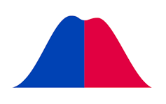
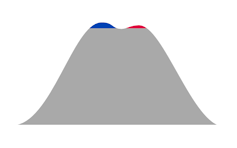
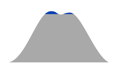
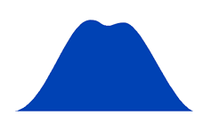

Peaks can be merged using two criteria: the peak height and the peak size. Merging is performed in three steps: minimum height; minimum size; and minimum size above saddle. Each step can be disabled.

**Peak Height**

The peak height sets a minimum height that the peak must be above the highest saddle point, i.e. how far the peak stands out from any neighbours.

The peak height contains two input fields: the main field (``Minimum peak height``) allows the selection of the method and the other field (``Peak parameter``) passes a parameter to the selected method if applicable.

.. list-table::
   :widths: 25 75
   :header-rows: 1

   * - Minimum peak height
     - Description

   * - Absolute height
     - The peak must be an absolute height above the highest saddle point. The height is specified by the ``Peak parameter``.

   * - Relative height
     - The peak must be a relative height above the highest saddle point. The height is calculated as:

       peak intensity * (parameter value)

       E.g. a value of 0.2 indicates that the peak must contain at least 20% of its total height above the saddle point.

   * - Relative above background
     - The peak must be a relative height above the highest saddle point. The height is calculated as:

       (peak intensity - background) * (parameter value)

       E.g. a value of 0.2 indicates that the peak must contain at least 20% of its height over the background above the saddle point.

Note that if the peak has no neighbours, i.e. it has no saddle points, then the peak height limit is applied relative to the background.

To disable the peak height criteria set the ``Peak parameter`` to zero.

**Peak Size**

The ``Minimum size`` parameter sets the minimum size of a peak. If the peak is below this size then the peak is merged/removed. Set to zero to show all peaks including isolated local maxima.

The ``Minimum above saddle`` option restricts the peak size criteria to the pixels above its highest contact with a neighbour peak (the saddle point). This can be useful for eliminating sub-peaks which may only have a few pixels above the saddle to the parent peak but have been allocated a large number of pixels below the saddle height. Set to **false** to disable this filtering step.

When peaks are merged the default behaviour is to count all the pixels above the highest saddle point. Note that when merging peaks it is possible to merge a peak into another without changing the highest saddle point of the new peak, i.e. the old peak saddle was below the new peak's highest saddle point. However additional pixels added to the peak may be above the highest saddle point. This may lead to counting pixels above the highest saddle point that are not connected. Use the ``Connected above saddle`` option to ensure that only connected pixels from the peak maximum down to the highest saddle point are used to determine the size above the saddle.

Note: The original version of the ``FindFoci`` algorithm did not support the ``Connected above saddle`` option so the default is **false** for backwards compatibility.

Results Parameters
^^^^^^^^^^^^^^^^^^

The results parameters control how the results will be displayed within ``ImageJ``.

The ``Sort method`` options correspond to different columns of the results table (see :numref:`{number}: {name} <findfoci_results_table>`). This allows the peaks to be sorted by any column in the table.

``Maximum peaks`` specifies a limit (N) on the number of peaks that will be reported. Peaks are ranked using the specified sort method and then the top N are selected.

The ``Show mask`` parameter sets the type of output image to display. The image will be displayed in an image window with the original image title plus 'FindFoci'. If this window exists (i.e. the plugin has already been run on the input image) then the plugin will update the existing window. Therefore you should save your result mask image if you do not wish it to be overwritten.

The mask is shown as a greyscale image with value 0 corresponding to no peak region. The ``ImageJ`` display range is adjusted so that the highest value is white. In all output mask images the peak maxima (X,Y,Z coordinates) are shown as white pixels.

The mask options are shown below:

.. list-table::
   :widths: 25 50 25
   :header-rows: 1

   * - Show mask
     - Description
     - Example

   * - None
     - No mask image is shown.
     -

   * - Peaks
     - The mask image contains all the pixels in the peak regions. Peak regions are assigned a value that corresponds to their ranking. The highest ranked peaks are shown as the lightest colours. The mask value for each peak is shown in the results table.
     - |findfoci_mask_peaks_png|

   * - Threshold
     - The mask image contains all the pixels in the peak regions. Each peak region is thresholded using the auto-threshold method. This shows the high parts of the peak in a light shade and the low parts in a dark shade. The saddle pixels between peaks are shown in a dark grey.
     - |findfoci_mask_threshold_png|

   * - Peaks above saddle
     - The mask image contains all the pixels in the peak region above the highest saddle point. Peaks are coloured as the ``Peaks`` output above.
     - |findfoci_mask_peaks_above_saddle_png|

   * - Threshold above saddle
     - The mask image contains all the pixels in the peak region above the highest saddle point. Peaks are coloured as the ``Threshold`` output above.
     - |findfoci_mask_threshold_above_saddle_png|

   * - Fraction of intensity
     - For each peak, this method cumulatively sums the pixels in descending intensity until a fraction of the total intensity is reached. All remaining pixels are not displayed.

       Requires setting the ``Fraction parameter``.
     -

   * - Fraction height above background
     - Show only the pixels within the peak that are within a fraction of the peak height above the background, measured from the peak maximum. E.g. a fraction of 0.5 shows the pixels in the top half of the peak height above the background.

       Requires setting the ``Fraction parameter``.
     -

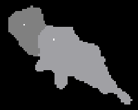
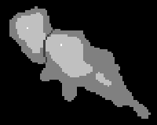
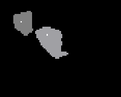
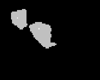

The remaining results parameters are shown below:

.. list-table::
   :widths: 25 75
   :header-rows: 1

   * - Parameter
     - Description

   * - Overlay mask
     - Draw the calculated mask on the original image using an overlay. The overlay is yellow at 50% opacity. This allows the user to view the pixels that have been used to create the mask.

       The overlay can be removed using ``Image > Overlay > Remove Overlay``.

   * - Fraction parameter
     - Define the parameter for the ``Fraction ...`` mask options.

   * - Show table
     - Show the results table. This contains all of the information on the peak regions including height, centre, area and intensity. Note that if a results table is already present the results will be appended.

   * - Clear table
     - Select this option to remove any results already in the results table.

   * - Mark maxima
     - Label the maxima on the input image using ``ImageJ`` point ROIs. Existing ROIs will be deleted.

       Note: The point ROI will be associated with the correct slice when using input images with more than 2 dimensions. Double clicking the point ROI button on the ``ImageJ`` toolbar will open the ``Point Tool`` options. Use ``Show on all slices`` to display the points on every slice in the stack.

   * - Mark peak maxima
     - Label the maxima on the result mask image using ``ImageJ`` point ROIs.

   * - Mark using overlay
     - Label the maxima using an overlay. The default uses an ``ImageJ`` ROI. Using an overlay prevents destroying any ROI on the image, for example an area ROI used to restrict the analysis region. This only applies if ``Mark maxima`` or ``Mark peak maxima`` are selected.

   * - Hide labels
     - Remove the number labels from the ``ImageJ`` point ROIs that are added by ``Mark maxima`` and ``Mark peak maxima``. This is useful when the labels overlap other closely spaced foci.

   * - Show peak maxima as dots
     - If this option is selected then the pixel location at the centre of the maxima will be given the maximum value displayed in the mask (this can be used instead of ``Mark peak maxima``). Disable this if the mask will be used for region labelling based on pixel value.

   * - Show log messages
     - Allow the plugin to write messages to the ``ImageJ`` log window. This provides additional information on the peak finding algorithm.

   * - Remove edge maxima
     - Removes any maxima from the results that contain pixels at the image border. This leaves only peaks that are entirely within the image.

   * - Maximum size
     - Removes any maxima from the results above a maximum size.

       Note: This is applied to the final results and does not affect the peak merge algorithm.

   * - Results directory
     - Specify a valid directory to save the results.

   * - Object analysis
     - If a mask was used then this option will search for objects within the mask. All non-zero pixels are potential objects. Objects are formed by joining touching pixels with the same value. Each distinct collection is assigned an object ID. The original mask value for the object is stored. The results table will contain the parent containing object and the original mask value for each identified maximum.

   * - Show object mask
     - Select this option to display an image of the mask objects calculated by the ``Object analysis``. Pixels will have the object ID as their pixel value.

   * - Save to memory
     - Save the results to memory. Results are named using the image title and the channel and frame used for the analysis, e.g. ``Image (c1,t1)``.

       This option allows other ``ImageJ`` plugins to use the results.

The ``Results directory`` parameter allows the user to specify a directory to use to save the results. The directory must exist otherwise the plugin ignores the parameter. If the directory exists then the plugin will create 3 files named with the prefix ``FindFoci-[Image Short Title]-YYYYMMDD_HHmmss`` (the datestamp ensures that files will not be over-written). The 3 files are:

* ``.xls``: A tab-delimited text file containing the results as written to the results table (the ``Show table`` option is not required).
* ``.roi``: An ``ImageJ`` ROI file. This uses ``ImageJ``'s ROI format. It can be loaded into ``ImageJ`` using the ROI manager.
* ``.params``: A text file containing all the parameters used to run the plugin including the original input image filename. This can be used as input for the :ref:`findfoci_plugins:FindFoci Batch` plugin.

Advanced Parameters
^^^^^^^^^^^^^^^^^^^

**Gaussian Blur**

The ``Gaussian blur`` parameter is used to apply a Gaussian blur to the input image before running the peak finding algorithm. This is very useful for noisy images since it can eliminate peaks that are single pixel local maxima by smoothing the image content. This dramatically improves the algorithm speed due to the smaller number of merging steps required to eliminate all the sub-peak regions. Note that if a Gaussian blur is applied the final results are still calculated using the original image (e.g. the total intensity values).

When using a blur on an integer image the result is stored as an integer image after rounding the blurred values; only a 32-bit input image is blurred as a 32-bit image (see :numref:`{number}: {name} <findfoci_32bit_support>`).

**Centre Method**

The centre method contains two input fields: the main field (``Centre method``) allows the selection of the method used to calculate the centre of the peak and the other field (``Centre parameter``) passes a parameter to the centre method if applicable.

The search image is the image used to identify the peaks; this is the blurred image if a ``Gaussian blur`` is applied, otherwise it is the original image.

.. list-table::
   :widths: 25 75
   :header-rows: 1

   * - Centre method
     - Description

   * - Max value (search image)
     - Define the peak centre using the highest pixel value of the search image (default). In the case of multiple highest value pixels, the closest pixel to the geometric mean of their coordinates is used.

   * - Max value (original image)
     - Re-map the peak centre using the highest pixel value of the original image. If no blur is applied then this matches the result using the search image.

   * - Centre of mass (search image)
     - Re-map the peak centre using the peak centre of mass (COM) of the search image. The COM is computed within a given volume of the highest pixel value. Only pixels above the saddle height are used to compute the centre. The volume dimensions are specified using 2xN+1 where N is the ``Centre parameter``.

   * - Centre of mass (original image)
     - As per ``Centre of mass (search image)`` using the original image.

   * - Gaussian (search image)
     - Re-map the peak centre using a Gaussian fit on the search image. Only pixels above the saddle height are used to compute the fit. The fit is performed in 2D using a projection along the z-axis. If the ``Centre parameter`` is 1 a maximum intensity projection is used; else an average intensity projection is used. The z-coordinate is computed using the centre of mass along the projection axis located at the xy centre.

       Note: Gaussian fitting functionality is experimental. This method rarely produces better results than the simpler methods above since a large peak is required for a fit. In addition the current method does not fit the correlation between axes and so poorly models elliptical peaks.

       If no fit is possible then the peak is not remapped from the ``Max value (search image)`` result.

   * - Gaussian (original image)
     - As per ``Gaussian (search image)`` using the original image.

.. index:: FindFoci Results Table

.. _findfoci_results_table:

Results Table
~~~~~~~~~~~~~

The results table contains details about each peak region. The table contains the following information:

.. list-table::
   :widths: 25 75
   :header-rows: 1

   * - Result
     - Description

   * - Peak #
     - The number of the peak.

   * - Mask Value
     - The value used for the peak in the mask image (applies to the mask ``Peaks`` option).

   * - X, Y, Z
     - The peak maxima location in X, Y and Z coordinates.

   * - Size
     - The number of pixels in the peak.

   * - Max
     - The maximum intensity value of the peak.

   * - Total
     - The total intensity of pixels in the peak.

   * - Saddle value
     - The intensity value of the highest saddle point.

   * - Saddle ID
     - The ID of the neighbour peak sharing the saddle.

   * - Abs.Height
     - The height of the peak above the highest saddle.

   * - Rel.Height (>Bg)
     - The relative height above the background:

       (absolute height) / (max value - background)

       i.e. the amount of the peak height that is above the saddle point.

   * - Size > saddle
     - The number of pixels above the highest saddle.

   * - Total > saddle
     - The total intensity above the highest saddle.

   * - Av
     - The average intensity of the peak.

   * - Total (>Bg)
     - The total intensity in the peak above the background level.

   * - Av (>Bg)
     - The average intensity in the peak above the background level.

   * - Total (>Min)
     - The total intensity in the peak above the minimum image value.

   * - Av (>Min)
     - The average intensity in the peak above the minimum image value.

   * - % Signal
     - The total intensity divided by the total image intensity.

   * - % Signal (>Bg)
     - The total intensity above background divided by the total image intensity above the background.

   * - % Signal (>Min)
     - The total intensity above minimum image value divided by the total image intensity above the minimum image value.

   * - Signal / Noise
     - The peak maximum value divided by the background.

   * - Object
     - The parent containing object identified by the mask object analysis. If ``Object analysis`` was not selected this will be zero.

   * - State
     - The original mask value of the parent containing object identified by the mask object analysis. If ``Object analysis`` was not selected this will be zero.

When the results are saved to the ``Results directory`` the results file starts with comment lines (prefixed with ``#``) recording the image title, image file, the channel, z-slice (if applicable) and frame, and the image statistics (background, minimum, maximum, average and standard deviation).

Sorting
^^^^^^^

Although not all the columns are listed in the ``Sort method`` parameter, some values are derived from others and it should be possible to order the results using any column describing the maximum properties.

It is not possible to sort using the ``Object`` or ``State`` columns since the object analysis is performed after selection of the top maxima.

Certain values based on intensity are sensitive to either the background or, in the case of 32-bit processing, if the image contains negative values:

.. list-table::
   :widths: 30 35 35
   :header-rows: 1

   * - Result
     - Sensitive to background
     - Sensitive to negative values

   * - Total
     -
     - Y

   * - Total (>Bg)
     - Y
     - Y

   * - Av
     -
     - Y

   * - Av (>Bg)
     - Y
     - Y

   * - Total > saddle
     -
     - Y

If the result is sensitive to the background then the user should note that changing the background method and/or parameter may reorder the results. This occurs when peaks cover a very different number of pixels, thus changing the background (Bg) will alter the total of each peak by :math:`\mathit{Size} \times \Delta \mathit{Bg}`. Thus a large peak may be re-ranked above a smaller peak, or vice versa.

**Negative Values**

If the sort result is sensitive to the image having negative values and the image contains negative values (this is only possible when performing 32-bit processing) then the sort will be incorrect. For example the total intensity of a large peak may sum to a large negative value, and a small peak a small negative value. The small peak will be sorted before the large peak. This is unwanted and so the plugin will write a warning to the ``ImageJ`` log::

    WARNING: Image minimum is below zero and the chosen sort index is sensitive to negative values

In this case the user is recommended to choose another result for the sort, for example ``Total (>Min)`` or ``Max``.

.. index:: ! FindFoci GUI

FindFoci GUI
------------

Opens a permanent window frame within ``ImageJ`` and allows selection of different images. The Graphical User Interface (GUI) passes the selected parameters to the :ref:`findfoci_plugins:FindFoci` plugin to perform the processing work. A preview option allows the parameters to be interactively updated.

.. index:: FindFoci GUI Features

Features
~~~~~~~~

* Permanent GUI within ``ImageJ``
* Allows different images to be selected
* Runs the ``FindFoci`` algorithm to identify peak regions
* Supports live preview of the results
* Supports the ``ImageJ`` macro recorder

Note that the plugin supports the ``ImageJ`` macro recorder for the ``FindFoci`` command. This means that a user can record their actions with the ``FindFoci GUI`` within a macro and it will successfully record the execution of the ``FindFoci`` plugin.

.. index:: FindFoci GUI Plugin Interface

Plugin Interface
~~~~~~~~~~~~~~~~

The ``FindFoci GUI`` uses a Java frame within the ``ImageJ`` application (:numref:`Figure %s <fig_findfoci_gui>`). The plugin supports all the options of the ``FindFoci`` plugin. Full details of the parameters can be found in the ``FindFoci`` :numref:`{number}: {name} <findfoci_plugin_interface>` section.

Since the interface is not limited by the layout of the standard ``ImageJ`` dialog the design has been altered. The window is smaller and several less used options are accessed by clicking the ``Advanced options ...`` button. The smaller size makes the plugin a better option to use on monitors with a low resolution.

The interface has a drop-down menu that is used to select the image. This allows the user to quickly try the same parameters on different images that are open. The image list is populated with the currently open 8-bit, 16-bit and 32-bit greyscale images. Any images with the title ending in 'FindFoci' (i.e. previous results) are ignored.

The interface has been designed to only allow the user to set the options that are relevant. For example it is only possible to set the ``Threshold method`` when the ``Background method`` is set to ``Auto threshold``. This makes it easier for a user to set the parameters for the algorithm.

.. _fig_findfoci_gui:
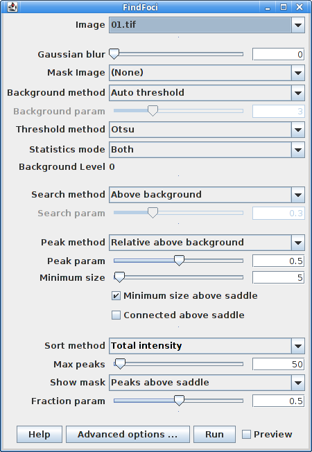

    FindFoci GUI

The interface has sliders to adjust the numeric parameters. The parameter can also be entered using the input text box. The range for the sliders are set to a default scale depending on the parameter. For example the background parameter is limited to the minimum and maximum values found in the image. The range for the slider can be updated by double-clicking the slider. This will display a dialog where the range can be updated.

To save space within the GUI not all the options from ``FindFoci`` are directly available. Clicking on the ``Advanced options ...`` button will open a second window where more parameters are available (:numref:`Figure %s <fig_findfoci_gui_advanced_options>`).

.. _fig_findfoci_gui_advanced_options:
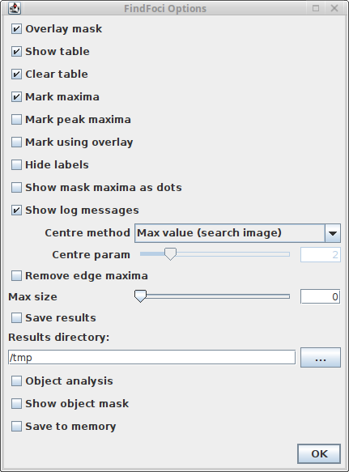

    FindFoci GUI advanced options

Preview
^^^^^^^

The ``FindFoci GUI`` interface has a preview option. If this option is checked then the plugin will automatically update the results based on any changes to the parameters. The plugin stores intermediate results in memory. When a parameter changes the plugin identifies the stages of the calculation that must be re-run and updates the results.

The preview provides the ability to change the parameters and quickly see the effects on the output mask and results table. However since the full ``FindFoci`` plugin is not run there is no output to the ``ImageJ`` log window and the command is not recorded to the ``ImageJ`` macro recorder. Only the ``Run`` button supports these options.

The ``Overlay mask`` and/or ``Mark maxima`` options are useful during the preview as they show the foci on the original image. The ``Mark using overlay`` option allows the maxima to be drawn on the image without destroying any ROI used to restrict the analysis area. The ``Hide labels`` option is useful to turn off the point ROI number labels when the number of foci is large.

Note: The preview option requires a large amount of memory to store the intermediate results. It may not be suitable for large stack images depending on the configuration of your system. The memory used by the preview is released when the preview option is unchecked. This method can also be used to reinitialise the preview in the event that it has stopped responding to parameter changes. The preview will also need to be reinitialised if a different ROI is selected for analysis. This is because the plugin is not alerted when an image ROI is updated and so will be operating on the originally selected input pixels.

Java Requirements
^^^^^^^^^^^^^^^^^

The ``FindFoci GUI`` uses the BeansBinding Java framework. This is included when the plugins are installed using the ``ImageJ2``/``Fiji`` update site; for a manual installation the ``beansbinding`` jar is required (see :ref:`installation:Installation`).

.. index:: ! FindFoci Batch

FindFoci Batch
--------------

Allows a set of parameters for the ``FindFoci`` algorithm to be applied to all the images in a directory. The algorithm is run on each image in turn and the results are saved to an output directory.

.. index:: FindFoci Batch Features

Features
~~~~~~~~

* Batch processing of images using ``FindFoci``
* Auto-detection of mask images
* Parameters are specified using an input file
* Saves the results to an output directory
* Multi-threaded processing

Overview
~~~~~~~~

The ``FindFoci Batch`` plugin can be used to speed up the analysis of large numbers of images. All the images in a single directory can be processed with the same parameters and the results recorded to an output directory.

The input images can be any format that is read by ``ImageJ``. The output images (if selected as an output option) will use the TIFF format.

.. _findfoci_batch_parameters_file:

Create the FindFoci Parameters
^^^^^^^^^^^^^^^^^^^^^^^^^^^^^^

The batch plugin requires all the parameters for ``FindFoci`` to be specified in a file. This can be done using three methods.

**Record the options using the ImageJ Macro Recorder**

#. Start the ``ImageJ`` macro recorder using ``Plugins > Macros > Record...``
#. Run the ``FindFoci`` plugin on an example image with the desired parameters
#. The ``ImageJ`` Recorder will save the plugin name and options in the recorder using the following entry::

    run("FindFoci", "[options ...]");

#. Copy the options string from the Recorder window and save it to a text file. The options should be saved to a single line in the file

The saved macro options can be used as the ``FindFoci`` parameters file.

**Save the options to file using FindFoci**

#. Start the ``FindFoci`` plugin on an example image with the desired parameters
#. Ensure that you provide a valid path to a ``Results directory``
#. Run the plugin

Or:

#. Start the ``FindFoci GUI`` plugin
#. Select an example image and set the desired parameters
#. Click the ``Advanced options ...`` button
#. Ensure the ``Save results`` checkbox is selected and provide a valid path to a results directory
#. Click the ``Run`` button to run the ``FindFoci`` plugin

The ``FindFoci`` plugin will save a file to the results directory containing all the parameters needed for the plugin. The file will be named ``FindFoci-[ImageTitle]-yyyyMMdd_HHmmss.params``. The params file can be used as the ``FindFoci Batch`` parameters file. The file can be renamed if desired.

**Save the options to file using the FindFoci Optimiser**

#. Run the :ref:`findfoci_plugins:FindFoci Optimiser` plugin on an example image
#. Ensure that you provide a valid path to a results file
#. The optimiser will save the top scoring parameters to file with the suffix ``.params``

Note that if the ``FindFoci Optimiser`` is run in multi-image mode then the parameters file will be placed in the output directory and named ``all.params``.

Note on the Parameters
^^^^^^^^^^^^^^^^^^^^^^

The ``FindFoci Batch`` plugin will auto-detect the type of parameters file that is selected. Any line in the file with an equals (``=``) character will be read. If the file contains only one line then it is assumed the file contains the macro options from the ``ImageJ`` Recorder. Otherwise the file should be a valid params file with ``key=value`` pairs for all the parameters, one pair on each line. Keys are not case sensitive.

The ``FindFoci Batch`` plugin will ignore the entries for:

* ``Results_directory``: This is specified in the ``FindFoci Batch`` dialog
* ``Image``: The image is auto-detected from the input directory
* ``Mask``: The mask is auto-detected using filenames
* ``Show_table``: The plugin will not produce a table of results as the results are always saved to a ``.xls`` file in the output directory

.. _findfoci_batch_czt:

Custom Channel, Time Frame and Z-slice Parameters
^^^^^^^^^^^^^^^^^^^^^^^^^^^^^^^^^^^^^^^^^^^^^^^^^

By default the algorithm will find foci in the entire z-stack of the first channel and time frame.

To process a specific channel and/or time frame the user will have to specify this using the parameters file. It is also possible to specify a single z-slice for processing. In this case the slice will be extracted from the z-stack before processing.

Custom dimension processing can be specified by adding entries to the parameters file as follows:

.. list-table::
   :widths: 20 80
   :header-rows: 1

   * - Option
     - Description

   * - Image_C
     - Image channel to process. Default = 1. This value is only used if it is less than or equal to the number of channels in the image.

   * - Image_Z
     - Image z-slice to process. Default = 0 (the entire z-stack). This value is only used if it is less than or equal to the number of slices in the image.

   * - Image_T
     - Image time frame to process. Default = 1. This value is only used if it is less than or equal to the number of frames in the image.

   * - Mask_C
     - Mask channel to process. Default = 1. This value is only used if it is less than or equal to the number of channels in the mask.

   * - Mask_Z
     - Mask z-slice to process. Default = 0 (the entire z-stack). This value is only used if it is less than or equal to the number of slices in the mask.

   * - Mask_T
     - Mask time frame to process. Default = 1. This value is only used if it is less than or equal to the number of frames in the mask.

Not all entries must be specified. If an entry is missing or outside the image/mask dimensions the default value will be used. An entry that is not an integer will cause the plugin to fail to read the parameters file.

Note that if the parameters file contains the options recorded by the ``ImageJ`` Recorder, the entries must be added at the end of the single line, e.g.::

    ... image_c=2 image_t=3

Adding entries on new lines will cause the plugin to fail to recognise the Recorder options.

If the parameters file contains key-value pairs on separate lines, the entries must be added as new key-value pairs on separate lines, e.g.::

    ...
    Image_C = 2
    Image_T = 3

If the parameters file was generated by ``FindFoci`` then these options will already be present. They can be removed or updated as necessary. These entries are not recorded by the ``FindFoci Optimiser``.

.. index:: FindFoci Batch Plugin Interface

Plugin Interface
~~~~~~~~~~~~~~~~

The ``FindFoci Batch`` interface uses a standard ``ImageJ`` dialog. The input fields must specify the full path to the directories and the parameters file. Clicking the ``...`` button next to a field will open a selection dialog.

The following parameters can be configured:

.. list-table::
   :widths: 20 80
   :header-rows: 1

   * - Parameter
     - Description

   * - Input directory
     - The directory containing the images to process.

       All valid images supported by ``ImageJ`` will be opened. Note that the ``FindFoci`` plugin will only work on 8, 16 and 32-bit greyscale images; any other image (e.g. RGB colour) will be logged as an error and skipped.

       Any file with the text ``mask.`` will be ignored as these are assumed to be mask images. Optional mask images should be named using the image filename with the text ``mask.`` placed before the image extension: ``[image_name].mask.[ext]``.

   * - Mask directory
     - The directory containing mask images. This parameter is optional.

       Mask images must be named with the same name as the parent image in the input directory, or using the image filename with the text ``mask.`` placed before the image extension: ``[image_name].mask.[ext]``.

   * - Parameter file
     - The name of the ``FindFoci`` parameters file (see :numref:`{number}: {name} <findfoci_batch_parameters_file>`).

   * - Output directory
     - The output directory.

       Note that the plugin will overwrite files that already exist.

   * - Multi-thread
     - Select this option to process images in parallel. The results output will be the same but ``ImageJ`` log messages may be in a different order.

       The number of threads is taken from the ``ImageJ`` preference set in ``Edit > Options > Memory & Threads...``.

   * - Show log messages
     - Write the progress of the algorithm for each image to the ``ImageJ`` log window. A summary of the batch is always written to the log.

The ``Mask directory`` parameter is optional. This allows the user to place the mask images in a separate directory or the same directory as the input image. The mask will be found using the following search order:

#. [Mask directory] + [Image filename]
#. [Input directory] + [image_name].mask.[ext]
#. [Mask directory] + [image_name].mask.[ext]

It should be noted that the ``FindFoci`` plugin will process the current channel and time frame of a hyperstack image. When opening the images the channel and time frame will be set to 1. To process a specific channel and time frame the user will have to specify this using the parameters file (see :numref:`{number}: {name} <findfoci_batch_czt>`).

Output
^^^^^^

The ``FindFoci Batch`` plugin will not produce any results within ``ImageJ``. The standard table of results or mask image will not be displayed. It is possible to see the algorithm running in the ``ImageJ`` status bar and in the ``ImageJ`` log (if ``Show log messages`` is enabled). The batch can be cancelled by pressing the ``Escape`` key.

All the results for each image are saved to the output directory. The results will be prefixed with the image title and the channel (C), z-slice (Z) and time frame (T) used when processing::

    [Title]_c[C]z[Z]t[T]

If Z is zero then the entire z-stack was analysed. To use the original title without the CZT suffix add the entry ``Original_Title=true`` to the parameters file (or ``original_title`` to the end of the Recorder options line).

The following files are produced for each image:

.. list-table::
   :widths: 20 80
   :header-rows: 1

   * - File
     - Description

   * - .xls
     - The results of the ``FindFoci`` algorithm including foci sizes and coordinates (see :numref:`{number}: {name} <findfoci_results_table>`).

   * - .roi
     - An ``ImageJ`` ROI file that allows the foci to be loaded onto an image within ``ImageJ``.

   * - .params
     - The parameters used for the analysis.

   * - .tiff
     - The input image saved with the marked maxima and/or the mask overlay.

       This is only produced if the ``Mark maxima`` or ``Overlay mask`` options are selected.

   * - .mask.tiff
     - The output mask image.

       This is only produced if the ``Show mask`` option is not ``None``.

   * - .objects.tiff
     - The input mask image reprocessed to display the identified objects.

       This is only produced if the options ``Object analysis`` and ``Show object mask`` are selected.

The results for all the images are also combined into a single file ``all.xls`` in the output directory. Each record is prefixed with the ``Image ID`` (the position of the image in the batch) and the ``Image`` name. If an image has no foci an empty record is written for the image.

Note that the plugin will overwrite files that already exist in the output directory. Therefore care must be taken when selecting the output directory to be the same as the input directory. Conflicts should not be possible given the results contain the CZT position that was analysed. However existing files (including previous results) will be overwritten.

Multi-thread Mode
^^^^^^^^^^^^^^^^^

The plugin will use the number of threads specified in the ``ImageJ`` preferences. This can be set using ``Edit > Options > Memory & Threads...``.

In single-thread mode messages are written immediately to the ``ImageJ`` log window. However when running in multi-thread mode all the log messages for processing a single image are stored in memory. When the processing of the image has finished the messages are recorded. This prevents log messages from processing different images from becoming interlaced. This does mean there will be a slight delay before progress can be followed in the log window.

The records in the ``all.xls`` file are sorted by ``Image ID`` when processing has finished.

The number of images processed can be followed in the ``ImageJ`` progress bar.

.. index:: ! FindFoci Optimiser

FindFoci Optimiser
------------------

Finds the best parameters for the ``FindFoci`` algorithm using the maxima marked on a representative image. It iterates through thousands of combinations and identifies the best parameters to find the desired peak regions. These parameters can then be easily applied to other images of the same type using the ``ImageJ`` scripting tools or the ``FindFoci Batch`` plugin.

The results of each combination are compared to the reference points and the parameters that best match the reference are identified. :numref:`Figure %s <fig_findfoci_optimiser_input>` shows an example input image with manually identified peaks. These are used as reference points for optimisation of the ``FindFoci`` algorithm. :numref:`Figure %s <fig_findfoci_optimiser_output>` shows the peaks identified with the best match to the reference points.

.. _fig_findfoci_optimiser_input:
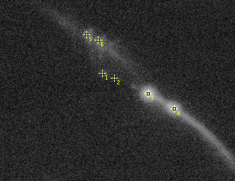

    FindFoci Optimiser input image with manually identified reference peaks

.. _fig_findfoci_optimiser_output:
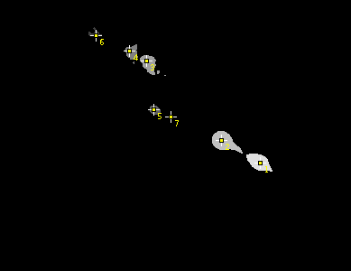

    FindFoci Optimiser output image showing the peaks with the best match to the reference

The scoring statistics comparing the identified peaks to the reference points for each set of parameters are shown in a results table (see :numref:`{number}: {name} <findfoci_optimiser_result_table>`).

.. index:: FindFoci Optimiser Features

Features
~~~~~~~~

* Enumerates combinations of parameters for the ``FindFoci`` plugin
* Compares the results to a reference image
* Reports the best parameters to identify the reference peaks
* Saves the results table to file
* Staged processing allows fast enumeration of parameters
* Supports 2D/3D foci

Overview
~~~~~~~~

The ``FindFoci Optimiser`` provides the ability to set multiple options for each parameter of the ``FindFoci`` plugin. All the combinations are run and the results compared to a reference image to identify the best combination.

The options for each parameter are specified by the user. In the case of selection inputs and flags it is possible to specify more than one option for each parameter. In the case of numeric inputs it is possible to select a lower limit, upper limit and increment to use, e.g. 0 to 10 in 2 step intervals. The optimiser then runs the ``FindFoci`` algorithm for all the combinations of parameters.

Since the ``FindFoci`` algorithm can be broken down into stages (background thresholding, maxima identification, peak growing and peak merging) it is possible to run only the parts of the algorithm that differ when changing a subset of the parameters. This allows the optimiser to efficiently run thousands of combinations of parameters.

Each run of the ``FindFoci`` algorithm is compared to a reference image with marked maxima and scored using various metrics. The final results are ranked and the best parameters identified.

Note that the optimiser runs on a single image. It is possible to run the optimiser on multiple images and combine all the results using the :ref:`findfoci_plugins:FindFoci Optimiser Multi-Image` plugin.

.. _findfoci_optimiser_reference_foci:

Stage 1: Create Reference Foci
^^^^^^^^^^^^^^^^^^^^^^^^^^^^^^

The optimiser requires a reference set of foci to set a benchmark for the algorithm. The aim is to match the reference foci as closely as possible. Reference foci can be created using two methods: (a) using the ``ImageJ`` ROI tool to mark the image; or (b) using a text file. 3D coordinates are supported using either method.

**Mark Foci on the Image**

Select the ``Multi-point`` tool by right-clicking on the ``Point Tool`` option in the toolbar and selecting the ``Multi-point Tool`` option (:numref:`Figure %s <fig_findfoci_optimiser_multipoint_tool>`).

.. _fig_findfoci_optimiser_multipoint_tool:
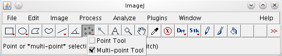

    Selecting the ImageJ Multi-point tool

Open a reference image. Click the image to mark a maxima. Points can be moved by hovering over an existing point and dragging them. Points can be deleted by holding down the ``Alt`` key and clicking them.

Once the image maxima have been labelled you can save the image as a TIFF. ``ImageJ`` will save the ROI points to the image and they will be shown when the image is next opened.

Note: The ``ImageJ`` ROI tool supports 3D coordinates. Each point is shown only on the slice where the image was clicked. To make it easier to see which points have been selected when scrolling through a z-stack use the point tool options to show the points on all slices. Double-clicking the point ROI button on the toolbar will open the ``Point Tool`` options. Use ``Show on all slices`` to display the points on every slice in the stack. This option will update the ROI immediately allowing the setting to be toggled when marking the ROI.

Foci on a 3D image with multiple slices can also be labelled using a text file. The :ref:`findfoci_plugins:Point Extractor` plugin can be used to assist in this task by saving marked ROI points to file.

**Specify Foci in a Text File**

The reference foci can be loaded from a text file. This supports both 2D and 3D coordinates.

The file must contain records with X, Y and optionally Z coordinates, i.e.::

    x  y  [z]

If no Z-coordinate is present for any record then the points will be loaded as 2D. Each field can be delimited by either a comma, space or tab character. Empty lines and lines starting with ``#`` are ignored. This file can be created manually or the :ref:`findfoci_plugins:Point Extractor` plugin can be used to create the file from points on an image or from ROIs within the ``ImageJ`` ROI Manager.

The text file for the image must be placed in the same directory as the image that will be analysed by the ``FindFoci Optimiser``. The file should be named using the same name as the image but using the suffix ``.csv``, ``.xyz`` or ``.txt``, e.g.::

    /path/to/files/image1.tiff
    /path/to/files/image1.csv

**Loading the Foci**

When the ``FindFoci Optimiser`` is run it identifies the original source file for the image. It then searches the same directory for a coordinate text file and attempts to load the foci. If it cannot load the foci from file then the foci are loaded directly from the image using the marked point ROI. This means that any foci marked on an image are ignored if a coordinate file exists for that image. Also note that the z-component of 3D foci loaded from file is ignored if the corresponding image is not a 3D stack.

If a mask is used then any reference foci outside the mask are ignored.

Stage 2: Run the Optimiser
^^^^^^^^^^^^^^^^^^^^^^^^^^

Select the different parameters for the optimiser to enumerate (see :numref:`{number}: {name} <findfoci_optimiser_plugin_interface>`).

Click ``OK`` and the optimiser will show a dialog containing the number of combinations. You can then select to continue, or cancel to stop the optimiser and change the parameters.

If you run the optimiser a progress bar will show in the ``ImageJ`` window that tracks the number of combinations currently completed. When the optimiser is finished a results window will appear showing the top N results. The number of results can be configured in the optimiser dialog.

If the best result does not perfectly match the reference points (F1 score below 1) and was obtained using a numeric parameter that lies on an extreme of the test range then the plugin will show a warning message in a dialog and the ``ImageJ`` log, for example::

    Optimal result (0.5556) for image1 obtained at the following limits:
    - Min Size @ lower limit (3)
    - Peak parameter @ lower limit (0.200000)
    You may want to increase the optimisation space.

This allows the user to increase the range to ensure that the optimal parameters are identified. A warning is also shown if the number of peaks in the best result is equal to the ``Maximum peaks`` parameter.

.. _findfoci_optimiser_result_assessment:

Result Assessment
~~~~~~~~~~~~~~~~~

The optimiser scores the results of the ``FindFoci`` algorithm by comparing the locations of the identified maxima to the reference points. Maxima are deemed to be correct if they are within a set distance of a reference point. The cut-off distance is configured in the plugin options. The default is 5% of the image width or height, whichever is smaller. Note that the distance will be computed in 3D if 3D reference foci have been loaded. For calibrated images the z-distance is scaled relative to the pixel unit distance of the x-dimension. For example an image with 110x110x250nm voxels will scale the z-distance by 250/110.

The maxima assignment process is iterative. The maxima closest to any reference point is assigned as a match and the pair removed from the search. This is iterated until no more reference points exist, or all maxima are too far from a reference point to be a match. The matches are true positives (TP); unmatched maxima are false positives (FP); and unmatched reference points are false negatives (FN). The results are then scored using the Precision, Recall, Jaccard and F-score metrics (see :numref:`{number}: {name} <binary_scoring_statistics>`). These metrics all range from 0 to 1.

.. _findfoci_optimiser_plugin_interface:

.. index:: FindFoci Optimiser Plugin Interface

Plugin Interface
~~~~~~~~~~~~~~~~

The ``FindFoci Optimiser`` interface uses a standard ``ImageJ`` dialog. The plugin has many options; these are described below.

Settings Presets
^^^^^^^^^^^^^^^^

To simplify configuration of the optimiser there is a ``Settings`` drop-down item that allows the user to choose from various presets. The following presets are available:

.. list-table::
   :widths: 20 20 60
   :header-rows: 1

   * - Preset
     - Combinations
     - Description

   * - Custom
     - Variable
     - This preset is selected when the user modifies any of the fields.

   * - Testing
     - 12
     - A small number of combinations for testing.

   * - Default
     - 720
     - The default combinations to try a range of parameters that are applicable to many images.

   * - Benchmark
     - 19,800
     - A set of combinations that can be used as an initial search of the entire range of the algorithm parameters.

It is possible to select any of the presets as a starting point for parameter configuration. When any setting is changed (except the result file) the ``Settings`` option will change to ``Custom``. It is possible to revert back to the preset by selecting it again from the ``Settings`` drop-down. In this event the current custom settings will be saved so that the user can switch back to their customised settings using the drop-down. However if any changes are made to the preset values then the saved custom settings will be discarded (since a new custom setting will be started).

Using custom settings is the best way to search for the optimum ``FindFoci`` parameters since each image analysis is unique. The following sections explain how to configure the optimiser parameters. Full details of each ``FindFoci`` parameter can be found in the ``FindFoci`` :numref:`{number}: {name} <findfoci_plugin_interface>` section.

.. _findfoci_optimiser_range_fields:

Range and List Fields
^^^^^^^^^^^^^^^^^^^^^

The plugin has several text fields that accept a lower limit, upper limit and interval. The numbers must be comma-delimited. If three numbers are present then the plugin will assume that they are the lower limit, upper limit and interval. If only one number is present then it is used as both the lower and upper limit. This is equivalent to using a single value and not a range of values. Values are enumerated from the lower limit while they are less than or equal to the upper limit. Note that the accumulated interval is subject to floating-point rounding: for example ``0, 0.6, 0.2`` will enumerate 0, 0.2 and 0.4 since three increments of 0.2 are slightly above 0.6.

The following fields allow range limits:

* ``Background parameter``
* ``Search parameter``
* ``Minimum size``
* ``Peak parameter``
* ``Centre parameter``

The plugin has several text fields that accept multiple values in a comma-delimited list. The following fields allow a comma-delimited list:

* ``Auto threshold``
* ``Statistics mode``
* ``Sort method``
* ``Gaussian blur``
* ``Centre method``

The use of a list for ``Gaussian blur`` is due to the fact that changes in the blur radius are most noticeable at increasing increments, e.g. 1, 2, 4, 8, 16. In this case a range field with a linear increment is unwanted.

Initialisation Parameters
^^^^^^^^^^^^^^^^^^^^^^^^^

The ``FindFoci`` algorithm must be initialised with an image and optionally a mask identifying which pixels are to be processed. The pixels are used to calculate image statistics and a background level for the peak finding algorithm. The optimiser will run the ``FindFoci`` algorithm for each background option that is enabled. There are additional fields that allow parameters to be passed to the background method and control the pixels used for the statistics.

.. list-table::
   :widths: 20 80
   :header-rows: 1

   * - Parameter
     - Description

   * - Mask
     - Optionally select a mask to define the pixels to process. Only images with the same dimensions as the input image are listed. Any non-zero pixel is included in the analysis.

   * - Background SD above mean
     - Use the ``Std.Dev above mean`` background method.

       It is not allowed to use this at the same time as the ``Absolute`` method.

   * - Background Absolute
     - Use the ``Absolute`` background method.

       It is not allowed to use this at the same time as the ``Std.Dev above mean`` method.

   * - Background parameter
     - Set the lower limit, upper limit and increment for enumerating the background parameter passed to the background method. This applies to either ``Std.Dev above mean`` or ``Absolute``.

   * - Background Auto Threshold
     - Use the ``Auto threshold`` background method.

   * - Auto threshold
     - The method for performing the ``Auto threshold`` calculation. The text field supports a comma-delimited list of method names for multiple options, e.g. ``Otsu, Triangle``.

   * - Statistics mode
     - When a mask image is used it is possible to set the region used to calculate the image statistics:

       * ``Inside``: Use the pixels inside the image mask
       * ``Outside``: Use the pixels outside the image mask
       * ``Both``: Use all the pixels in the image

       The text field supports a comma-delimited list for multiple options. When no mask image is used, or the background method is ``Absolute``, this option is ignored.

Search Parameters
^^^^^^^^^^^^^^^^^

The optimiser will run the ``FindFoci`` algorithm for each search option that is enabled. There is an additional field that allows a parameter to be passed to the search method.

.. list-table::
   :widths: 20 80
   :header-rows: 1

   * - Parameter
     - Description

   * - Search above background
     - Use the ``Above background`` search method.

   * - Search fraction of peak
     - Use the ``Fraction of peak - background`` search method.

   * - Search parameter
     - Set the lower limit, upper limit and increment for enumerating the search parameter passed to the ``Fraction of peak - background`` method.

Peak Merging Parameters
^^^^^^^^^^^^^^^^^^^^^^^

The optimiser will run the ``FindFoci`` algorithm for each combination of the following peak merging options.

.. list-table::
   :widths: 20 80
   :header-rows: 1

   * - Parameter
     - Description

   * - Minimum peak height
     - Set the method for setting the minimum peak height. Only a single method can be used since the parameter for each method uses a different scale.

   * - Peak parameter
     - Set the lower limit, upper limit and increment for enumerating the parameter passed to the minimum peak height method.

   * - Minimum size
     - Set the lower limit, upper limit and increment for enumerating the minimum size parameter passed to the peak merge method.

   * - Minimum above saddle
     - Set the option for limiting the peak size to above the saddle, including the option to compute using only connected pixels above the saddle.

       Select ``Yes``; ``Yes - Connected``; ``No``; or ``All`` (to try all three options).

Results Parameters
^^^^^^^^^^^^^^^^^^

.. list-table::
   :widths: 20 80
   :header-rows: 1

   * - Parameter
     - Description

   * - Sort method
     - Set the method used to sort the peaks before extracting the top N. This only has an effect if the total number of peaks is above the ``Maximum peaks``.

       Methods are specified using the method name or number; the names and numbers for the methods are shown in the dialog, e.g. ``[1] Total intensity`` can be specified as ``Total intensity`` or ``1``. Multiple options can be specified using a comma-delimited list.

   * - Maximum peaks
     - Set the maximum number of peak results.

Extra Parameters
^^^^^^^^^^^^^^^^

Control other options available within the ``FindFoci`` algorithm.

.. list-table::
   :widths: 20 80
   :header-rows: 1

   * - Parameter
     - Description

   * - Gaussian blur
     - Set the size of the blur to apply before running the ``FindFoci`` algorithm.

       Multiple options can be specified using a comma-delimited list.

   * - Centre method
     - Set the method used to determine the centre of the peak.

       Methods are specified using the method name or number; the names and numbers for the methods are shown in the dialog, e.g. ``[0] Max value (search image)`` can be specified as ``Max value (search image)`` or ``0``. Multiple options can be specified using a comma-delimited list.

   * - Centre parameter
     - Set the lower limit, upper limit and increment for enumerating the parameter passed to the centre method. This is only used by the ``Centre of mass (search image)`` method.

Optimisation Parameters
^^^^^^^^^^^^^^^^^^^^^^^

The ``FindFoci Optimiser`` plugin has several options for controlling how the ``FindFoci`` results are scored and ranked.

.. list-table::
   :widths: 20 80
   :header-rows: 1

   * - Parameter
     - Description

   * - Match search method
     - Choose the method for specifying the distance for two peaks to be a match:

       * ``Relative``: Use a distance relative to the shortest edge (width or height) in the image
       * ``Absolute``: Use an absolute distance in pixels

   * - Match search distance
     - Set the distance limit used to determine if a peak maxima and a reference point are a match.

       This value is specified as a fraction of the image short edge, e.g. 0.05 for a 600x400 pixel image would be 20 pixels (400 x 0.05), or an absolute value in pixels (see ``Match search method``). The relative distance is rounded up to the next integer number of pixels.

   * - Result sort method
     - Specify the metric used to sort the results: ``Precision``; ``Recall``; ``F0.5``; ``F1``; ``F2``; ``F-beta``; ``Jaccard``; or ``RMSD``. Using ``None`` will output the results in the order they were computed.

   * - F-beta
     - Specify the :math:`\beta` parameter used to calculate the custom F-score.

   * - Maximum results
     - Specify the maximum number of results to include in the result table.

   * - Step limit
     - The optimiser will not run if the total number of combinations (steps) is at or above the ``Step limit``. This parameter can be used to increase the potential optimisation space.

Additional Parameters
^^^^^^^^^^^^^^^^^^^^^

.. list-table::
   :widths: 20 80
   :header-rows: 1

   * - Parameter
     - Description

   * - Show score images
     - If enabled the optimiser will show three duplicates of the input image with overlay points marking the True Positives, False Positives and the False Negatives. The points are shown using an overlay as this can label points to a specific slice of a 3D stack. (A point ROI would be visible through the entire stack.)

   * - Result file
     - Provide the prefix for the results files. The prefix should be a full path to a valid directory and include a filename prefix, e.g. ``/tmp/FindPeaks``. Clicking the ``...`` button will open a file selection dialog.

       Results files will have a suffix added corresponding to the result:

       * ``.results.xls``: Contains the optimiser results
       * ``.points.csv``: Contains the peak coordinates from the best result
       * ``.params``: Contains the ``FindFoci`` parameters for the best result (this can be input to the :ref:`findfoci_plugins:FindFoci Batch` plugin)

Output
~~~~~~

The ``FindFoci Optimiser`` records the parameters and results of each run of the ``FindFoci`` algorithm. The best results are shown in a result table and the complete results can be saved to file. The plugin also runs the ``FindFoci`` algorithm using the optimal parameters on the input image to show the result peaks. Further details are outlined below.

.. _findfoci_optimiser_result_table:

Result Table
^^^^^^^^^^^^

The result table shows the top scoring results from all the parameter combinations. The results are sorted using the ``Result sort method`` parameter and limited to the number specified by the ``Maximum results`` parameter. Results are presented in descending order so that the best result from the most recent analysis is shown at the bottom of the table.

In the event that two sets of parameters have an equal score then the results are ranked using a second metric. This is the RMSD (a measure of how close the true positives are to the reference points), or if RMSD is chosen as the primary rank metric, the Jaccard.

In the event of a tie the parameters that have the most conservative settings are ranked first. The following logic is used:

#. Lowest blur
#. Background method: ``None`` < ``Min Mask/ROI`` < ``Auto threshold`` < ``Std.Dev above mean`` < ``Mean`` < ``Absolute``
#. Lowest background parameter
#. Lowest minimum size
#. Search method: ``Above background`` < ``Fraction of peak - background`` < ``Half peak value``
#. Lowest search parameter
#. Peak method: ``Relative above background`` < ``Relative height`` < ``Absolute height``
#. Lowest peak parameter
#. Lowest run time

The result table shows the result rank and then columns containing the parameters: ``Blur``; ``Background method`` (with the statistics mode and the parameter or threshold method); ``Max`` (the maximum peaks); ``Min`` (the minimum size, with ``>saddle`` if the size is computed above the saddle and ``conn`` if using only connected pixels); ``Search method``; ``Peak method``; ``Sort method``; and ``Centre method``. The table then shows the following scoring metrics:

.. list-table::
   :widths: 20 80
   :header-rows: 1

   * - Metric
     - Description

   * - N
     - The number of maxima in the result.

   * - TP
     - True Positives: The number of maxima in the result that match a reference point.

   * - FP
     - False Positives: The number of maxima in the result that do not match a reference point.

   * - FN
     - False Negatives: The number of reference points that were not identified as maxima.

   * - Jaccard
     - Measure of the overlap similarity between the reference and the maxima.

   * - Precision
     - Measure of how many identified maxima are correct.

   * - Recall
     - Measure of how many reference points were identified.

   * - F0.5, F1, F2, F-beta
     - Combined score that provides a weighted measure of the prediction accuracy. The F-score is calculated using :math:`\beta` of 0.5, 1, 2 and the input ``F-beta`` parameter.

   * - Score
     - The score used for ranking.

   * - RMSD
     - The Root Mean Square Deviation (RMSD) of the true positive results from the reference points:

       .. math::

           \mathit{RMSD} = \sqrt{\frac{\sum d^2}{\mathit{TP}}}

       where :math:`d` is the distance between the predicted and reference coordinates.

   * - mSec
     - The number of milliseconds taken to perform the calculation. The results file records the time in nanoseconds (``nanoSec``).

See :numref:`{number}: {name} <binary_scoring_statistics>` for details of the scoring metrics.

A blank line is inserted at the end of the result table to allow easy visual separation of the results from multiple runs of the plugin.

**Showing a result**

By default the ``FindFoci Optimiser`` shows the result of running the ``FindFoci`` algorithm with the best result. However it is possible to show any result by double-clicking a row in the result table. The ``FindFoci`` algorithm will then be re-run with the parameters from that row.

Note that it is only possible to view the results for the latest run of the optimiser. Parameters for prior runs are discarded from this review functionality.

FindFoci Images
^^^^^^^^^^^^^^^

Upon completion the optimiser runs the ``FindFoci`` algorithm on the input image to display the peaks. To preserve the input image ROI points a copy is made of the original. This is named with the suffix ``clone``. ``FindFoci`` is then run on the clone image to mark the peak ROI points. A mask image showing the peaks above the saddle points is also created with the suffix ``clone FindFoci``. If a mask was used then the pixels of the clone image outside the mask are set to zero.

Score Images
^^^^^^^^^^^^

If the ``Show score images`` parameter is enabled then the input image is duplicated three times, using the suffix ``TP``, ``FP`` and ``FN``. These images are then marked with the points for either the True Positives (TP), False Positives (FP) or False Negatives (FN). The points are marked using an overlay, not a point ROI. This allows marking the points using the specific slice of a 3D image. Scroll up and down through a 3D stack to view the location of each result.

If the optimiser is re-run on the same input image then the output result images will be detected (using the image title) and updated. This feature allows the images to be updated with the results of using the specified parameters when double-clicking on the result table (see Showing a result above).

.. index:: ! FindFoci Optimiser GUI

FindFoci Optimiser GUI
----------------------

A convenience plugin that provides an ``ImageJ`` window with a selection list of all images available for the ``FindFoci Optimiser``. The Graphical User Interface (GUI) runs the :ref:`findfoci_plugins:FindFoci Optimiser` on the selected image.

.. index:: FindFoci Optimiser GUI Features

Features
~~~~~~~~

* Permanent GUI within ``ImageJ``
* Allows different images to be selected
* Runs the ``FindFoci Optimiser`` algorithm to identify peak regions
* Supports the ``ImageJ`` macro recorder

Note that the plugin supports the ``ImageJ`` macro recorder for the ``FindFoci Optimiser`` command. This means that a user can record their actions with the ``FindFoci Optimiser GUI`` within a macro and it will successfully record the execution of the ``FindFoci Optimiser`` plugin.

.. index:: FindFoci Optimiser GUI Plugin Interface

Plugin Interface
~~~~~~~~~~~~~~~~

The ``FindFoci Optimiser GUI`` uses a Java frame within the ``ImageJ`` application. The plugin provides a selection box of the currently open images that can be processed by the optimiser.

Clicking the ``Run`` button launches the ``FindFoci Optimiser`` on the selected image. Full details of the parameters can be found in the ``FindFoci Optimiser`` :numref:`{number}: {name} <findfoci_optimiser_plugin_interface>` section.

The interface has a drop-down menu that is used to select the image. This allows the user to quickly try the same parameters on different images that are open. The image list is populated with the currently open 8-bit, 16-bit and 32-bit greyscale images with a single channel and time frame that have an ``ImageJ`` point ROI. Any images with the title ending in ``FindFoci``, ``clone``, ``TP``, ``FP`` or ``FN`` (i.e. previous results) are ignored. The ``Run`` button is disabled if there are no valid images.

Note that the GUI requires the image to have a point ROI even if the reference foci are loaded from a text file (see :numref:`{number}: {name} <findfoci_optimiser_reference_foci>`).

Java Requirements
^^^^^^^^^^^^^^^^^

The ``FindFoci Optimiser GUI`` uses the BeansBinding Java framework. This is included when the plugins are installed using the ``ImageJ2``/``Fiji`` update site; for a manual installation the ``beansbinding`` jar is required (see :ref:`installation:Installation`).

.. index:: ! FindFoci Optimiser Multi-Image

FindFoci Optimiser Multi-Image
------------------------------

Allows the ``FindFoci Optimiser`` to be run on a directory of reference images to find the best parameters across the dataset. The results for each image are saved to an output directory and can be reloaded allowing the parameters to be ranked using different scoring methods.

.. index:: FindFoci Optimiser Multi-Image Features

Features
~~~~~~~~

* Processes multiple reference images
* Enumerates combinations of parameters for the ``FindFoci`` algorithm
* Compares the results to a reference image
* Saves the results for each reference image
* Combines the results from multiple images into a single ranking of parameters
* Reloads pre-computed results to allow re-ranking using different scoring metrics
* Supports 2D/3D foci

Input
~~~~~

The plugin requires a set of images in a single directory. Each image must have the foci marked on the image using the ``ImageJ`` ROI tool, or recorded in a text file in the same directory. See the ``FindFoci Optimiser`` :numref:`{number}: {name} <findfoci_optimiser_reference_foci>` section for details on how to do this.

Method for Combined Ranking
~~~~~~~~~~~~~~~~~~~~~~~~~~~

When run on a single image the ``FindFoci Optimiser`` computes a score for each parameter set that specifies the match between the reference results and the ``FindFoci`` algorithm. The score can be chosen using the parameter ``Result sort method``, for example the Jaccard score.

When using multiple images the overall rank for a set of parameters must combine the score from each image. The scores for each image can be converted to allow fair combination. The converted scores are then averaged across all images for the same set of parameters. The parameters are ranked using their averaged score and the results displayed.

.. _findfoci_optimiser_multi_score_conversion:

Score Conversion
^^^^^^^^^^^^^^^^

The scores on each image can be converted using the following methods:

.. list-table::
   :widths: 25 75
   :header-rows: 1

   * - Method
     - Description

   * - Raw score metric
     - No conversion is made. The raw score, e.g. the Jaccard, will be averaged across all the images.

   * - Relative (% drop from top)
     - The score is converted to a relative score using the percentage drop from the top score on the image:

       .. math::

           \mathit{relative} = 100 \times \frac{\mathit{score} - \mathit{top}}{\mathit{top}}

   * - Z-score
     - The z-score is computed using the average and standard deviation (SD) of all the scores on the image:

       .. math::

           z = \frac{\mathit{score} - \mathit{average}}{\mathit{SD}}

   * - Rank
     - The score is used to rank the results on the image and the rank is combined across images.

Note that if the RMSD metric is used to score the results then the raw score is always used; the RMSD is combined across all the images (see :numref:`{number}: {name} <findfoci_optimiser_multi_result_table>`). It is not recommended to use RMSD to score results since this will be zero if no true positives are found, i.e. perfect, which is not the case as the result has failed to find any foci. The metric is useful to discriminate results with the same number of true positives as a secondary comparison.

.. index:: FindFoci Optimiser Multi-Image Plugin Interface

Plugin Interface
~~~~~~~~~~~~~~~~

The ``FindFoci Optimiser Multi-Image`` plugin is an extension of the ``FindFoci Optimiser``. It uses the same processing engine to enumerate combinations of parameters for the ``FindFoci`` algorithm. The plugin shares the same main parameters as the ``FindFoci Optimiser``. Additional parameters for processing multiple images are collected using a first dialog.

The input fields must specify the full path to directories that exist. The plugin will not create the output directory automatically. Clicking the ``...`` button next to a field will open a directory selection dialog.

The following parameters can be configured:

.. list-table::
   :widths: 20 80
   :header-rows: 1

   * - Parameter
     - Description

   * - Input directory
     - The directory containing the images to process.

       Any file with the text ``mask.`` will be ignored as these are assumed to be mask images. Optional mask images should be named using the image filename with the text ``mask.`` placed before the image extension: ``[image_name].mask.[ext]``.

       Optional coordinate files should be named: ``[image_name].[csv|xyz|txt]``. If no coordinate file exists for an image then the reference foci will be loaded from the point ROI within the image.

   * - Mask directory
     - The directory containing mask images. This parameter is optional.

       Mask images must be named with the same name as the parent image in the input directory, or using the image filename with the text ``mask.`` placed before the image extension: ``[image_name].mask.[ext]``.

   * - Output directory
     - The output directory.

       Note that the plugin will overwrite files that already exist. The results for each image will be saved to a file named ``[image_name].results.xls``, and the parameters for the best result for the image to ``[image_name].params``.

       The combined results across all images will be saved to a file named ``all.results.xls``. The parameters for the best result across all images will be saved to a file named ``all.params``. This can be input to the :ref:`findfoci_plugins:FindFoci Batch` plugin.

   * - Score conversion
     - Set the score conversion method (see :numref:`{number}: {name} <findfoci_optimiser_multi_score_conversion>`).

   * - Re-use results
     - Select this option to re-use results that are in the output directory. Only files with the correct number of parameter combinations will be re-used, otherwise the results will be recomputed.

       This option can be used to try different ``Score conversion`` and ``Result sort method`` parameters on the same set of results.

The ``Mask directory`` parameter is optional. This allows the user to place the mask images in a separate directory or the same directory as the input image. The mask will be found using the following search order:

#. [Mask directory] + [Image filename]
#. [Input directory] + [image_name].mask.[ext]
#. [Mask directory] + [image_name].mask.[ext]

Once the parameters for processing multiple images have been collected the plugin displays the same dialog as the ``FindFoci Optimiser`` (see :numref:`{number}: {name} <findfoci_optimiser_plugin_interface>`). However the plugin does not allow specification of a mask image, a results file, or the option to show score images. The mask for each image is found using the search order above. All results will be saved to the output directory.

Results
~~~~~~~

When started the plugin will run the ``FindFoci Optimiser`` on each input image. Progress can be monitored using the ``ImageJ`` progress bar in the ``ImageJ`` window. As with the ``FindFoci Optimiser``, if the best result for an image is obtained using a numeric parameter that lies on an extreme of the test range then the plugin will log a warning message to the ``ImageJ`` log window. This allows the user to increase the range to ensure that the optimal parameters are identified.

Processing is performed using multiple threads to increase speed. The number of threads can be specified using the ``ImageJ`` preferences: ``Edit > Options > Memory & Threads...``.

The final combined ranking of the top N parameters is displayed in a table in ``ImageJ``. All the combined results are saved to the output directory.

Once the results have been computed it is possible to re-rank the parameter sets using a different scoring method without re-calculating the results. The results will be loaded from the output directory if the ``Re-use results`` option is selected and the results files contain the correct number of combinations.

.. _findfoci_optimiser_multi_result_table:

Result Table
^^^^^^^^^^^^

The result table shows the top scoring results from all the parameter combinations. The results are sorted using the average score across all the images and limited to the number specified by the ``Maximum results`` parameter. Note that RMSD scores cannot be averaged. The combined RMSD is re-computed using the RMSD and number of true positives in each image result.

Results are presented in descending order so that the best result from the most recent analysis is shown at the bottom of the table.

Ties are resolved using the same logic as the ``FindFoci Optimiser`` (see :numref:`{number}: {name} <findfoci_optimiser_result_table>`).

The result table shows the result rank and then columns containing the parameters. The table then shows the same scoring metrics as the ``FindFoci Optimiser``. However the counts display the total across all images and the scoring metrics show the average across all images. It is important to note that the scoring metrics, e.g. Jaccard and F-scores, are not recomputed using the total counts across all images. The following results are displayed:

.. list-table::
   :widths: 20 80
   :header-rows: 1

   * - Metric
     - Description

   * - N
     - The total number of maxima in the results.

   * - TP
     - True Positives: The total number of maxima in the results that match a reference point.

   * - FP
     - False Positives: The total number of maxima in the results that do not match a reference point.

   * - FN
     - False Negatives: The total number of reference points that were not identified as maxima.

   * - Jaccard
     - Average Jaccard score across all the images.

   * - Precision
     - Average Precision score across all the images.

   * - Recall
     - Average Recall score across all the images.

   * - F0.5, F1, F2, F-beta
     - Average F-score across all the images. The F-score is calculated using :math:`\beta` of 0.5, 1, 2 and the input ``F-beta`` parameter.

   * - Score
     - The average score used for ranking across all the images.

       This is the score set using the ``Result sort method`` parameter in the main optimiser dialog and converted per image using the method defined by the ``Score conversion`` parameter from the multi-image dialog.

   * - RMSD
     - The Root Mean Square Deviation (RMSD) of the true positive results from the reference points, computed over all the images:

       .. math::

           \mathit{RMSD} = \sqrt{\frac{\sum d^2}{\mathit{TP}}}

       where :math:`d` is the distance between the predicted and reference coordinates.

   * - mSec
     - The total number of milliseconds across all the images.

See :numref:`{number}: {name} <binary_scoring_statistics>` for details of the scoring metrics.

Invalid Results
^^^^^^^^^^^^^^^

Note that the results do not store the distance at which the scoring metrics were computed. Therefore it is left to the user to remember that if the match search distance is changed then results should be recomputed as they will not be valid. The option to ``Re-use results`` should be disabled.

However if the user wishes to change the ``Result sort method`` or the ``Score conversion`` parameters then the results can be re-used to produce the final combined ranking.

.. index:: ! FindFoci Helper

FindFoci Helper
---------------

An interactive plugin that aligns the manually added point Regions of Interest (ROIs) with the peaks found by the ``FindFoci`` algorithm. The plugin intercepts user clicks with the multi-point ROI tool and assigns the marked points to the closest/highest peak within a search radius.

.. index:: FindFoci Helper Features

Features
~~~~~~~~

* Processes 8-, 16- or 32-bit images
* Extracts a single channel and time frame for processing N-dimensional images
* Computes the image peaks using the ``FindFoci`` algorithm
* Intercepts user clicks with the multi-point ROI tool and assigns the marked points to the true peaks
* Supports dragging points
* Supports 3D point ROIs (each point is associated with a z slice)
* Outputs assignments to the ``ImageJ`` log window
* Optional output of a results table of point positions with intensity

Overview
~~~~~~~~

The ``FindFoci Helper`` provides a semi-automated tool to assist in manually counting the peaks in an image. The tool is designed to work in conjunction with the ``ImageJ`` multi-point ROI tool.

The plugin must be attached to an image and initialised. During initialisation all the potential peaks in an image are calculated using the ``FindFoci`` algorithm.

The plugin then listens for mouse-click events from the ``ImageJ`` multi-point ROI tool. If a new ROI point is added then the plugin attempts to align the point to an available peak within a set distance. The alignment is performed using the highest or the closest peak. If an existing point is moved then the plugin will detect the drag and attempt to align the point when it is dropped.

.. index:: FindFoci Helper Plugin Interface

Plugin Interface
~~~~~~~~~~~~~~~~

The ``FindFoci Helper`` uses a Java frame within the ``ImageJ`` application.

The following parameters can be configured:

.. list-table::
   :widths: 20 80
   :header-rows: 1

   * - Parameter
     - Description

   * - Image
     - The target image.

   * - Mask Image
     - Optional mask image defining the region where points will be aligned.

   * - Resolution (px)
     - Defines the search radius for aligning a point (in pixels).

   * - Log Messages
     - If selected record details of the point alignments to the ``ImageJ`` log window (see :numref:`{number}: {name} <findfoci_helper_alignment_log>`).

   * - Search Mode
     - Define the search mode for aligning points to the available maxima: ``Highest`` or ``Closest``.

   * - Assign Dragged
     - If selected the plugin will re-align dragged points when they are dropped.

Workflow
~~~~~~~~

Multi-point ROI Mode
^^^^^^^^^^^^^^^^^^^^

The ``ImageJ`` multi-point ROI tool must be activated. This can be found on the ``ImageJ`` toolbar (see :numref:`Figure %s <fig_findfoci_optimiser_multipoint_tool>`). If the single-point ROI mode button is shown then the multi-point mode can be enabled by right-clicking the button and toggling the mode.

The multi-point ROI mode allows the user to manually mark multiple points on an image. Each point is represented by a cross and shows a numbered label (if more than 1 point is selected).

**3D Images**

The multi-point ROI can associate each point of the ROI with a z slice. This is used by the ``FindFoci Helper`` to mark the exact maxima in 3D. ``ImageJ`` offers the option to render the ROI with each point only on the z slice that contains the point or on all slices. Double-clicking the point ROI button on the toolbar will open the ``Point Tool`` options. Use ``Show on all slices`` to display the points on every slice in the stack. Any change to the ``Point Tool`` options takes effect immediately. It is useful to leave the ``Point Tool`` options dialog open and toggle between showing on all slices (when picking new points) and showing on the specific slice (when browsing the marked maxima for correctness).

The search resolution is specified in pixels. However a 3D image may have different calibration for the width, height and depth of the voxels. The depth (and height for images with different XY calibration) is scaled relative to the pixel width using the image calibration. For example if the pixel width is 0.1 micrometres and the voxel depth is 0.25 micrometres then the distance of 1 slice is scaled to 2.5px. This allows the search resolution to apply to 2D and 3D images as the radius of a circle or sphere respectively.

Initialisation
^^^^^^^^^^^^^^

The ``FindFoci Helper`` shows a list of the available images that can be processed. This will be all the 8-, 16- and 32-bit greyscale images; any images with the title ending in ``FindFoci`` (i.e. previous results) are ignored. Select the image and the list of possible mask images will be updated. Mask images must have the same width and height as the image, and either the same number of z slices or a single slice. Any non-zero pixel in the mask defines the region of the image where potential maxima will be detected. The mask image is optional.

Next configure the resolution for point assignment. The resolution defines the search distance around the point that can be used to locate a maxima. Note that the resolution is dynamic and can be modified after the helper is initialised.

Click ``Start`` to initialise the helper. The plugin supports images with multiple channels or time frames but will only calculate the peaks on a single channel and time point. If a multi-dimensional image is selected then the plugin will show a dialog requesting the user to select the channel and/or frame to be processed.

The plugin will calculate all the potential maxima above the mean of the image using the ``FindFoci`` algorithm. The mean is used as a reasonable threshold to avoid identifying false peaks.

If the image contains an existing multi-point ROI then the plugin will attempt to assign each point. If the ``Highest`` search mode is enabled the plugin will process the points in descending height order. If the ``Closest`` search mode is enabled the points will be processed using the closest pairing of point and maxima, iterating until no more assignments can be made.

The number of potential maxima along with the count of mapped and unmapped points will be displayed in the plugin window.

Marking Peaks
^^^^^^^^^^^^^

Mark a new peak by clicking on the image. The plugin will search for the closest or highest unassigned maxima within the search resolution.

If a maxima is found the point will be moved to the maxima. The mapped count on the plugin interface will increment.

If no maxima is found then the point will be unchanged. The unmapped count on the plugin interface will increment.

If the plugin does not assign the peak as expected it can be moved by dragging as described below.

Moving Peaks
^^^^^^^^^^^^

If the mouse cursor is hovered over an existing point it will change to a finger. The point can then be moved by holding down the mouse button and moving the mouse to drag the point.

The plugin will identify the point that has been dragged. If it is an aligned point the mapped count on the interface will decrement, otherwise the unmapped count will decrement.

When the mouse button is released the plugin will detect the point has been dropped. If the ``Assign Dragged`` option is enabled the plugin will attempt to align the point. Otherwise the point will be unchanged and the unmapped count will increment.

Note that it is possible to disable and re-enable the ``Assign Dragged`` option during the course of marking an image. This allows points to be moved without alignment or using alignment.

It is possible that the plugin fails to correctly detect that the peak was assigned before dragging. This will cause the mapped and unmapped counts to show errors. This can be solved by deleting a point which forces all existing points to be remapped without movement. The point can then be added back.

Deleting Peaks
^^^^^^^^^^^^^^

If the mouse cursor is hovered over an existing point it will change to a finger. It is possible to delete the point by clicking on it whilst holding down the ``Alt`` key on the keyboard.

The plugin will identify a point has been deleted. To maintain the ordering of points by ``ImageJ`` and the log message window the plugin will process all the remaining points and output the assignments using the new ``ImageJ`` point numbers.

Point Overlay
^^^^^^^^^^^^^

The current mapped and unmapped points can be displayed as an image overlay by clicking the ``Show Overlay`` button. This action saves the current ROI points and removes them from the image display. The points are then added back to the image as an overlay using green for the mapped points and yellow for the unmapped points (:numref:`Figure %s <fig_findfoci_helper_points>` and :numref:`Figure %s <fig_findfoci_helper_overlay>`).

.. _fig_findfoci_helper_points:
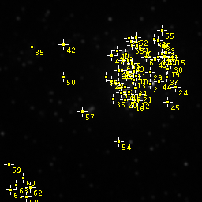

    Image with the marked ROI points

.. _fig_findfoci_helper_overlay:
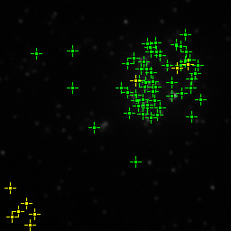

    Image with the point overlay. Mapped points are green; unmapped points are yellow.

The ``Show Overlay`` button is a toggle button. It will return to the off state under the following conditions:

.. list-table::
   :widths: 25 75
   :header-rows: 1

   * - Condition
     - Result

   * - ``Show Overlay`` clicked
     - Removes the overlay and restores the ROI points.

   * - Image clicked
     - Removes the overlay and:

       * If using the multi-point ROI tool then the new point will be added to the ROI points
       * If a different ROI tool is used, for example the Rectangle tool, then the ROI points will be lost
       * If any other tool is used, for example to move or zoom the image, then the previous ROI is restored

   * - ``Stop`` clicked
     - Removes the overlay and restores the ROI points.

Saving Results
^^^^^^^^^^^^^^

The current point coordinates can be saved to a results table by clicking the ``Save Results`` button. The table contains the following information:

.. list-table::
   :widths: 20 80
   :header-rows: 1

   * - Field
     - Description

   * - ID
     - The point identifier. This matches the ``ImageJ`` point ROI label.

   * - X
     - The point X coordinate.

   * - Y
     - The point Y coordinate.

   * - Z
     - The point Z coordinate. This is 0-based to match the z-slice position reported by ``ImageJ`` in the status bar.

   * - X (unit), Y (unit), Z (unit)
     - The point coordinates in the calibrated units of the image.

   * - Height
     - The image intensity at the point.

   * - Assigned
     - True if the point is located on a ``FindFoci`` maxima. False entries indicate points that could not be aligned.

Stopping Point Alignment
^^^^^^^^^^^^^^^^^^^^^^^^

Clicking the ``Stop`` button will halt the ``FindFoci Helper``. It will no longer intercept any mouse interactions with the image. All the working data used by the plugin is discarded and consequently the ``Save Results`` option will be disabled.

Note that clicking the ``Start`` button will reinitialise the ``FindFoci Helper`` and as part of the initialisation will perform alignment of the existing points to maxima. This can potentially move any points that have been dragged with the ``Assign Dragged`` option disabled, i.e. points that were previously unmapped.

.. _findfoci_helper_alignment_log:

Alignment Log
~~~~~~~~~~~~~

If the ``Log Messages`` option is enabled then the alignment result of each point will be recorded to the ``ImageJ`` log.

Each entry is preceded by the point ID. The numbering matches the IDs assigned by ``ImageJ`` on the image. Following the ID is the keyword ``Mapped`` or ``Unmapped``, depending on the alignment status, and then the XYZ coordinates of the point that was clicked. If a mapped point was moved to align to the true peak then the new coordinates will be shown along with the distance moved in pixels (including scaled pixels for 3D stacks). Examples are shown below::

    45: Mapped (166,80,1) => (167,80,1) (1.0px)
    46: Mapped (201,51,1)
    46: Unmapped (196,75,1)

Java Requirements
~~~~~~~~~~~~~~~~~

The ``FindFoci Helper`` uses the BeansBinding Java framework. This is included when the plugins are installed using the ``ImageJ2``/``Fiji`` update site; for a manual installation the ``beansbinding`` jar is required (see :ref:`installation:Installation`).

.. index:: ! FindFoci Settings

FindFoci Settings
-----------------

Configure settings for the ``FindFoci`` algorithm, e.g. the limit on the number of potential maxima for the ``FindFoci`` algorithm.

The current settings are displayed in the dialog. If the ``OK`` button is clicked then the settings are immediately updated for use in all the plugins that use the ``FindFoci`` algorithm.

The settings are saved to the ``ImageJ`` preferences when ``ImageJ`` exits so that they will be applied for all future ``ImageJ`` sessions.

The following settings are available:

.. list-table::
   :widths: 20 80
   :header-rows: 1

   * - Setting
     - Description

   * - Capacity
     - This sets the limit on the number of potential maxima for the ``FindFoci`` algorithm. When the algorithm runs each pixel that is higher than all the surrounding pixels is labelled as a potential maxima. If the number of potential maxima exceeds the capacity then the algorithm will not run. This prompts the user to adjust the ``FindFoci`` parameters to be more suitable, for example by smoothing the image using a Gaussian blur.

       The legacy capacity for the algorithm was that set by a signed 16-bit number, 32767. This is the default limit to retain backwards compatibility. This limit may be too low when analysing large images. The algorithm now uses 32-bit integers to support up to 2147483647 candidate maxima.

   * - Empty Field
     - When processing multiple files using the :ref:`findfoci_plugins:FindFoci Batch` plugin, each input image has a record written to the batch results file containing all the results (``all.xls``). This is true even if no foci were found. This allows the results file to be processed for all images, even those with no results.

       In the event of no foci, the record written to the results file will contain the image ID, the image title and then an empty record. All the fields in the empty record will contain the contents of the ``Empty Field`` setting. By default this is empty but you may require a value within the results file, for example zero (0).

.. index:: ! FindFoci Match Calculator

FindFoci Match Calculator
-------------------------

Allows two sets of ``FindFoci`` results to be compared. The ``FindFoci`` analysis must have been saved to memory using the ``Save to memory`` option.

Two results sets are required. The plugin will present a dialog allowing the results to be selected. Analysis is performed as per the :ref:`findfoci_plugins:Match Calculator` plugin with the following differences:

* The ``Unit`` parameter sets the distance between matching points in ``Pixel`` or ``Calibrated`` units. Calibrated units require both results to have a calibration with the same unit in each dimension. The ``Distance`` is an absolute distance in the chosen units.
* Height analysis, the overlay, and the match table heights require the images used to create the results to be open. If the images are closed then a message is written to the ``ImageJ`` log; the match table is still produced but without heights.
* The ``FindFoci image`` and ``FindFoci result`` extra parameters are not available.

.. index:: ! FindFoci Macro Extensions

FindFoci Macro Extensions
-------------------------

Registers functions that can be used in the ``ImageJ`` macro language.

To register the functions in an ``ImageJ`` macro script use the following command:

.. code::

    run("FindFoci Macro Extensions");

The functions can be accessed using the ``Ext`` prefix for macro extensions.

getNumberOfPeaks
~~~~~~~~~~~~~~~~

Get the number of peaks from the last call to ``FindFoci``.

.. list-table::
   :widths: 20 10 60
   :header-rows: 1

   * - Parameter
     - Type
     - Description

   * - numberOfPeaks
     - Output
     - The number of peaks.

.. code::

    Ext.getNumberOfPeaks(numberOfPeaks);
    print(numberOfPeaks);

.. index:: ! Match Calculator

Match Calculator
----------------

Computes the match statistics between two images marked with point ROIs. This uses the same match scores as the ``FindFoci Optimiser``: Number of matches; True positives; False positives; False negatives;
`Jaccard <https://en.wikipedia.org/wiki/Jaccard_index>`_;
`Precision; Recall <https://en.wikipedia.org/wiki/Precision_and_recall#Definition>`_;
`F-score <https://en.wikipedia.org/wiki/F-score>`_. It can be used to compare the peak identification performed by two methods, including manual assignment.

.. index:: Match Calculator Features

Features
~~~~~~~~

* Processes any images with point ROI
* Compares the ROI points and assigns matches using a nearest-neighbour method within a configurable distance threshold
* Generates a results table of match statistics
* Optional overlay of the match results onto the image
* Allows selection of channel and frame for multi-dimensional images when extracting heights
* Optional match statistics for each quartile of the data points when ranked by height
* Optional scatter plot of the height of matched and unmatched points
* Optional height analysis of the unmatched points

Overview
~~~~~~~~

The ``Match Calculator`` plugin compares the ROI points on two images and computes the number of points that match. The matches can be used to generate match statistics (see :numref:`{number}: {name} <binary_scoring_statistics>`).

The plugin was developed to provide comparisons between the manual peak identification performed by different experimenters on the same image. The plugin can rapidly show differences between the peak labelling techniques used by two people.

Match Algorithm
^^^^^^^^^^^^^^^

Matches are calculated using a nearest-neighbour algorithm:

#. The coordinates of the ROI points from each image are used to build two sets, A and B
#. An all-vs-all distance matrix is computed for the two sets of points, i.e. the distance for any point in set A to any point in set B
#. The closest pair of points is identified
#. If the closest pair is below a distance threshold they are marked as a pair and removed from the sets. Step 3 is repeated
#. If the closest pair is above the distance threshold the search ends

The distance threshold can be set using an absolute number of pixels or can be set relative to the image size, e.g. 5% of the shortest edge. Distances are computed in 3D if the points do not all have the same z coordinate, otherwise in 2D. 3D distances will use scaling of the z dimension (relative to the XY dimensions) if the input images use the same calibration, otherwise no scaling is performed.

Height Analysis
^^^^^^^^^^^^^^^

The plugin can produce an analysis of the points using their heights (image intensity values). To eliminate the requirement for an exact z position, or if the ROI do not have a z coordinate, z-stacks are supported using a maximum intensity projection for height analysis. This requires selection of the channel/frame that is used for the heights for multi-dimensional images. If either image has multiple channels or frames then a dialog is shown to select the channel and frame for each image.

The heights for all the points can be used to divide the data into quartiles. All the heights from both sets are combined into a single dataset and used to set quartile boundaries. Each set of points is compared to the other using only the points that fall within each quartile boundary. This analysis will show if the higher points (greater intensity) have an increased number of matches. Due to subdivision of the data the analysis is less relevant when the number of points is small (e.g. less than 50).

In addition the heights for the paired points can be used to divide the data. In this case the height is taken as the average height of the pair. The height distribution is used to set quartile boundaries. The unmatched points in a set can be counted for each of the height classifications defined using the boundary limits. This analysis shows where the unmatched points occur relative to points that have been matched.

A visual display of the heights for the matched and unmatched points uses a scatter plot of the point heights. The X-axis is the height of the point from image 1 and the Y-axis uses image 2. If the points have been matched they will have both X and Y values and are plotted using a green ``x``. Otherwise they will be plotted on the axis using a cross: yellow for unmatched points from image 1 and blue for unmatched points from image 2.

.. index:: Match Calculator Plugin Interface

Plugin Interface
~~~~~~~~~~~~~~~~

The ``Match Calculator`` plugin uses a standard ``ImageJ`` dialog. The following parameters can be configured:

.. list-table::
   :widths: 20 80
   :header-rows: 1

   * - Parameter
     - Description

   * - Input 1 & Input 2
     - The first and second input images.

       Note: The selection options show images with ROI points or no ROI (no points). At least two images are required.

   * - Distance type
     - Define the type for the distance parameter:

       * ``Relative``: A fraction of the shortest image edge. If the images are different sizes then the larger shortest edge is used. The distance is rounded up to an integer number of pixels.
       * ``Absolute``: A number of pixels.

   * - Distance
     - Specify the maximum distance allowed for a matched pair of points.

   * - Overlay
     - Show the matched and unmatched points using a coloured overlay on image 2 (see :numref:`{number}: {name} <match_calculator_overlay>`).

   * - Quartiles
     - Compute the match statistics for the points divided into 4 sets using their heights to define quartiles.

   * - Scatter plot
     - Output a scatter plot of the heights of image 1 versus image 2; matched points are plotted as height pairs.

   * - Unmatched distribution
     - Output a result table of the counts of unmatched points within the limits defined by the quartile boundaries of the matched points.

   * - Match table
     - Show a table with the coordinates and values of the points, paired into matches and then the unmatched points from one image and then the other.

   * - Save matches
     - Save the matches to a tab delimited file. A file selection dialog will be shown to allow the filename to be chosen.

       The file contains a header with the match statistics, then the X, Y pixel coordinates and value (height) of the points from each image. Matched points are listed first; for unmatched points the coordinates and value for the other image are zero.

Extra Parameters
^^^^^^^^^^^^^^^^

If the ``FindFoci`` plugin has been run on an image the results are stored in memory. The ``Match Calculator`` can add values from these results to the match table if they correspond to one of the input images. The plugin dialog presents extra parameters that allow the user to specify which image (if any) is marked with the current ``FindFoci`` results. If the selected image has the same number of ROI points as the ``FindFoci`` results then the value from the ``FindFoci`` results can be added to the match table.

.. list-table::
   :widths: 20 80
   :header-rows: 1

   * - Parameter
     - Description

   * - FindFoci image
     - The image marked with the ``FindFoci`` results: ``[None]``; ``Image1``; or ``Image2``.

   * - FindFoci result
     - The value from the ``FindFoci`` results to add to the match table: ``Intensity``; ``Intensity above saddle``; ``Intensity above background``; ``Count``; ``Count above saddle``; ``Max value``; or ``Highest saddle value``.

For example if the second image contains the ROI points identified by the ``FindFoci`` plugin the output match table will contain an extra column showing the chosen value from the ``FindFoci`` results for each point from image 2. Addition of the data from the ``FindFoci`` results allows a comparison of a manually marked image to the points identified by the algorithm with data that may explain why points have been matched (e.g. the intensity above background or pixel count is higher in matched points).

Note that if the selected image for the ``FindFoci image`` parameter is ``[None]`` or the image has the wrong number of marked ROI points then no extra data will be output (since it is impossible to assign the points to the ``FindFoci`` results).

Results Table
~~~~~~~~~~~~~

The results table contains details about the match statistics. The table contains the following information:

.. list-table::
   :widths: 20 80
   :header-rows: 1

   * - Field
     - Description

   * - Image 1
     - The first input image. If a channel and frame were selected for height analysis then these are appended to the title, e.g. ``c1 t1``.

   * - Image 2
     - The second input image.

   * - Distance
     - The distance limit for matched pairs. When using a relative distance type this is the computed distance in pixels.

   * - Unit
     - The unit of the distance. This is ``px`` unless the :ref:`findfoci_plugins:FindFoci Match Calculator` is used with calibrated units.

   * - N 1
     - The number of points in the first image.

   * - N 2
     - The number of points in the second image.

   * - Match
     - The number of points that match.

   * - Unmatch 1
     - The number of points in image 1 that do not match image 2.

   * - Unmatch 2
     - The number of points in image 2 that do not match image 1.

   * - Jaccard
     - The Jaccard score.

   * - Recall 1
     - The proportion of points in image 1 that appear in image 2.

   * - Recall 2
     - The proportion of points in image 2 that appear in image 1.

   * - F1
     - The F1-score, a balanced weighting of Recall 1 and Recall 2.

If the ``Quartiles`` parameter is selected then an additional set of columns will be appended for each quartile Q1 through to Q4. There will be a column for N1, N2, Matches (M), Unmatched 1 (U1), Unmatched 2 (U2), Jaccard, Recall1, Recall2 and F1 for each quartile, e.g. ``Q1 N1``.

Unmatched Results Table
~~~~~~~~~~~~~~~~~~~~~~~

If the ``Unmatched distribution`` parameter is selected then a result table will be generated containing the height distribution of the unmatched points from each image relative to the matched points. The following fields are shown for image 1 and then image 2:

.. list-table::
   :widths: 20 80
   :header-rows: 1

   * - Field
     - Description

   * - Image 1/2
     - The first/second input image title.

   * - N
     - The number of unmatched points.

   * - % <Q1
     - The percentage of points below the height of the lowest matched point.

   * - % Q1
     - The percentage of points within the first quartile of matched points.

   * - % Q2
     - The percentage of points within the second quartile of matched points.

   * - % Q3
     - The percentage of points within the third quartile of matched points.

   * - % Q4
     - The percentage of points within the fourth quartile of matched points.

   * - % >Q4
     - The percentage of points above the height of the highest matched point.

Match Table
~~~~~~~~~~~

If the ``Match table`` parameter is selected then a result table will be generated containing the matched and unmatched points. The following fields are shown for image 1 and then image 2; the fields are ``-`` for an unmatched point:

.. list-table::
   :widths: 20 80
   :header-rows: 1

   * - Field
     - Description

   * - Image 1/2
     - The first/second input image title.

   * - ID
     - The ROI point ID.

   * - X
     - The X pixel coordinate.

   * - Y
     - The Y pixel coordinate.

   * - Slice
     - The z slice.

The table then has the following fields:

.. list-table::
   :widths: 20 80
   :header-rows: 1

   * - Field
     - Description

   * - Distance
     - The distance between the matched points.

   * - Image N: [Result]
     - If the ``FindFoci`` results stored in memory have been assigned to one of the images an extra column will be added containing the selected value from the ``FindFoci`` results, e.g. ``Image 2: Intensity``.

.. _match_calculator_overlay:

Overlay
~~~~~~~

The results of the match can be shown as an overlay on the original image 2 using the ``Overlay`` parameter. The following key is used for the overlay:

.. list-table::
   :widths: 30 35 35
   :header-rows: 1

   * - Classification
     - Colour
     - Colour safe

   * - Matched
     - Yellow
     - Green

   * - Unmatched image 1
     - Red
     - Yellow

   * - Unmatched image 2
     - Green
     - Blue

The ``Colour safe`` colours have been chosen so that the different points should be visible to those with colour vision deficiency. :numref:`Figure %s <fig_match_calculator_overlay>` shows an example of a ``Colour safe`` overlay applied to the image.

.. _fig_match_calculator_overlay:
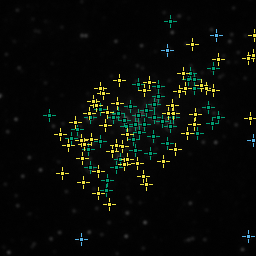

    Match Calculator overlay using the colour safe colours

The overlay can be removed using ``Image > Overlay > Remove Overlay``.

Note that the point ROI has been removed from the image. This can be restored using the ``ImageJ`` menu option ``Edit > Selection > Restore Selection`` (``Ctrl+Shift+E``). The point ROI are not removed if the ``Overlay`` option is ``None``.

.. index:: ! File Match Calculator

File Match Calculator
---------------------

Compares the coordinates in two files and computes the match statistics.

Can read ``FindFoci`` results files; QuickPALM xls files; STORMJ xls files; and a generic CSV file.

The generic CSV file has records using one of the following formats::

    ID,T,X,Y,Z,Value
    ID,T,X,Y
    X,Y,Z

The generic file can also be tab delimited.

.. index:: ! Point Aligner

Point Aligner
-------------

``ImageJ`` plugin that aligns the marked multi-point Regions of Interest (ROIs) of an image with the peaks found by the ``FindFoci`` algorithm. Foci are aligned using an uphill gradient to the parent maxima.

:numref:`Figure %s <fig_point_aligner_input>` shows an example input image containing a multi-point ROI. :numref:`Figure %s <fig_point_aligner_output>` shows the output overlay (see :numref:`{number}: {name} <point_aligner_overlay>`).

.. _fig_point_aligner_input:
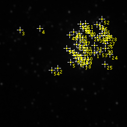

    Point Aligner input image containing a multi-point ROI

.. _fig_point_aligner_output:
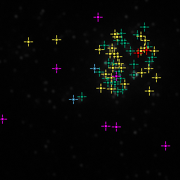

    Point Aligner output overlay showing aligned points in green, aligned but moved points in yellow, conflict points in red, unaligned points in blue and missed points in magenta

.. index:: Point Aligner Features

Features
~~~~~~~~

* Processes any image with point ROI
* Computes the image peaks using the ``FindFoci`` algorithm
* Assigns the marked points to the true peaks
* Generates a results table of alignment statistics
* Identifies any peaks that have been missed by the marked points
* Optional overlay of the alignment results onto the image
* Optional output of marked points that cannot be aligned (conflict regions) as images

Overview
~~~~~~~~

The ``Point Aligner`` plugin aligns the ROI points on an image to the peaks found using the ``FindFoci`` algorithm. Comparison of the original points and the aligned points can be used to generate match statistics (see :numref:`{number}: {name} <binary_scoring_statistics>`).

The plugin was developed to re-align the manual peak identification performed by an experimenter to the correct peak maxima location.

The plugin processes the current channel and time frame of the image. For a 3D image all the ROI points must have a z coordinate.

Alignment Algorithm
^^^^^^^^^^^^^^^^^^^

Alignments are calculated using the following algorithm:

#. The image ROI points are extracted into an XYZ coordinate set.
#. The height of each point is the image value at the XYZ position.
#. A background level is set using the lowest point height in a maximum intensity projection of the image, minus the standard deviation of the maximum intensity projection.
#. The ``FindFoci`` algorithm is used to find maxima above the background level. No merging is performed thus the output peak map contains all potential maxima. Noisy images will benefit from use of a smoothing filter on the input image to eliminate noise and reduce the number of potential maxima.

   The maximum number of maxima may be reached for large images. This can be changed using the :ref:`findfoci_plugins:FindFoci Settings` plugin, or avoided by using a mask to target regions of the input image.
#. Points are processed in height order, highest first. Each point is aligned using the peak map (the pixels allocated to each maxima) effectively aligning the point by only proceeding up an intensity gradient to a peak. The maxima is then excluded from future alignments.
#. If the point aligns to a previously assigned maxima a search is conducted within the distance to the excluded maxima for an alternative. The highest maxima within the radius is selected.
#. Following alignment the heights of all the assigned maxima are analysed. The heights are used to set a limit for the minimum peak height that can be used for an alignment. Any point that aligns to a peak below the minimum peak height is reset to unaligned.

Minimum Peak Height Limit
^^^^^^^^^^^^^^^^^^^^^^^^^

The minimum peak height is used to avoid points aligning to insignificant peaks. Note that the ``FindFoci`` algorithm will identify any pixel higher than its neighbours and extend the peak using a downhill gradient. This can produce false peaks at a low intensity that are not above the image background. These are available to the alignment algorithm and so should be filtered at the end of the process.

The height limit is set using the distribution of the assigned peak heights. The purpose is to identify any outlier low peaks that do not fit the distribution, similar to plotting outlier points on a box plot. The following methods are available, each method requires an input parameter f:

.. list-table::
   :widths: 20 80
   :header-rows: 1

   * - Method
     - Description

   * - None
     - No height limit.

   * - Q1 - f * IQR
     - The limit is set using a factor of the interquartile range (IQR = Q3 - Q1) subtracted from the lower quartile (Q1). A typical factor is 1.5.

   * - Mean - f * SD
     - The limit is set using a factor of the standard deviation subtracted from the mean. A factor of 3 will cover 99% of all the data assuming a standard normal distribution.

   * - nth Percentile
     - The limit is set using the f-th percentile of the heights. Using zero will not exclude any peaks. 100 will exclude all peaks.

       Note: This method is poor since it will not target outliers but penalises any low points.

   * - % Missed < f
     - The number of unassigned (missed) and assigned peaks above the lowest assigned peak are counted. The percentage missed peaks is calculated:

       .. math::

           \text{Percentage missed} = 100 \times \frac{\mathit{missed}}{\mathit{missed} + \mathit{assigned}}

       If the percentage missed is not below the specified factor then the lowest assigned peak is removed and the process repeated. Finally the limit is set using the lowest assigned peak height.

       Note: This method assumes that the purpose of the initial ROI point marking was to label the highest intensity values. If there are a large number of missed peaks above the highest assigned peak the method will fail. This can be the case if points were only labelled in a certain region of the image. This can be overcome using a mask image parameter.

Alignment Results
^^^^^^^^^^^^^^^^^

Each point in the original image is given an alignment result. In addition it is possible to analyse maxima found by the ``FindFoci`` algorithm. The following alignment results are provided:

.. list-table::
   :widths: 20 80
   :header-rows: 1

   * - Result
     - Description

   * - OK
     - The point aligns with a maxima and is in the correct location.

   * - Moved
     - The point aligns with a maxima but must be moved.

   * - Conflict
     - The point aligns with a maxima that has been assigned to a higher point, i.e. it conflicts with another aligned point.

   * - NoAlign
     - The point does not align with a maxima, or aligns with a maxima below the height limit.

   * - Missed
     - The unassigned maxima is higher than the lowest maxima that has been assigned, i.e. it was missed in the original input points.

.. index:: Point Aligner Plugin Interface

Plugin Interface
~~~~~~~~~~~~~~~~

The ``Point Aligner`` interface uses a standard ``ImageJ`` dialog.

The following parameters can be configured:

.. list-table::
   :widths: 20 80
   :header-rows: 1

   * - Parameter
     - Description

   * - Title
     - A text title to be inserted into the results table. For example this can be used within automated scripts to identify the experimenter who scored the image.

   * - Mask
     - Allows selection of an image mask. Only images with compatible dimensions are listed. The mask can be used to restrict the region of peaks provided by the ``FindFoci`` algorithm; any peak located in a zero-value pixel will be excluded.

   * - Limit method
     - The method used to set the minimum height for assigned peaks.

   * - Factor
     - The factor parameter used by the ``Limit method``.

   * - Log alignments
     - Output the alignments to the ``ImageJ`` log window (see :numref:`{number}: {name} <point_aligner_alignment_log>`).

   * - Update ROI
     - If selected the point ROI on the image will be moved to the position of their assigned peaks. Unassigned points are removed.

   * - Show moved
     - Show the aligned points that have been moved separately in the results table and overlay. The default is to show the OK and Moved points together.

   * - Show overlay
     - Produce a coloured overlay on the image showing the points that were OK, moved, conflicting, missed or unaligned.

   * - Update overlay
     - If selected the overlay will show the moved points relocated to the correct positions. The default is to use the original location.

   * - Show unaligned
     - Extract an image containing each unaligned point (see :numref:`{number}: {name} <point_aligner_unaligned_images>`).

   * - Unaligned border
     - The number of border pixels to use for an unaligned point image. If zero then no unaligned point images are created.

   * - Results directory
     - If provided the unaligned images will be saved to this directory. The directory will be created if it does not exist. Clicking the ``...`` button will open a directory selection dialog.

       Note: The ``Show unaligned`` option does not have to be enabled.

Results Table
~~~~~~~~~~~~~

The results table contains details about the alignment results. The success of the alignment is assessed using binary scoring statistics (see :numref:`{number}: {name} <binary_scoring_statistics>`). The original ROI points are compared against the potential maxima found by the ``FindFoci`` algorithm. Only maxima above the lowest assigned maxima are included.

The table contains the following information:

.. list-table::
   :widths: 20 80
   :header-rows: 1

   * - Field
     - Description

   * - Title
     - The ``Title`` parameter.

   * - Image
     - The input image.

   * - Method
     - The method used to set the minimum height for assigned peaks.

   * - Factor
     - The factor parameter used by the ``Limit method``.

   * - Min Height
     - The minimum height of the input ROI points.

   * - Threshold
     - The height threshold computed using the heights of the assigned ``FindFoci`` results.

   * - Min Assigned Height
     - The minimum height of the assigned ``FindFoci`` results.

   * - OK
     - The number of points that were aligned without a move.

   * - Moved
     - The number of points that were aligned with a move. This is always zero if ``Show moved`` is not enabled.

   * - Av.Move
     - The average distance that an aligned point is moved in pixels. If ``Show moved`` is disabled the average includes the points that are not moved and will be lower.

   * - Conflict
     - The number of points that conflict with another aligned point.

   * - NoAlign
     - The number of points that cannot be aligned.

   * - Missed
     - The number of maxima that are above the lowest assigned maxima.

   * - N
     - The number of ROI points in the image.

   * - TP
     - The True Positives, i.e. OK + Moved.

   * - FP
     - The False Positives, i.e. Conflict + NoAlign.

   * - FN
     - The False Negatives, i.e. Missed.

   * - Precision
     - The proportion of points in the image that are aligned.

   * - Recall
     - The proportion of identified peaks in the image that have been assigned.

   * - Jaccard
     - The Jaccard score.

   * - F1-score
     - The F1-score, a balanced weighting of Precision and Recall. This provides an overall measure of the alignment success.

.. _point_aligner_alignment_log:

Alignment Log
~~~~~~~~~~~~~

If the ``Log alignments`` option is enabled then the alignment result of each point will be recorded to the ``ImageJ`` log. The log also records the background level used for the ``FindFoci`` algorithm, the calculation of the height limit, the minimum picked value, the threshold, and the minimum assigned peak height. The following text shows examples of each situation.

**OK / Moved**

If the peak can be aligned then the new coordinates and the pixel distance for the move are provided. The records are of the format::

    Point [ID] <height> @ X,Y[,Z] => <height> @ Xnew,Ynew[,Znew] (distance)

E.g.::

    Point [49] 793 @ 140,70 => 831 @ 141,70 (1.00)
    Point [50] 784 @ 173,57 => 784 @ 173,57 (0.00)

**Conflict**

If the peak is in conflict then the ID of the other peak is provided. The coordinates of both peaks should be in close proximity. E.g.::

    Point [24] 1350 @ 205,67 => 1367 @ 205,68 (1.00)
    Point [52] 717 @ 208,71 conflicts for assigned point [24]

**NoAlign**

If the peak is below the height threshold or cannot be aligned this is recorded. E.g.::

    Point [55] 479 @ 104,141 ~> 479 @ 104,141 (0.00) below height threshold (< 666)
    Point [56] 186 @ 11,208 cannot be aligned

.. _point_aligner_unaligned_images:

Unaligned Images
~~~~~~~~~~~~~~~~

If a point cannot be aligned then the pixels surrounding the point can be extracted into a sub-image. A point can be unaligned for 3 reasons:

* There is no suitable maxima [noalign]. Note: This may be because the point is below the background level for ``FindFoci``
* It is below the height limit threshold [below_threshold]
* It conflicts with another aligned point [conflict]

The sub-image is named using the input image name, the classification and the point ID::

    <Input image>_<classification>_<ID>

The sub-image contains the unaligned point plus a border of extra pixels set by the ``Unaligned border`` parameter. If the image shows a conflict point or a below_threshold point then the potential maxima is included in the image. An overlay is added to mark the unaligned point (red for a conflict point, otherwise blue) and the potential maxima (green, if available). The images can be displayed using the ``Show unaligned`` option and/or saved to the ``Results directory``.

:numref:`Figure %s <fig_point_aligner_conflict>` shows an example of a conflict point sub-image.

.. _fig_point_aligner_conflict:
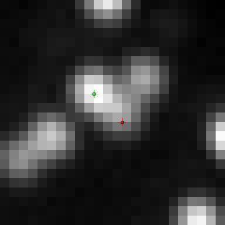

    Point Aligner unaligned point sub-image for a conflict point with the potential maxima

Note that in this case the conflict point has been manually placed where there appears to be intensity from a second spot. However the ``FindFoci`` algorithm does not identify this as a point since it uses a downhill gradient to define peaks from local maxima. This example demonstrates how the conflict images can be used to review where the ``FindFoci`` algorithm differs from a manual peak assignment. Knowledge of the ``FindFoci`` behaviour will allow better use of the semi-automated peak labelling tool provided by the :ref:`findfoci_plugins:FindFoci Helper` plugin.

.. _point_aligner_overlay:

Overlay
~~~~~~~

The results of the alignment can be shown as an overlay on the original image using the ``Show overlay`` parameter. The key for the overlay is written to the ``ImageJ`` log. The following key is used for the overlay:

.. list-table::
   :widths: 30 70
   :header-rows: 1

   * - Classification
     - Colour

   * - OK
     - Green

   * - Moved
     - Yellow

   * - Conflict
     - Red

   * - NoAlign
     - Blue

   * - Missed
     - Magenta

:numref:`Figure %s <fig_point_aligner_overlay>` shows an example of an overlay applied to the image.

.. _fig_point_aligner_overlay:
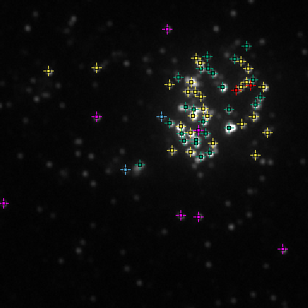

    Point Aligner overlay

The overlay can be removed using ``Image > Overlay > Remove Overlay``.

The point ROI is not removed from the image. To aid the display of the overlay it can be removed using ``Edit > Selection > Select None`` (``Ctrl+Shift+A``). The point ROI can be restored using the ``ImageJ`` menu option ``Edit > Selection > Restore Selection`` (``Ctrl+Shift+E``).

.. index:: ! Point Extractor

Point Extractor
---------------

``ImageJ`` plugin that saves the XYZ coordinates from marked multi-point Regions of Interest (ROIs) in an image or the ``ImageJ`` ROI Manager to file.

.. index:: Point Extractor Features

Features
~~~~~~~~

* Save points from a point ROI on an image
* Save points from the ROI Manager
* Supports 2D/3D coordinates
* Optionally extract a pixel value for the coordinates from the current image
* Optionally filters the points to those within a 2D/3D mask

Overview
~~~~~~~~

The ``Point Extractor`` plugin saves the coordinates from point ROIs to a coordinate file. The point ROI may be marked on an image. Z coordinates are supported if the points are marked on a specific slice. Alternatively the point ROI may be read from the ``ImageJ`` ROI Manager. Each ROI in the manager can be associated with a slice or hyperstack position. The plugin can attempt to extract Z coordinates from all the point ROI in the ROI Manager using the current image to decode the stack position to a z coordinate. The coordinate file can be used as input to train the :ref:`findfoci_plugins:FindFoci Optimiser` (see :numref:`{number}: {name} <findfoci_optimiser_reference_foci>`).

The ``Point Extractor`` has options to save the pixel value of each coordinate from the current image to the output file. It can also restrict the coordinates to a specific subset using a mask.

When the plugin is run it counts the number of point ROI in the ``ImageJ`` ROI Manager. If no point ROI are present then an image must be open. If the image does not contain a point ROI the dialog shows a warning and an empty file will be produced; this supports use in macros.

.. index:: Point Extractor Plugin Interface

Plugin Interface
~~~~~~~~~~~~~~~~

If the ROI Manager has point ROI then the dialog shows the number of ROIs and points in the manager and has extra options.

The following parameters can be configured:

.. list-table::
   :widths: 20 80
   :header-rows: 1

   * - Parameter
     - Description

   * - Mask
     - Allows selection of an image mask. The mask can be used to restrict the coordinates. Any point located in a zero-value pixel will be excluded. Any open image can be used as the mask.

   * - Filename
     - The name of the file used to save the coordinates. Clicking the ``...`` button will open a file selection dialog.

   * - xyz only
     - This option is only available if there is a current image.

       If selected only the XYZ coordinates are saved to file using records of ``X,Y,Z``. If not selected then the value of the XYZ coordinate in the current image is obtained and the output file will contain records of ``ID,T,X,Y,Z,Value``. ID will be ascending from 1. T will be the current frame. If the current image has multiple channels or frames then the current channel and frame will be used.

       The file has a header line with the field names.

   * - Use manager ROIs
     - This option is available if there are point ROIs in the ``ImageJ`` ROI Manager.

       Select this option to obtain the XYZ coordinates from all the point ROIs in the ROI Manager. Otherwise the point ROI on the current image is used. If there is no current image then the ROI Manager is always used.

   * - Use current image for z
     - Use the current image to decode stack position information from the ROIs in the ROI Manager.

   * - Reset manager
     - This option is available if there are point ROIs in the ``ImageJ`` ROI Manager.

       Select this option to remove all the ROIs from the ROI Manager after the points have been extracted from the manager. This can be used as part of a workflow to label an image, save the ROIs then reset the manager.

The points are saved in ascending order of Z, X and then Y. When using the ROI Manager any duplicate XYZ positions are removed.

Creating a 3D Coordinate File
~~~~~~~~~~~~~~~~~~~~~~~~~~~~~

``ImageJ`` point ROIs store the XY coordinates and each point can be associated with a stack index. This is performed by adding the points manually in ``ImageJ`` using the point ROI tool. This allows the ``Point Extractor`` plugin to extract XYZ coordinates directly from an image ROI.

To make it easier to see which points have been selected when scrolling through a z-stack use the point tool options to show the points on all slices. Double-clicking the point ROI button on the toolbar will open the ``Point Tool`` options. Use ``Show on all slices`` to display the points on every slice in the stack. This option will update the ROI immediately allowing the setting to be toggled when marking the ROI.

For images with few foci it is often possible to label all the desired foci in a single ROI. Large images with many foci may require processing parts of the image in stages. Each stage can be saved to the ROI Manager. Each ROI saved to the manager can be reapplied to the image to check the points. All points can be extracted together when labelling is complete. Note that the ``Point Extractor`` plugin will remove duplicate XYZ positions from the ROI Manager when creating the output file thus any labelling duplications will be avoided.

The following is a suggested workflow for creating 3D coordinate files via the ROI Manager:

#. Remove all ROIs from the current image: ``Edit > Selection > Select None`` (``Ctrl+Shift+A``).
#. Clear the ROI Manager: ``Analyze > Tools > ROI Manager...``. Select all the ROIs (if present) and click ``Delete``.
#. Select the ``ImageJ`` point ROI tool. Switch to single-point or multi-point mode by right-clicking the tool and selecting ``Point Tool`` or ``Multi-point Tool``.
#. Scroll up and down through the image z-stack until you have decided the correct z-slice for a point. Click the point to label it.
#. Add the point to the ROI Manager: ``Edit > Selection > Add to Manager`` (``Ctrl+T``). When using the multi-point tool the current ROI should be cleared after saving (``Ctrl+Shift+A``).
#. Continue labelling XY points (steps 4-5). Note if in single point mode you can create a multi-point ROI by holding the ``Shift`` key. This will be replaced by a single point if you let go of the ``Shift`` key for the next click.
#. When all foci have been labelled and added to the ROI Manager you can review them by clicking on each named ROI in the ROI Manager window. This will show the point ROI on the corresponding image slice.
#. If all foci are correct run the ``Point Extractor`` plugin to save the foci to file. The ROI Manager can be cleared in preparation for the next image to be labelled using the ``Reset manager`` option.

.. index:: ! Spot Distance

Spot Distance
-------------

Detects spots within a mask/ROI region. The mask can define multiple regions using a different pixel value for each. Outputs a table of spot positions and a summary table of the number of spots with min/max/average distances.

Spots are detected using the maxima within a difference of Gaussians image. The ``Smoothing`` parameter controls the removal of image noise. The ``Feature Size`` parameter controls the expected size of the spots; contrast changes (edges) much larger than the ``Feature Size`` will be removed from the image. (Set the ``Feature Size`` to zero to disable the difference of Gaussians; spots will be detected using peaks on the smoothed image.) Optionally spots can be removed if they fail a circularity threshold.

Provides options to process the current frame or all frames in the stack. The last identified spots can be shown on the image as an overlay. When the region is defined using an area ROI, each separate region is labelled using the region counter. The counter is incremented for each region and retained between runs of the plugin allowing regions to be separated in the results.

For multi-channel images the ``Dual channel`` option detects spots in two selected channels and the summary reports the distances between spots in the first channel and spots in the second channel. When processing multiple frames the ``Track objects`` option assigns spot IDs using closest-distance matching to the spots in the previous frame, allowing the same spot to be followed through time.

.. index:: ! Spot Pairs

Spot Pairs
----------

``ImageJ`` plugin that analyses marked ROI points in an image. Find the closest pairs within a set distance of each other. Supports a preview of the pairs and saves results to a table.

.. index:: ! Mask Divider

Mask Divider
------------

Overlay a mask on an image and divide into two classes. For each object in the mask (contiguous pixels with the same value; optionally 8-connected), obtain the mean pixel value of the object and then divide the objects into two classes, either by auto-thresholding or interactively.

.. index:: ! Double Mask Divider

Double Mask Divider
-------------------

Compares two masks created using the ``Mask Divider`` with pixels of AB and A'B' and creates a new mask with pixels of AA' AB' BA' BB'.

.. index:: ! Mask Analyze Particles

Mask Analyze Particles...
-------------------------

Extend the ``ImageJ`` ``Particle Analyser`` to allow the particles to be obtained using contiguous pixels with a unique value. If blank pixels exist between two pixels with the same value then they will be treated as separate objects.

This plugin is useful on masks where each object region has a unique value, for example the output mask created by ``FindFoci``.

.. index:: ! Mask Analyze Channels

Mask Analyze Channels...
-------------------------

For each object in the mask (contiguous pixels with the same value), analyse the pixels values for each channel of a target image. Estimate the background of each channel using the lowest intensity non-object pixels within the convex hull of the objects.

.. index:: ! Spot Density

Spot Density
------------

Calculate the density of spots from a second ``FindFoci`` results set around the spots from a first results set (the sets can be the same); both are loaded from memory. Only spots within a mask region are processed. Any foci within the maximum analysis distance from the edge are excluded from analysis. Analysis is performed in 2D only.

Outputs histograms of the closest distances between spots and the density of particles around the spots (i.e. the `Pair Correlation <https://en.wikipedia.org/wiki/Radial_distribution_function>`_ function).

.. index:: ! Mask Object Dimensions

Mask Object Dimensions
----------------------

Identify the inertia tensor (principle rotation axes around the centre-of-mass) for each object and computes the minimum and maximum pixel along each axis that is inside the object. Draws the axes on the image and produces a results table. Can be used to estimate dimensions of objects in 2/3D. The plugin works best on objects that are spherical.

Objects are identified using unique pixel values (can be non-contiguous), for example the output mask created by FindFoci.

Optionally objects with centres within a merge distance (in pixels) can be iteratively joined before the dimensions are computed.

.. index:: ! Assign Foci to Objects

Assign Foci to Objects
----------------------

Finds objects in an image using contiguous pixels of the same value. Locates the closest object within a search radius to each focus and summarises the counts. Foci are taken from the last ``FindFoci`` result held in memory or from point ROIs. Analysis is performed in 2D only.

The plugin can be used to align the most recent foci identified by the ``FindFoci`` algorithm to objects on a mask image, for example foci within cells.

.. index:: Assign Foci to Objects Features

Features
~~~~~~~~

* Identify objects within a mask image
* Optionally remove objects based on size
* Identify foci using the latest ``FindFoci`` results or a point ROI
* Assign foci to objects using 2D distance, even if the foci are outside the objects
* Limit assignment using a distance threshold
* Outputs summary statistics of the number of foci per object

Overview
~~~~~~~~

The ``Assign Foci to Objects`` plugin requires a set of foci and an image containing objects. The plugin is run on the object image.

The foci from the last successful run of the ``FindFoci`` plugin are always stored in memory and can be used as the foci. Alternatively a point ROI on the object image can be used to define the foci, for example if the ``Process > Find Maxima...`` command has been run. If the point ROI is on another image then it can be copied to the object image using ``Edit > Selection > Restore Selection``.

The object image can be any image. The plugin will find objects defined by contiguous pixels of the same value. So the input image can be a binary mask image or for example an output mask from ``FindFoci`` where each foci object has a different pixel value.

If no foci are available then an error is shown. Otherwise the dialog shows the number of foci available from each source.

.. index:: Assign Foci to Objects Plugin Interface

Plugin Interface
~~~~~~~~~~~~~~~~

The following parameters can be configured:

.. list-table::
   :widths: 20 80
   :header-rows: 1

   * - Parameter
     - Description

   * - Foci
     - Select the foci to use: ``Find Foci`` or ``ROI``. Options are only shown if results are available from that source.

   * - Radius
     - The maximum search radius from each focus to look for objects. Foci will be assigned to the closest object (or not assigned).

   * - Min size
     - The minimum size for objects. Any objects below this size will be ignored.

   * - Max size
     - The maximum size for objects. Any objects above this size will be ignored. Set to zero to ignore.

   * - Eight connected
     - Use 8-connected pixels (including diagonals) to define contiguous object pixels. If not selected then 4-connected pixels are used.

   * - Remove small objects
     - Remove objects below the ``Min size`` before foci are assigned. This allows foci to be assigned to a different object if their closest object is too small.

       The alternative is that foci are assigned to their closest objects, even if they do not pass the size filter. The foci are then labelled as ignored in the results. Objects above the ``Max size`` are never removed; foci assigned to them are labelled as ignored.

   * - Show objects
     - Show a mask where each identified object is a different pixel value.

   * - Show foci
     - Show an overlay on the objects mask where each focus is colour-coded:

       * Green = assigned to an object
       * Yellow = assigned to an object that failed the size filter
       * Red = not assigned to an object

   * - Show distances
     - Output a table showing the distance of each focus to the nearest object.

   * - Show histogram
     - Output a histogram of the count of foci per object.

Results
~~~~~~~

When the plugin is run it identifies all the objects using contiguous pixels of the same value. The objects are then optionally filtered using size criteria. Each focus is then assigned to the closest object, or not assigned if no objects are within the search radius. If more than one object is at the closest distance then the object with the most pixels at that distance is chosen. Foci outside the image are not assigned.

If size criteria were used to exclude objects but the objects were not removed then any foci assigned to these invalid objects will be marked as ignored.

The results are reported using tables. A table is shown containing the details of each of the objects with the following information:

.. list-table::
   :widths: 20 80
   :header-rows: 1

   * - Field
     - Description

   * - Image
     - The title of the object image.

   * - Object
     - The ID of the object.

   * - cx
     - The X centre-of-mass.

   * - cy
     - The Y centre-of-mass.

   * - Size
     - The number of pixels in the object.

   * - Valid
     - True if the object passes the size criteria.

   * - Count
     - The number of foci assigned to the object.

A summary table is shown with the following information:

.. list-table::
   :widths: 20 80
   :header-rows: 1

   * - Field
     - Description

   * - Image
     - The title of the object image.

   * - nObjects
     - The number of objects.

   * - Valid
     - The number of valid objects.

   * - nFoci
     - The number of foci.

   * - In
     - The number of foci assigned to a valid object.

   * - Ignored
     - The number of foci assigned to an invalid object.

   * - Out
     - The number of foci not assigned to an object.

   * - Min
     - The minimum number of foci in a valid object.

   * - Max
     - The maximum number of foci in a valid object.

   * - Av
     - The average number of foci in a valid object.

   * - Med
     - The median number of foci in a valid object.

   * - SD
     - The standard deviation of the number of foci in a valid object.

Optionally a table is shown with the distance of each focus to its nearest object:

.. list-table::
   :widths: 20 80
   :header-rows: 1

   * - Field
     - Description

   * - Image
     - The title of the object image.

   * - Foci
     - The focus ID.

   * - x
     - The focus x position.

   * - y
     - The focus y position.

   * - Object
     - The ID of the nearest object. Will be empty if no objects are closer than the search radius.

   * - Valid
     - True if the object passes the size criteria.

   * - Distance
     - The distance to the object.

The plugin also shows graphical results. Optionally a histogram can be shown of the foci count per valid object. The mean count is marked with a red line. When there are many objects and foci this histogram may present patterns in the number of foci per object.

If the ``Show objects`` option has been selected the plugin will show the objects, optionally with the foci labelled on the image (``Show foci`` option), e.g. :numref:`Figure %s <fig_assign_foci_objects>`.

.. _fig_assign_foci_objects:
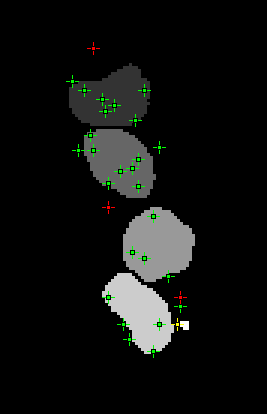

    Assign Foci objects mask with the foci overlay. Green = assigned to an object; yellow = assigned to an object that fails the size filter; red = not assigned to an object.

.. index:: ! Assign Foci to Clusters

Assign Foci to Clusters
-----------------------

Performs 2D clustering on the latest ``FindFoci`` results held in memory. Optionally can draw the clusters on the Find Foci output mask if this is selected when the plugin is run.

.. index:: Assign Foci to Clusters Features

Features
~~~~~~~~

* Perform clustering of foci
* Support display of clusters on a ``FindFoci`` mask
* Optionally remove clusters based on size
* Optionally filter clusters using a point ROI
* Supports results preview
* Outputs a table of clusters

Note that analysis is limited to two dimensions (2D).

Overview
~~~~~~~~

The ``Assign Foci to Clusters`` plugin requires the last set of foci calculated by the ``FindFoci`` plugin. These are automatically stored in memory and available for other plugins to use. If no foci are available then the plugin will show an error.

If valid foci are available then the plugin dialog is shown.

Optionally the plugin can be run with an input image that is the mask output from ``FindFoci``. The foci loaded from memory are checked against the currently active image when the plugin is run. If the results can be matched to the image pixel values at the focus coordinates then it is assumed that the image is a valid input ``FindFoci`` mask. The plugin then allows additional options for mask output. If the mask image also has a point ROI then options to filter the clusters using the points are available.

.. index:: Assign Foci to Clusters Plugin Interface

Plugin Interface
~~~~~~~~~~~~~~~~

The following parameters can be configured:

.. list-table::
   :widths: 25 75
   :header-rows: 1

   * - Parameter
     - Description

   * - Radius
     - The clustering radius.

   * - Algorithm
     - The clustering algorithm (see :numref:`{number}: {name} <assign_foci_clusters_algorithm>`).

       The fastest method is ``Pairwise`` which is useful when using the preview.

   * - Weight
     - The weight for each focus. The options are set using various output values from the ``FindFoci`` algorithm: ``None``; ``Pixel count``; ``Total intensity``; ``Max Value``; ``Average intensity``; ``Total intensity minus background``; ``Average intensity minus background``; ``Count above saddle``; or ``Intensity above saddle``.

   * - Min size
     - The minimum cluster size (number of foci).

   * - Show mask
     - Show an output mask coloured by cluster.

       Only available with a ``FindFoci`` mask image.

   * - Eliminate edge clusters
     - Remove any cluster that contains a focus with pixels within the border of the image.

       Only available with a ``FindFoci`` mask image.

   * - Border
     - Define the border size in pixels.

       Only available with a ``FindFoci`` mask image.

   * - Label clusters
     - Mark each cluster centre with the cluster ID using an ``ImageJ`` point overlay.

       Only available with a ``FindFoci`` mask image.

   * - Filter using Point ROI
     - Only keep clusters that match a point in the point ROI on the mask image. Clusters are matched to the points using their centre and the ``Filter radius``. A table of the match statistics is shown.

       Only available with a ``FindFoci`` mask image that has a point ROI.

   * - Filter radius
     - The maximum distance between a cluster centre and a point for a match.

       Only available with a ``FindFoci`` mask image that has a point ROI.

   * - Preview
     - Check this to preview results.

.. _assign_foci_clusters_algorithm:

Clustering Algorithm
~~~~~~~~~~~~~~~~~~~~

The following table lists the available clustering algorithms:

.. list-table::
   :widths: 25 75
   :header-rows: 1

   * - Algorithm
     - Description

   * - Particle single-linkage
     - Joins the closest pair of particles, one of which must not be in a cluster. Clusters are not joined and can only grow when particles are added.

   * - Centroid-linkage
     - Hierarchical centroid-linkage clustering by joining the closest pair of clusters iteratively.

   * - Particle centroid-linkage
     - Hierarchical centroid-linkage clustering by joining the closest pair of any single particle and another single or cluster. Clusters are not joined and can only grow when particles are added.

   * - Pairwise
     - Join the current set of closest pairs in a greedy algorithm. This method computes the pairwise distances and joins the closest pairs without updating the centroid of each cluster, and the distances, after every join (centroids and distances are updated after each pass over the data). This can lead to errors over true hierarchical centroid-linkage clustering where centroids are computed after each link step. For example if A joins B and C joins D in a single step but the new centroid of AB is closer to C than D.

   * - Pairwise without neighbours
     - A variant of ``Pairwise`` is to join the closest pairs only if the number of neighbours for each item of the pair is 1, i.e. there are no alternatives. In the event that no pairs have only a single neighbour then only the closest pair is joined.

The clustering algorithms iteratively join foci together to create clusters. The centre of the cluster is updated after each join. The centre is computed using a weighted centre-of-mass calculation. Each focus can have a weight assigned to it using output from the ``FindFoci`` algorithm, e.g. ``Pixel count`` or ``Total intensity``. This allows the algorithm to adapt to the size of the foci it is combining. The weight is set using the ``Weight`` parameter.

All the clustering algorithms (except ``Pairwise``) are multi-threaded for at least part of the algorithm. The number of threads to use is the ``ImageJ`` default set in ``Edit > Options > Memory & Threads...``.

The ``Pairwise`` algorithm is not suitable for multi-threaded operation but is the fastest algorithm by an order of magnitude over the others. All other algorithms have a similar run-time performance except the ``Pairwise without neighbours`` algorithm which doesn't just search for the closest clusters but also tracks the number of neighbours. At very low densities this algorithm is faster since all pairs without neighbours can be joined in one step. However at most normal and high densities tracking neighbours is costly and the algorithm is approximately 3x slower than the next algorithm.

Results
~~~~~~~

When the plugin is run it clusters the ``FindFoci`` results using the selected clustering parameters. The clusters are then optionally filtered and the results displayed. Clusters are numbered in descending order of the total weight.

The ``Preview`` checkbox can be used to show a live preview of the results. If a valid ``FindFoci`` mask is available then the clusters will be shown on the mask image. If not then the number of clusters will be shown on a label on the plugin dialog.

The results are reported using tables. A table is shown containing the details of each of the clusters with the following information:

.. list-table::
   :widths: 20 80
   :header-rows: 1

   * - Field
     - Description

   * - Title
     - The title of the ``FindFoci`` mask image.

       If no mask image is available then the title will be ``Result N`` with N incrementing for each set of results.

   * - Cluster
     - The ID of the cluster.

       This will match the pixel value of the cluster on the output mask.

   * - cx
     - The X centre-of-mass.

   * - cy
     - The Y centre-of-mass.

   * - Size
     - The number of foci in the cluster.

   * - W
     - The total sum of the weights of foci in the cluster.

A summary table is shown with the following information:

.. list-table::
   :widths: 20 80
   :header-rows: 1

   * - Field
     - Description

   * - Title
     - The title of the ``FindFoci`` mask image.

       If no mask image is available then the title will be ``Result N`` with N incrementing for each set of results.

   * - Radius
     - The clustering radius.

   * - Foci
     - The total number of foci.

   * - Clusters
     - The total number of clusters.

   * - Min
     - The minimum number of foci in a cluster.

   * - Max
     - The maximum number of foci in a cluster.

   * - Av
     - The average number of foci in a cluster.

   * - Min W
     - The minimum total weight of foci in a cluster.

   * - Max W
     - The maximum total weight of foci in a cluster.

   * - Av W
     - The average total weight of foci in a cluster.

If the ``Filter using Point ROI`` option is used then a match table is shown comparing the points to the cluster centres with the fields: ``Title``; ``Radius`` (the filter radius); ``Points``; ``Clusters``; ``TP``; ``FN``; ``FP``; ``Jaccard``; ``Recall``; ``Precision``; and ``F1`` (see :numref:`{number}: {name} <binary_scoring_statistics>`).

If the ``Show mask`` option is selected then a new mask image is shown where the pixels of each focus are set to the ID of its cluster. :numref:`Figure %s <fig_assign_foci_clusters_output>` shows an example of the coloured output with the cluster labels.

.. _fig_assign_foci_clusters_output:
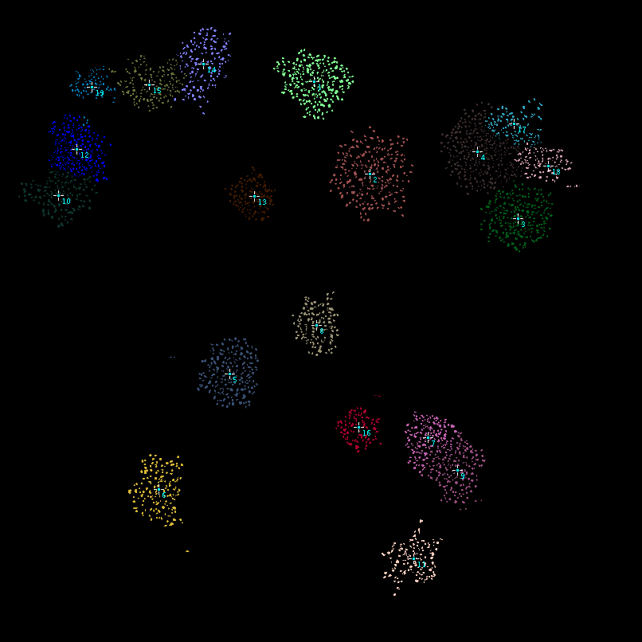

    Assign Foci to Clusters output mask coloured by cluster with the cluster labels

.. index:: ! Translocation Finder

Translocation Finder
--------------------

Find translocations using markers for colocalisation using 3 ``FindFoci`` results sets stored in memory. Find triplets where the two markers from channel 2 & 3 matching a foci in channel 1 are also a matching pair. Output a guess for a translocation where channel 13 distance ``<< 12|23``, no translocation where ``12 << 13|23``.

.. index:: ! Translocation Finder (Tool)

Translocation Finder (Tool)
---------------------------

Provide a tool on the ``ImageJ`` toolbar that responds to a user clicking repeatedly on the same image to identify foci for potential translocations. 3 consecutive clicks are required to mark 3 channels for analysis.

Analysis options can be set for the tool.

.. index:: ! Spot Radial Intensity

Spot Radial Intensity
---------------------

Output the radial intensity around spots within a mask region. Spots are defined using ``FindFoci`` results held in memory or a point ROI.

.. index:: ! Spot Pair Distance

Spot Pair Distance
------------------

Output the distances between the pair of spots from two channels at a user selected position. Functions using a plugin action tool added to the ``ImageJ`` toolbar.

.. index:: ! Object Foci Depth

Object Foci Depth
-----------------

Finds objects in an image using contiguous pixels of the same value. Computes the distance of each foci inside an object to the edge/surface (the foci depth).

.. index:: ! Foci Neighbour Analysis

Foci Neighbour Analysis
-----------------------

Identifies foci in a primary channel and computes summary statistics of the neighbouring foci in secondary channels.

.. _binary_scoring_statistics:

.. index:: ! Binary Scoring Statistics

Binary Scoring Statistics
-------------------------

Several plugins within the GDSC package compute matches between points. When comparing the points the following combinations are possible:

.. list-table::
   :widths: 15 15 45 25
   :header-rows: 1

   * - Set 1
     - Set 2
     - Classification
     - Label

   * - Present
     - Present
     - Match; True Positive
     - TP

   * - Present
     - Absent
     - Unmatch 1; False Negative
     - FN

   * - Absent
     - Present
     - Unmatch 2; False Positive
     - FP

The match/unmatch nomenclature is used when it is not clear which set is the real answer. When one set is the actual result and the other is the prediction then it is more conventional to use the TP/FN/FP nomenclature.

The classification counts can be used to compute binary scoring statistics as described below.

Jaccard
~~~~~~~

The `Jaccard <https://en.wikipedia.org/wiki/Jaccard_index>`_ measures the similarity between two sets and is defined as the size of the intersection divided by the size of the union:

.. math::

    \mathit{Jaccard} = \frac{|A \cap B|}{|A \cup B|} = \frac{\mathit{TP}}{\mathit{TP} + \mathit{FP} + \mathit{FN}}

A score of 1 indicates that the overlap is perfect. Zero indicates no overlap.

Recall
~~~~~~

`Recall <https://en.wikipedia.org/wiki/Precision_and_recall>`_ measures the number of actual points that are correctly predicted. It is also known as the True Positive Rate or sensitivity.

.. math::

    \mathit{Recall} = \frac{\mathit{TP}}{\mathit{TP} + \mathit{FN}}

A score of 1 indicates that all the points were predicted, lower scores indicate that some points were missed.

Recall can be interpreted probabilistically as the chance that a randomly selected actual point will be predicted.

Precision
~~~~~~~~~

`Precision <https://en.wikipedia.org/wiki/Precision_and_recall>`_ measures the confidence of the predicted points. It is also known as the Positive Predictive Value.

.. math::

    \mathit{Precision} = \frac{\mathit{TP}}{\mathit{TP} + \mathit{FP}}

A score of 1 indicates that all the predicted points were correct, lower scores indicate that some points are not correct.

Precision can be interpreted probabilistically as the chance that a randomly selected prediction is correct.

F-score
~~~~~~~

The precision and recall can be combined in a weighted score, the :math:`F_{\beta}`-measure or `F-score <https://en.wikipedia.org/wiki/F-score>`_:

.. math::

    F_{\beta} = (1 + \beta^2) \cdot \frac{\mathit{Precision} \cdot \mathit{Recall}}{\beta^2 \cdot \mathit{Precision} + \mathit{Recall}}

A weight of 1 produces the balanced F-score where precision and recall are weighted equally. :math:`F_{0.5}` puts more emphasis on precision and :math:`F_2` puts more emphasis on recall. However the weight :math:`\beta` can be any non-negative real value. The score was derived so that it measures the effectiveness of retrieval with respect to a user who attaches :math:`\beta` times as much importance to recall as precision.

Defining the Actual or Predicted Points
~~~~~~~~~~~~~~~~~~~~~~~~~~~~~~~~~~~~~~~

Note that the categorisation of the actual and predicted points can be arbitrary. If the categorisation is reversed then the precision and recall scores will be reversed. However the :math:`F_1`-score will remain identical because it is the harmonic mean of the two scores. The :math:`F_1`-score is consequently a good measure of the similarity of two sets of points that have been aligned for matches. If it is inappropriate to label either set as the actual result then the scores can be labelled as Recall 1 and Recall 2.
